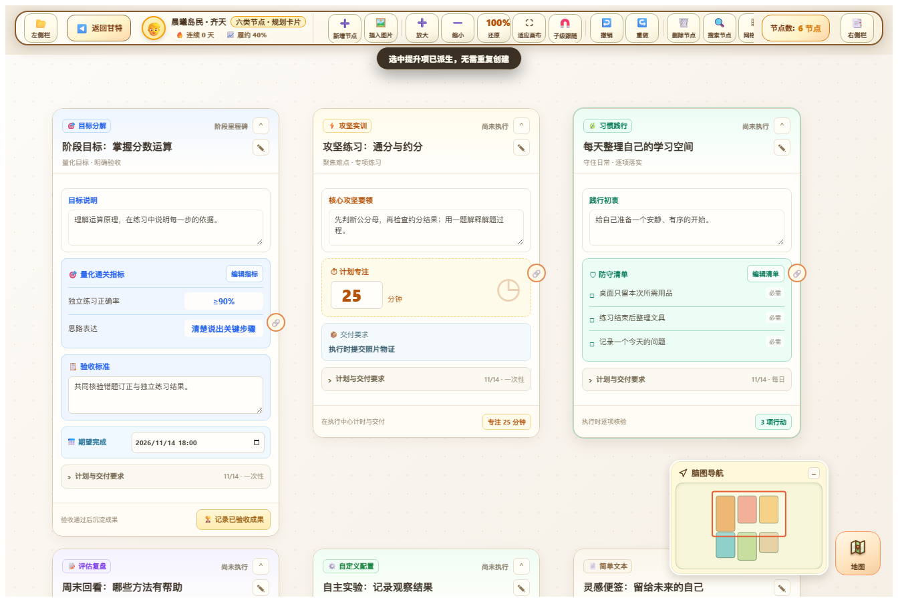
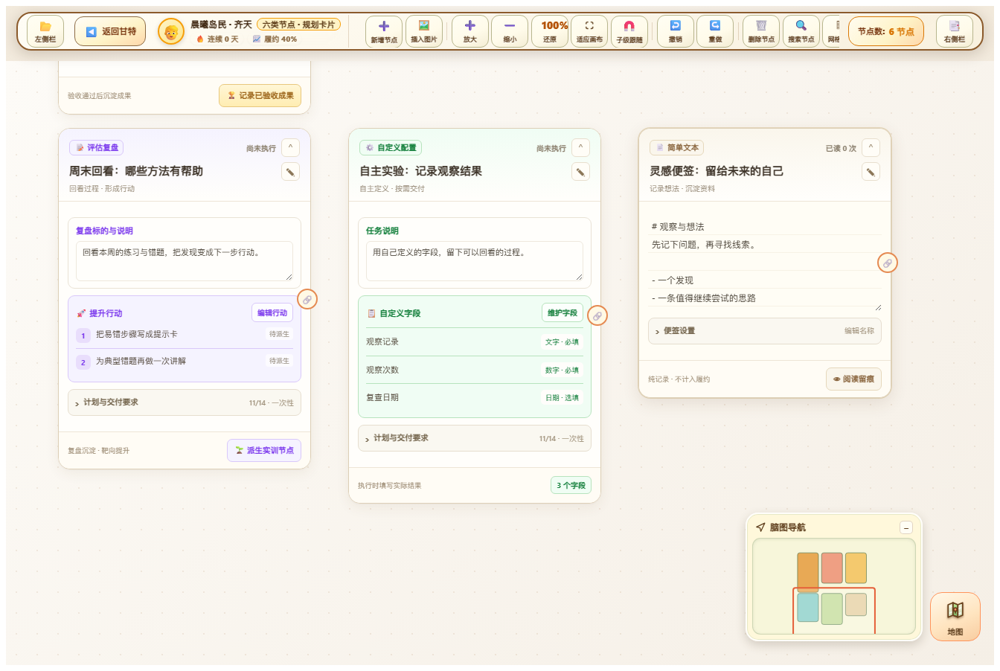

# 1.1.6 节点卡片样式修复

用户反馈脑图操作已正常，但卡片外观退化。本版对照设计图六类节点和PRD 2.3重新组织卡片，保留原有规划、验收与保存事务。

原渲染将所有节点变为同一长表单，类型缺少视觉区分，日期、频次和依赖占据主要空间，按钮也容易受宿主样式影响。现在使用暖白底、16px圆角、轻阴影和各类型强调色：目标蓝、实训琥珀、习惯绿、复盘紫、自定义绿、文本米色。名称完整换行，状态取真实记录或阅读次数；通用设置默认收起，铅笔可直接展开并编辑名称。

| 类型 | 卡片重点 |
| --- | --- |
| 目标 | 量化指标/标准、验收说明、期望完成时间；金色成果验收按钮 |
| 实训 | 核心要领、大号专注分钟、物证要求；页脚显示计划分钟 |
| 习惯 | 践行初衷、防守清单与必需标签；不将规划清单当执行勾选 |
| 复盘 | 标的说明、编号提升行动、已派生标签；继续使用幂等派生事务 |
| 自定义 | 任务说明、字段列表、类型和必填/选填标签 |
| 文本 | 独立纸张行纹便签、Markdown正文、阅读留痕 |

名称、时长、物证、日期、频次变更后，同步卡片摘要且保留当前编辑区域和焦点。指标等列表仍通过原结构化编辑器保存；成果仍需真实验收，阅读仍不计入履约。折叠节点只显示名称和展开按钮，连接手柄、标题拖动、双击折叠、避障重绘与导航沿用原有交互。

## 维护与设计同步

`src/runtime/nodeCards.js`是唯一卡片内容实现；`src/ui/nodeCards.css`是隔离到卡片内的视觉规则。`domainNodeHtml`委托给该渲染器，删除旧通用长表单。构建先将两份源码同步到独立设计图，再生成插件运行时、CSS和发布包，避免设计预览与插件分叉。PRD补充了节点视觉与布局契约；上版PRD存于`docs/history/PRD_Youth_Holistic_Growth_System_1.1.5.md`。

## 验证

- `npm.cmd run build`、`npm.cmd run typecheck`、`npm.cmd test`通过。
- 节点卡片集成检查：插件24项、独立设计图23项，覆盖六类布局、配色、折叠不重叠、字段摘要同步、指标表单真实保存、复盘派生幂等、阅读语义及Vault重载。
- 原生浏览器回归：移动端31项、画布44/43项、导航41/42项、业务闭环85项、设计流程10项。合计343项。长内容滚动用明确溢出的清单验证，短卡片不强制滚动。
- 截图和JSON证据在`audit/screenshots/1.1.6/`和`audit/*validation-1.1.6.json`；安装包逐文件校验见`audit/release-validation-1.1.6.json`。

截图使用独立测试数据，不代表用户实际执行记录。触屏检查使用Chrome原生触摸事件及模拟Obsidian API，尚未在用户的Android设备上验收。

## 更新

版本号、manifest、版本映射和生成文件统一为1.1.6。正式更新入口为[GitHub Release 1.1.6](https://github.com/zuixianjian/test/releases/tag/1.1.6)。BRAT更新后完全关闭并重新打开Obsidian，在插件设置确认v1.1.6；只刷新脑图页面不会替换已加载的运行时。
