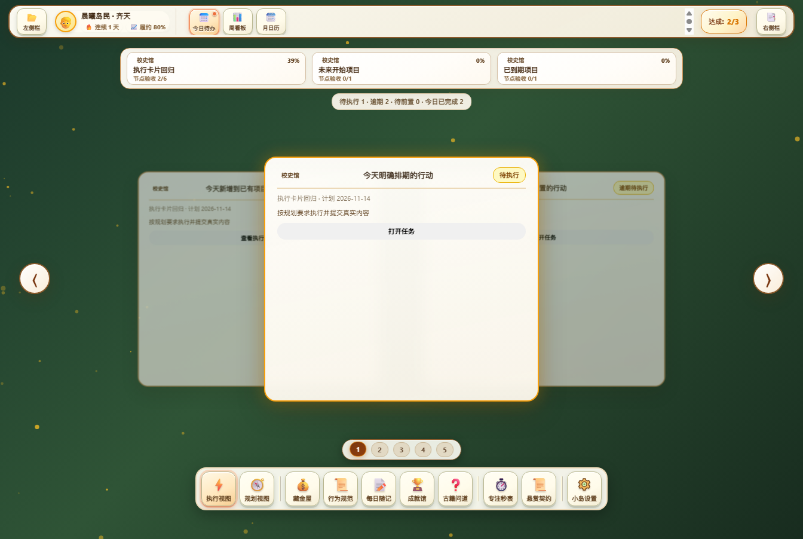

# 1.1.7 首页执行卡片缺失修复

用户反馈今天新建的任务也不显示。实际ItemView复现确认：2026-11-14向开始日为11月11日的项目新增节点，未填写计划日期时继承11月11日；首页又只选今日实例，因此新节点虽然保存成功却没有执行卡片。上版验证检查了调度实体，缺少这一场景的真实可见性检查。

本版修复以下问题：

1. 新增节点默认取今日，并限制在项目周期内；未来项目取开始日，已到期项目取结束日。显式计划日期和已有节点日期保持不变。
2. 首页队列展示今日任务和未完成的过去实例。前置未完成的卡片显示原因，可回到原规划；不会开放绕过校验的提交。未来普通任务不提前进入队列，过去已完成实例退出队列。逾期展示不改变今日履约分母。
3. 返回执行/日视图时重新投影；运行中跨日、应用恢复前台时更新日期。保留有效的选中实例，并保证存在活动轮播卡。
4. Vault旧快照的dayCardDeckHtml可能为空，恢复它会删除空态提示。现在不恢复执行HTML缓存，由领域状态重建卡片和空态；没有任务时给出下一项计划日期或加入执行任务的说明。
5. 周期任务的记录按taskInstanceId匹配；无ID旧记录按scheduledDate/date回退。补做昨日实例不再误把今日实例标记完成，项目进度也不重复计数。

PRD、设计图和插件共用`src/core/domain.mjs`、`src/runtime/homeExecutionQueue.js`和卡片投影；未迁移或改写用户既有节点日期、执行原件及历史记录。1.1.6的六类脑图卡片和连线交互继续保留。

## 验证

- 构建、类型检查、插件完整性和业务/调度/画布/存储纯规则检查通过。
- 新增首页检查：实际ItemView 24项、设计预览22项，涵盖今天新增到已有项目、真实卡片命中、逾期和待前置、点击并完成真实执行、独立周期实例、返回首页、旧HTML缓存、Vault重启、前台跨日、未来/到期项目和竖屏。
- 原有9组浏览器检查343项继续通过；合计389项。
- 证据：`audit/execution-validation-1.1.7.json`、`audit/execution-design-validation-1.1.7.json`、其他版本报告及`audit/screenshots/1.1.7/`。发布包文件校验见`audit/release-validation-1.1.7.json`。

测试使用独立数据、Chrome原生输入与模拟Obsidian API；未在用户Android真机上验收。通过[正式Release 1.1.7](https://github.com/zuixianjian/test/releases/tag/1.1.7)供BRAT更新。更新后完全关闭并重新打开Obsidian，在设置确认实际版本为1.1.7。
