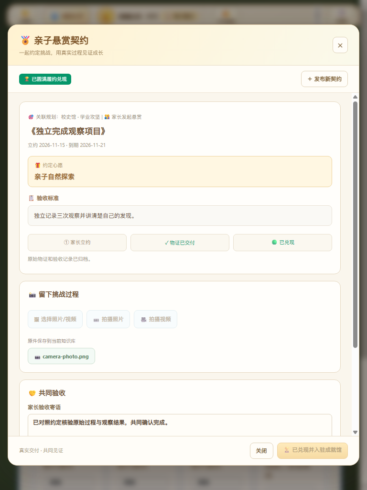
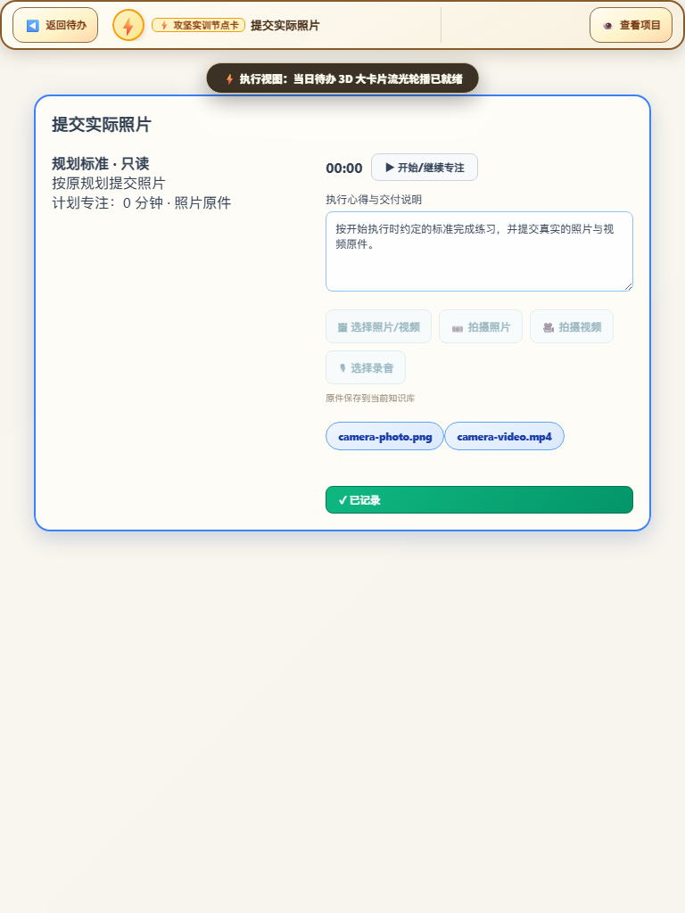

# 1.2.0 规划与执行边界、悬赏弹窗及媒体入口

本版对应三个反馈，同步更新PRD、独立设计图、插件运行时及Android发布包。

规划脑图只维护项目、节点、日期、标准和依赖。移除目标验收和阅读打卡按钮，不放执行计时、实际结果或物证输入；复盘的“派生后续规划”仍是规划操作。执行页完整展示打开时的规划标准，只能填写本次结果。修复复盘提交覆盖源节点提升行动的问题，实际行动保存到记录；返回规划后显式派生，按记录和行动来源防止重复创建。已验收记录保留标准快照，不受后续规划编辑影响。

悬赏弹窗改为暖白分区卡片，按发布、揭榜、共同验收展示真实状态、心愿、期限、标准、原件、家长寄语和历史。标题与操作栏固定，正文独立滚动，支持竖屏、Esc和焦点约束。继续使用原有发布/揭榜/核验领域事务，不以界面状态代替履约。新增物证后必须重新核验，已兑现契约只读。

执行、悬赏、随记、生活高光及规划资料分别提供“选择照片/视频”“拍摄照片”“拍摄视频”。普通文件选择不带capture，拍照和拍视频请求后置摄像头；执行另有录音入口。直接点击原生file输入，保留系统选择器所需的用户激活。原件写入Vault，保存原名、类型、路径和实际大小；空MIME按已知扩展名补类型，字节不变。绑定发起时的具体对象，上传中阻止提交和核准，关闭等待写入完成，已验收任务禁止替换原件。

实现入口：`src/runtime/planningBoundary.js`、`src/runtime/mediaPicker.js`、`src/runtime/bountyDialog.js`、`src/ui/bountyDialog.html`、`src/ui/phaseMedia.css`。构建将同一实现写入设计图和插件生成文件。

## 验证

构建、类型检查、插件完整性与业务/调度/画布/存储规则通过。新增插件28项、设计26项检查，覆盖规划与执行隔离、标准快照、实际复盘派生、原生文件入口、真实原件字节、空MIME、错误类型、上传锁、关闭等待、悬赏核验、随记及生活高光。既有13组472项浏览器检查通过，合计15组526项。

浏览器使用实际ItemView及VaultStorageAdapter、模拟Obsidian API、Chrome原生文件输入和触控事件；设计图使用独立IndexedDB。PNG使用真实图片，视频使用最小文件夹具，验证选择与保存，不能据此证明相机拍摄或编码播放兼容。报告见`audit/*validation-1.2.0.json`，截图见`audit/screenshots/1.2.0/`，发布包内容与哈希见`audit/release-validation-1.2.0.json`。

未在用户Android平板实机测试。`accept`/`capture`向系统请求相册或拍摄，能否直接唤起相机由Obsidian的Android WebView文件选择器实现决定，不能保证特定照片应用、摄像头或权限行为。[W3C媒体采集规范](https://www.w3.org/TR/html-media-capture/)与[Android FileChooserParams说明](https://developer.android.com/reference/android/webkit/WebChromeClient.FileChooserParams)。

通过[正式Release 1.2.0](https://github.com/zuixianjian/test/releases/tag/1.2.0)提供BRAT更新。更新后完全关闭并重新打开Obsidian，在插件设置确认实际版本1.2.0。
