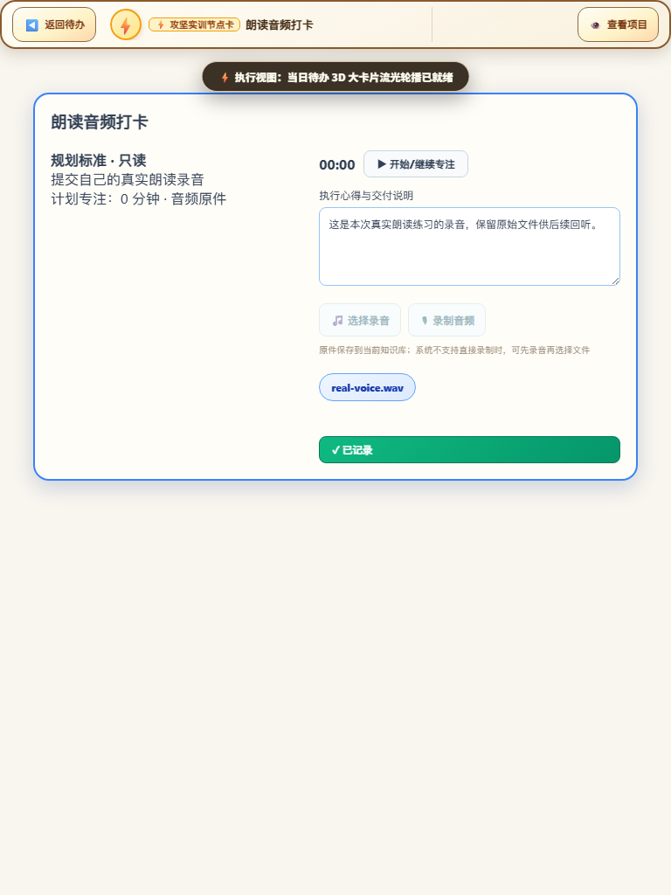

# 1.2.1 音频打卡

1.2.0已支持选择已有音频及音频交付校验，本版补上音频任务的系统录制入口。规划设置音频要求，执行页据打开时的标准快照只展示“选择录音 / 录制音频”，不混入照片/视频按钮；规划字段不受录音或提交影响。

“选择录音”使用audio/*且不带capture，选择已有文件；“录制音频”使用audio/*和capture=user向系统请求麦克风采集。两者使用同一原件保存和执行草稿事务，保留文件名、路径、类型、大小及可读的实际时长。支持空MIME的常见录音扩展名，包括AMR、AAC、OPUS、FLAC和3GA；类型补全不修改字节，也不等同于宿主播放格式保证。音频卡必须有真实音频原件，文字或照片不能替代。保存后可以从记录打开audio播放器，验收后禁止替换原件。

构建、类型检查及纯业务/调度/画布/存储规则通过。媒体和规划边界浏览器检查：插件36项、设计33项，共69项，其中新增音频检查8项/7项。使用生成的有效一秒WAV验证原生file输入、真实文件保存、实测时长、类型拒绝、AMR空MIME补全、记录校验和播放器控件；没有模拟用户实际麦克风采集。原件写入使用实际VaultStorageAdapter及模拟Obsidian API，设计使用独立IndexedDB。

未在用户Android平板实测。录制入口请求系统录音，最终界面和可用性取决于Obsidian宿主；不支持时可用平板录音应用录好后选择文件。[W3C媒体采集规范](https://www.w3.org/TR/html-media-capture/)和[Android宿主说明](https://developer.android.com/reference/android/webkit/WebChromeClient.FileChooserParams)。

验收证据见`audit/phase-media*-validation-1.2.1.json`和`audit/release-validation-1.2.1.json`。通过[正式Release 1.2.1](https://github.com/zuixianjian/test/releases/tag/1.2.1)提供BRAT更新，更新后重启并确认实际版本1.2.1。
