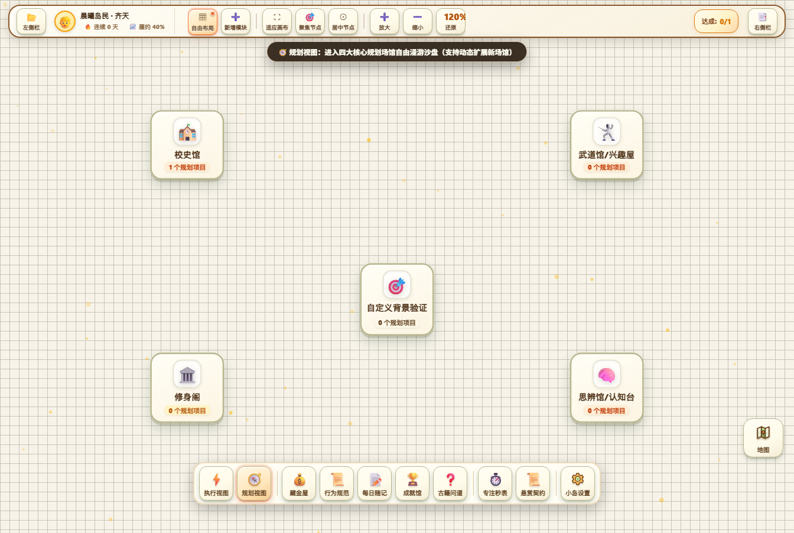
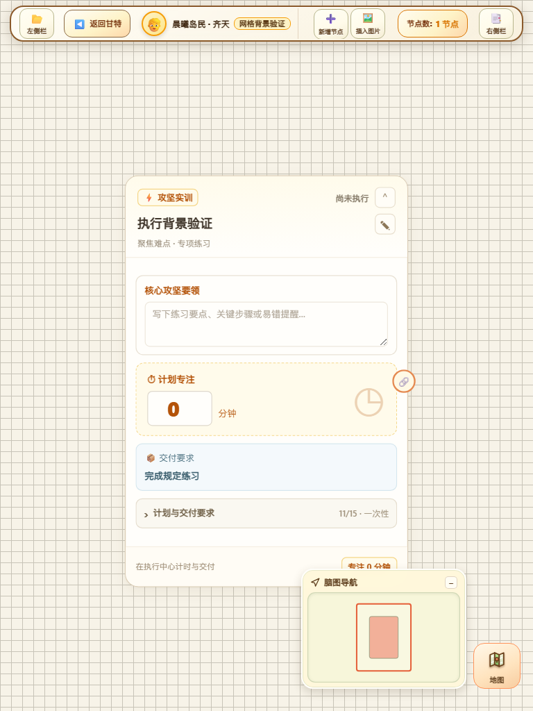

# 1.2.3 未设置壁纸时统一网格线

所有页面无有效背景设置时统一使用暖白底16px横纵网格线。首页日/周/月、规划、四场馆及独立模块、自定义场馆、脑图、实际执行和关联项目视图使用同一回退规则，覆盖自动场景图、点阵与执行白底；卡片、表单、弹窗及表格保留现有样式。

保留已有全局/场馆壁纸及继承规则。全局背景开启时统一读取全局设置；关闭时读取独立场馆设置，没有时沿用全局，两者都没有才显示网格。重置不把默认网格写成用户新壁纸。脑图从真实项目读取场馆，执行从真实任务读取场馆，避免返回页面后使用上一个场馆的背景。Vault和独立预览恢复完成后重新应用设置，已安装的场景资源不代表用户已设置背景。

共享实现为`src/runtime/pageBackground.js`和`src/ui/pageBackground.css`，构建同步到设计HTML和插件。设置提示也改为网格默认规则。

构建、类型检查、纯规则/存储测试通过；背景检查插件28项、设计27项，既有业务85项，共140项浏览器检查通过。覆盖逐页默认值、实际场馆、已有设置、继承、重置、旧配置缺少壁纸字段、有效场景资源存在时的回退、Vault/IndexedDB实际重载。使用隔离数据与模拟Obsidian API，未在用户Android真机验收。报告见`audit/background*-validation-1.2.3.json`及`audit/validation-1.2.3.json`，发布包一致性见`audit/release-validation-1.2.3.json`。

通过[Release 1.2.3](https://github.com/zuixianjian/test/releases/tag/1.2.3)提供BRAT更新，更新后重启并确认版本1.2.3。
