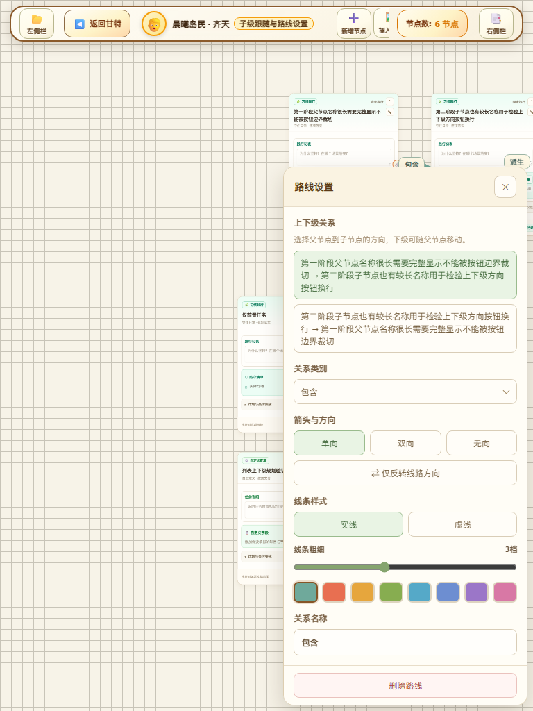
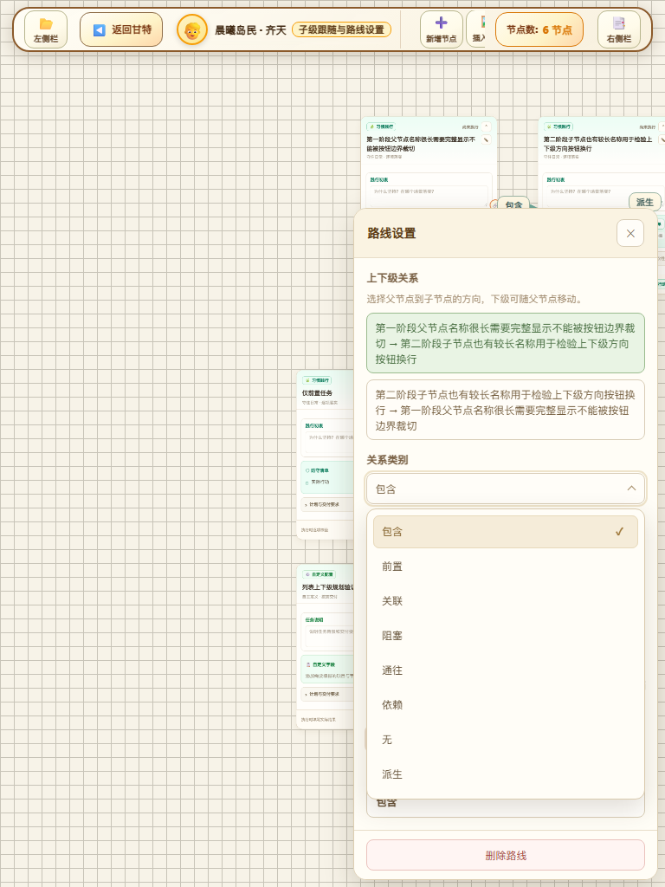

# 1.2.4 脑图跟随、路线弹窗与统一列表

本次同时更新PRD、设计HTML和插件。节点卡片继续使用原有六类设计；未设置背景时保留网格线。

子级跟随失效的原因是：旧“设置上下级”按钮可能保留前置/依赖类型，而实际跟随只遍历包含/派生；开关还遗留了另一套选中样式，关闭后看起来仍在开启。现在设置上下级明确创建包含关系，经过原线路事务解除该边的前置依赖；仅反转按钮单独保留原类型。鼠标、触屏按缩放后的同一坐标增量移动全部层级后代，开关、撤销/重做与保存恢复一致。前置任务和普通关联不随父节点移动。

路线弹窗改为固定头尾和可滚动内容。上下级长名称完整换行，关系、箭头、线条、颜色、名称独立分区；删除按钮不覆盖内容。窄屏与旋转继续使用现有视口定位规则。

工作台的select统一为共享列表，保留原select值、选项和input/change接口。菜单按空间向上/下展开，长文字换行，禁用项不可选；多选采用草稿、取消、应用流程。支持动态表单、父fieldset禁用与键盘操作，宿主Obsidian设置页仍使用宿主控件。实现入口是`src/runtime/selectControls.js`、`src/ui/selectControls.css`及`src/ui/routeSettings.*`。

构建、类型检查、纯规则与存储测试通过。21组浏览器场景共692项检查通过，其中本次交互检查插件26项、设计25项；包含真实鼠标/触屏拖动、多级跟随、关闭与重载、线路依赖写回、多选新增真实节点、窄屏几何、长文字、上拉和禁用状态。既有移动端31项继续验证侧栏手势边界、路线触摸与保存恢复。报告见`audit/*validation-1.2.4.json`，发布包校验见`audit/release-validation-1.2.4.json`。

测试使用隔离数据、Chrome及模拟Obsidian宿主API，未在用户的Android平板实机验收。

通过[Release 1.2.4](https://github.com/zuixianjian/test/releases/tag/1.2.4)更新。BRAT更新后完全退出并重启Obsidian，确认版本1.2.4。
