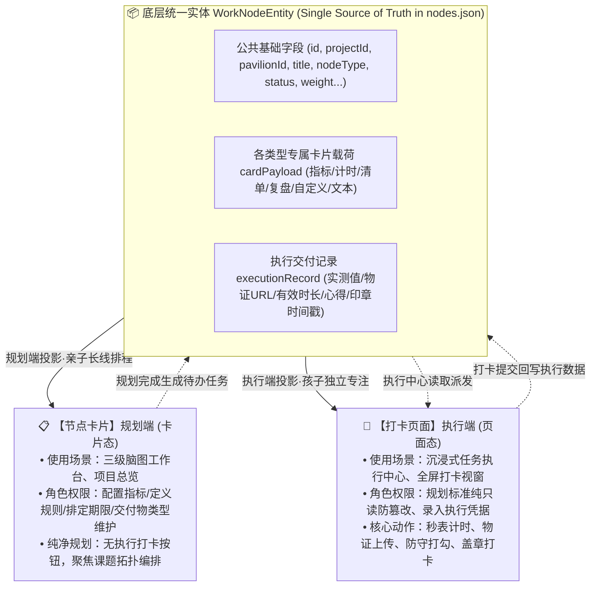
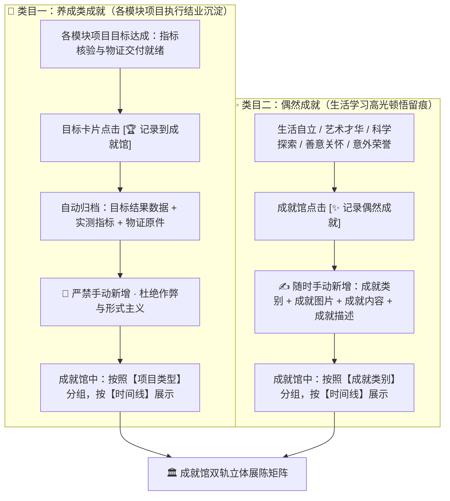
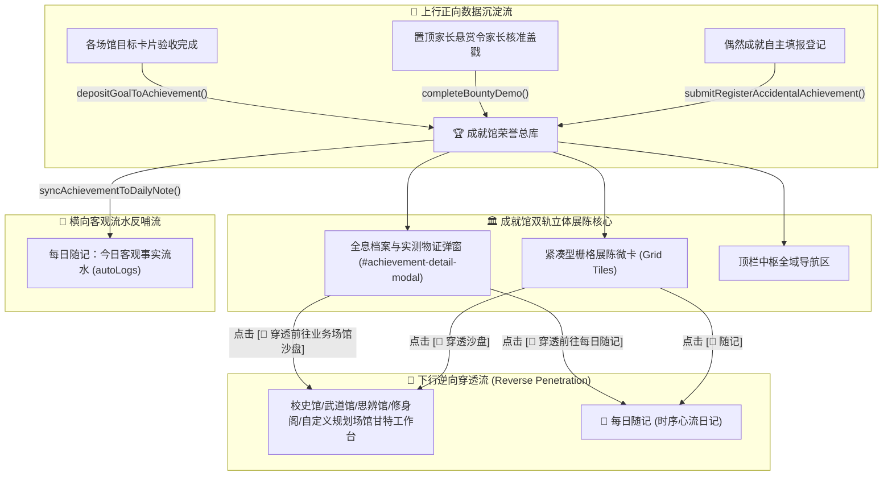
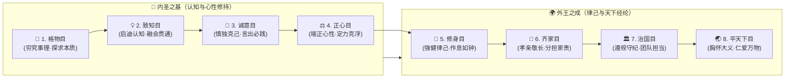
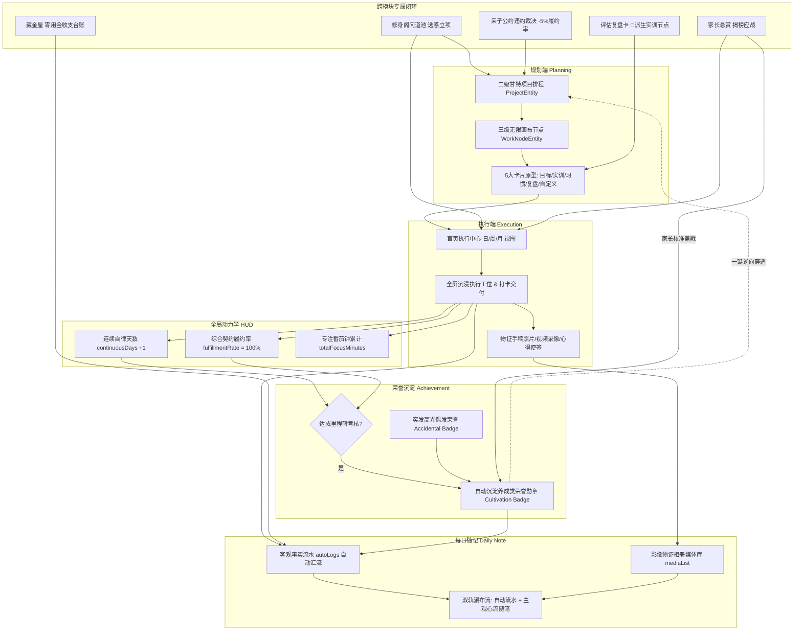

# 终身岛民·青少儿全人成长与自主进化系统
## 产品需求文档 (PRD & 软件详细业务规格说明书 · 模块化详述版)

> **【文档定位与开发标准声明】**  
> 1. **核心业务与功能规格蓝图**：本文档为青少儿全人素养成长与自主进化系统的核心产品需求规格书（PRD），详尽界定全系统所有业务功能模块、每个页面的定位、全部交互按钮与控件的功能触发规范、前置校验、页面状态流转、数据读写契约与跨模块协同闭环。  
> 2. **UI 视觉与设计标准声明**：为保持产品文档的业务逻辑纯粹与条理性，**本文档不包含具体的像素尺寸数值、CSS 样式代码、颜色渐变色值与微观拟物材质修饰**。在正式前端开发时，界面视觉布局、组件样式、响应式适配与交互动效，**严格以高保真原型设计图（`high_fidelity_ui_preview.html`）为唯一权威视觉参考标准**。

---

## 目录
- [1. 系统定位、成长哲学与全局架构](#1-系统定位成长哲学与全局架构)
  - [1.1 核心痛点与系统定位](#11-核心痛点与系统定位)
  - [1.2 成长哲学：以真实记忆构建逆境免疫力（水滴石穿）](#12-成长哲学以真实记忆构建逆境免疫力水滴石穿)
  - [1.3 生命双主视口物理互斥运行模型](#13-生命双主视口物理互斥运行模型)
  - [1.4 双核心自律动力学指标规范（continuousDays 与 fulfillmentRate）](#14-双核心自律动力学指标规范continuousdays-与-fulfillmentrate)
  - [1.5 青少儿专属交互与安全铁律](#15-青少儿专属交互与安全铁律)
- [2. 通用节点统一数据模型、规划卡片与打卡执行页面分离设计](#2-通用节点统一数据模型规划卡片与打卡执行页面分离设计)
  - [2.1 统一底层数据源模型（Single Source of Truth 统一节点数据字典）](#21-统一底层数据源模型single-source-of-truth-统一节点数据字典)
  - [2.2 【节点卡片】规划端详细设计（规划态 · 节点规划与结构编排）](#22-节点卡片规划端详细设计规划态--节点规划与结构编排)
  - [2.3 【打卡页面】执行端详细设计（执行态 · 供孩子任务执行沉浸操作）](#23-打卡页面执行端详细设计执行态--供孩子任务执行沉浸操作)
  - [2.4 规划端（节点卡片）与执行端（打卡页面）权限与字段对比矩阵](#24-规划端节点卡片与执行端打卡页面权限与字段对比矩阵)
- [3. 通用基础工作台模块详细规范](#3-通用基础工作台模块详细规范)
  - [3.1 通用二级项目排程工作台（甘特管理页面）](#31-通用二级项目排程工作台甘特管理页面)
  - [3.2 通用三级自由脑图全景工作台（无限画布页面）](#32-通用三级自由脑图全景工作台无限画布页面)
- [4. 全域业务功能模块详细需求规范](#4-全域业务功能模块详细需求规范)
  - [4.1 首页执行中心视图 (Task Execution Center)](#41-首页执行中心视图-task-execution-center)
  - [4.2 首页规划沙盘视图 (Island Canvas SandBox)](#42-首页规划沙盘视图-island-canvas-sandbox)
  - [4.3 🏫 校史馆（学科学业攻坚与错题试卷复盘）](#43--校史馆学科学业攻坚与错题试卷复盘)
  - [4.4 🥋 武道馆/兴趣屋（兴趣特长提升与体能竞技闭环）](#44--武道馆兴趣屋兴趣特长提升与体能竞技闭环)
  - [4.5 🧠 思辨馆/认知台（自我认知建立与心智模型研习）](#45--思辨馆认知台自我认知建立与心智模型研习)
  - [4.6 🏛️ 修身阁（圣贤经典研读与少年修身问道池）](#46-️-修身阁圣贤经典研读与少年修身问道池)
  - [4.7 💰 藏金屋（少儿独立财商实践与零用金收支台账）](#47--藏金屋少儿独立财商实践与零用金收支台账)
  - [4.8 🏆 成就馆（全域成长荣誉殿堂 · 双轨荣誉体系）](#48--成就馆全域成长荣誉殿堂--双轨荣誉体系)
  - [4.9 🌳 个人行为规范（已确立规范查阅室 · 古籍风骨生命法典）](#49--个人行为规范已确立规范查阅室--古籍风骨生命法典)
  - [4.10 📝 每日随记（全自动客观真实流水 + 主观心流随笔双轨日记）](#410--每日随记全自动客观真实流水--主观心流随笔双轨日记)
  - [4.11 🚩 家长端置顶悬赏公告系统（Bounty System · 纯亲子契约挑战令）](#411--家长端置顶悬赏公告系统bounty-system--纯亲子契约挑战令)
  - [4.12 ➕ 一级场馆动态扩展规范](#412--一级场馆动态扩展规范)
  - [4.13 ⚙️ 小岛设置中心（背景壁纸 / 角色档案 / 环境微粒 / 沉浸专注）](#413-️-小岛设置中心背景壁纸--角色档案--环境微粒--沉浸专注)
- [5. 全局数据契约与统一实体字典](#5-全局数据契约与统一实体字典)
  - [5.1 用户全局生命档案实体 (`UserProfile`)](#51-用户全局生命档案实体-userprofile)
  - [5.2 二级规划项目实体 (`ProjectEntity`)](#52-二级规划项目实体-projectentity)
  - [5.3 通用三级工作节点实体 (`WorkNodeEntity`)](#53-通用三级工作节点实体-worknodeentity)
  - [5.4 首页执行卡片模型 (`ExecutionCardModel`)](#54-首页执行卡片模型-executioncardmodel)
  - [5.5 藏金屋收支账户与台账实体 (`TreasuryAccount` & `TreasuryTransaction`)](#55-藏金屋收支账户与台账实体-treasuryaccount--treasurytransaction)
  - [5.6 成就荣誉档案实体 (`AchievementEntity`)](#56-成就荣誉档案实体-achievemententity)
  - [5.7 全域数据全生命周期闭环流转规范 (End-to-End Closed Loop Lifecycle Matrix)](#57-全域数据全生命周期闭环流转规范-end-to-end-closed-loop-lifecycle-matrix)
- [6. 底层存储与 Obsidian 本地网络化知识库规范](#6-底层存储与-obsidian-本地网络化知识库规范)

---

## 1. 系统定位、成长哲学与全局架构

### 1.1 核心痛点与系统定位
当前青少儿成长与自我管理领域存在三大核心痛点：
1. **外在动机陷阱与游戏化反噬**：依靠积分、虚拟金币或打怪升级只能唤起短效多巴胺，一旦奖励撤销，自主学习动力迅速枯竭；
2. **多端数据割裂与缺乏系统沉淀**：学科刷题、运动健身、品格修养、零用钱消费彼此孤立，青少儿无法建立对自我的全景掌控感；
3. **缺乏客观存证与逆境免疫力**：形式主义的“打卡画勾”无法记录真实的思考挫折、演算草稿、心得体会，难以在挫败时提供心理抗压支撑。

**系统定位**：本系统是一套专为 7~15 岁青少儿打造的**全息终身自主进化系统**。系统以“晨曦海岛”为生命空间隐喻，采用生命双主视口物理互斥调度机制，依托客观事实留痕、5 大通用卡片原型拆解与跨模块业务闭环，培养青少儿自律坚毅的品格与自主进化的终身心智模型。

---

### 1.2 成长哲学：以真实记忆构建逆境免疫力（水滴石穿）
1. **去虚荣数值与积分化**：全系统严格杜绝虚假的等级、金币数值与经验条。评价青少儿成长的核心基石唯有**真实的时间投入**与**客观的履约事实**；
2. **水滴石穿与自传体记忆**：通过日常攻坚物证（演算草稿原卷照片、跳绳切片视频、经典诵读音频、亲子思辨记录），让孩子在遭遇挫折时回溯自己的真实足迹，激活自我效能感；
3. **知行合一与品格立宪**：将圣贤经典智慧与日常生活困惑深度结合，将道德理念切实转化为言行自律底线。

---

### 1.3 生命双主视口物理互斥运行模型
系统确立**“生命双主视口物理互斥”**的顶级运行机制：同一时间，系统仅允许一个主视口处于活跃状态，杜绝界面重叠与认知过载：

| 视口名称 | 核心定位与职责 | 操作权限与业务边界 | 核心数据源 |
| :--- | :--- | :--- | :--- |
| **⚡ 执行视图**<br>*(Task Execution)* | **全域唯一打卡执行总入口**。<br/>专为无杂念沉浸执行打造。 | • **只做执行打卡与客观存证**，不可在此修改宏观规划；<br/>• 点击待办卡片在操作区**原位全屏展开专属执行区**；<br/>• 内置番茄秒表计时、物证上传与心得提交。 | 聚合自全域各规划场馆三级脑图中处于“待打卡就绪态”的节点，以及悬赏应战、问道转化与违约修身派发任务。 |
| **🧭 规划视图**<br>*(Planning SandBox)* | **宏观战略沙盘与课题深度拆解**。<br/>亲子共同参与的排程与脑图工坊。 | • 海岛沙盘承载 **4 大核心规划场馆**（🏫 校史馆、🥋 武道馆/兴趣屋、🧠 思辨馆/认知台、🏛️ 修身阁）及动态新增的自定义规划场馆（`custom-*`），底部常驻 Dock 收纳 **4 大免规划独立模块**（💰 藏金屋、📜 个人行为规范、📝 每日随记、🏆 成就馆）；<br/>• 二级项目甘特总览管理周期与只读方格进度；<br/>• 三级自由脑图画布进行任务节点拓扑编排与依赖连线。 | 各规划场馆业务项目库 (`projects.json`) 与按项目隔离持久化的三级节点网络拓扑 (`nodes_{projectId}.json`)。 |

---

### 1.4 双核心自律动力学指标规范（continuousDays 与 fulfillmentRate）

全系统以时间维度的坚毅恒心与空间维度的诚信履约为双支柱，构建全人自律指标计算引擎：

```mermaid
flowchart LR
    subgraph Input["📥 每日真实行为输入源 (严格不包含个人行为规范主查阅页)"]
      direction TB
      I1["🏫 校史馆 / 🥋 武道馆 / 🏛️ 修身阁<br/>(草稿物证上传 / 番茄秒表专注 / 反思手记)"]
      I2["❓ 古籍问道便捷输入<br/>(生活困惑随时登记 / 选惑一键转化修身规划)"]
      I3["🧠 思辨馆/认知台 & ➕ 自定义场馆<br/>(议题思辨拆解 / 研学实训物证打卡)"]
      I4["📜 家长置顶悬赏荣誉契约<br/>(揭榜应战打卡 / 亲子双向寄语盖戳兑现)"]
    end

    subgraph Engine["⚙️ 双核心指标实时计算引擎"]
      direction TB
      E1["🔥 连续坚持判定引擎 (Streak Engine)<br/>实质物证打卡达标 · 零空打卡 · 审批豁免保护"]
      E2["📈 综合契约履约率算法 (Fulfillment Engine)<br/>规划完成度 (60%) + 悬赏与修身履约度 (40%) - 公约违约扣减 (每次5%)"]
    end

    subgraph Storage["💾 全局状态持久化 (UserProfile)"]
      direction TB
      S1["continuousDays: 连续天数<br/>maxContinuousDays: 历史最高纪录<br/>streakFreezeAllowance: 月度豁免额度"]
      S2["fulfillmentRate: 契约履约率<br/>violationCount: 亲子确认违约次数<br/>violationRecords: 违约裁决与派发台账"]
    end

    subgraph Output["🖥️ 全域闭环业务应用"]
      direction TB
      O1["顶部全局 HUD Profile (🔥 连续天数 | 📈 履约率点击直达公约裁决)"]
      O2["🏛️ 违约自动派发【修身阁】7日纠偏项目与今日待办"]
      O3["🏆 成就馆习惯养成勋章自动解锁 (连续达标留痕)"]
      O4["📝 每日随记上半轨客观流水实时自动汇流"]
    end

    Input --> Engine
    Engine --> Storage
    Storage --> Output
```



> [!IMPORTANT]
> **【架构铁律：输入源边界与个人行为规范纯查阅定位】**  
> 1. **每日真实行为输入源严格限定**：全系统的日常活跃与自律行为输入，**严格由 4 大核心规划场馆（校史馆/武道馆/思辨馆/修身阁）及自定义场馆日常打卡、底栏古籍问道转化、以及家长置顶悬赏契约核验所驱动**；  
> 2. **个人行为规范主视图绝非日常打卡输入源**：底部发射器 Dock 中的 `[ 📜 个人行为规范 ]` 主页面**纯只读查阅之前已确定的《大学》八目行为规范法典**，严禁在此进行日常打卡或任务执行；  
> 3. **违约扣减与修身弥补闭环唯一合法入口**：若现实生活中发生触碰家规底线事实，由家长与孩子共同打开《亲子立宪自律公约正本》弹窗（点击个人行为规范底部 `[ 📜 亲子立宪公约全文与戒律法典 ]` 或顶部 HUD `[ 📈 履约率 ]`），在第三章**【⚖️ 亲子共同确认 · 违约事实裁决与修身派发台】**中勾选双方核实确认后提交，系统自动扣减综合履约率 `5%`，并向【修身阁】自动派发七日慎独纠偏甘特项目与今日待办复盘任务。

#### 1.4.1 指标一：🔥 连续坚持天数 (`continuousDays` / Streak)
1. **有效打卡判定准则**：在本地时区当日 00:00:00 ~ 23:59:59 内，必须**同时满足**以下条件方判定为有效履约日：
   - **实质性物证存证（杜绝空打卡）**：在校史馆、武道馆、思辨馆、修身阁或自定义规划场馆完成至少 1 项有效打卡行为（提交做题草稿照片、训练切片视频、防守清单核验、复盘心得或专注计时记录）；
   - **底线无恶意违背**：当日未被登记确认违背之前已确定的个人行为规范底线。
2. **断签熔断与豁免保护机制**：
   - 若某日无有效打卡记录，连续天数归零；
   - **月度亲子审批豁免权**：每月提供至多 2 次免断卡保护机会（因生病、长途旅行等客观原因，由家长签署豁免批准，保持连续天数不断裂）。

#### 1.4.2 指标二：📈 综合契约履约率 (`fulfillmentRate`)
1. **综合计算公式**：
   $$\text{综合契约履约率} = \max\Big(0\%,\, \min\big(100\%,\, 0.60 \times \text{规划任务完成率} + 0.40 \times \text{亲子悬赏与修身履约率}\big) - 5\% \times \text{违约确认次数}\Big)$$
2. **参数定义与闭环触发机制**：
   - **规划任务完成率（权重 60%）**：当日待办池中按期完成的攻坚卡片数 / 当日待办池任务总数；
   - **亲子悬赏与修身履约率（权重 40%）**：家长置顶悬赏契约与修身知行攻坚项目的履约率；
   - **违背行为规范扣减（每次 `-5%`）与修身派发闭环**：在 `#family-pact-modal` 第三章【⚖️ 亲子共同确认 · 违约事实裁决与修身派发台】中，选定触碰条款、如实填写客观违约事实并勾选“亲子双方已心平气和核实事实”后确认，系统立即执行：① `violationCount + 1`，全局 HUD `fulfillmentRate` 实时扣减 `5%` 并标红警示；② 月历当日生成违约警示标记；③ 自动在【修身阁】创建为期 7 天的《修身弥补·七日慎独纠偏》甘特项目及配套脑图，并同步一张修身复盘卡至首页今日待办；④ 自动记入【每日随记】上半轨客观流水。

---

### 1.5 青少儿专属交互与安全铁律
1. **复盘提升清单一键派生实训闭环（Reflection-to-Action Derivation）**：
   - 在任意【📝 评估复盘卡】中录入错因复盘说明与具体提升清单项后，点击卡片底部 `[ 🌱 派生实训节点 ]`，系统直接从已勾选的提升项原位派生下游【⚡ 攻坚实训卡】并自动建立拓扑连线，同时同步注册至首页【今日待办】与【周看板】，彻底消除只复盘不落地的断点。
2. **派生节点原子成组保护（Atomic Group Protection）**：
   - 成组派生的任务节点自动继承父级唯一组识别码 (`groupId`)，禁止单点孤立误删，仅允许在主节点触发整组归档或移除，保障认知链路完整闭环。

---

## 2. 通用节点统一数据模型、规划卡片与打卡执行页面分离设计

### 2.1 统一底层数据源模型（Single Source of Truth 统一节点数据字典）

系统确立**“同一底层数据实体，规划与执行双态投影”**的架构铁律。节点卡片（规划态）与打卡页面（执行态）共享同一个底层数据实体（`WorkNodeEntity`），彻底杜绝规划与执行双份独立数据源导致的状态不同步与数据割裂。



#### 2.1.1 公共基础实体数据字典（Common Base Attributes）

全系统所有节点无论卡片原型为何种类别，均严格具备以下公共基础字段：

| 字段名称 | 字段类型 | 存储层级 | 业务含义与约束规则 | 规划端权限 | 执行端权限 |
| :--- | :--- | :--- | :--- | :--- | :--- |
| **`id`** | `String` | 根实体 | 节点全域唯一标识码（如 `NODE-20261102-001`）。 | 只读分配 | 只读展示 |
| **`projectId`** | `String` | 根实体 | 所属规划项目 ID，对应二级工作台项目。 | 只读绑定 | 只读继承 |
| **`pavilionId`** | `String` | 根实体 | 所属规划业务场馆（`study` / `dojo` / `cognition` / `cultivation` / `custom-*`）。 | 只读归属 | 只读继承 |
| **`title`** | `String` | 根实体 | 节点主标题（限制 2~30 字，明确该节点的攻关主题）。 | 可编辑修改 | 只读展示 |
| **`nodeType`** | `Enum` | 根实体 | 卡片原型枚举：`goal` / `drill` / `habit` / `review` / `custom` / `text`。 | 规划时选定 | 只读确定 |
| **`status`** | `Enum` | 根实体 | 生命周期状态：`pending`（待执行）/ `in_progress`（攻关中）/ `completed`（已打卡）/ `archived`（已归档）。 | 状态查看/手动重置 | 执行打卡完成后自动回写为 `completed` |
| **`weight`** | `Number` | 根实体 | 该节点在所属项目中所占综合进度权重百分比（1~100）。 | 可调整配置 | **严格不可见或只读锁定** |
| **`canvasPosition`** | `Object` | 根实体 | 规划三级脑图画布绝对坐标 `{ x: Number, y: Number }`。 | 拖拽自由排布 | 不涉及 |
| **`createTime`** | `String` | 根实体 | 节点规划创建时间戳（ISO 8601）。 | 系统自动生成 | 只读 |
| **`updateTime`** | `String` | 根实体 | 节点最近配置修改时间戳（ISO 8601）。 | 配置更新时刷新 | 只读 |
| **`completedTime`** | `String \| null`| 根实体 | 孩子提交打卡完成的时间戳。 | 摘要展示 | 打卡成功时自动加盖写入 |
| **`isVerified`** | `Boolean` | 根实体 | 家长公证双向核验标记（`true` / `false`）。 | 家长公证盖章 | 只读核验徽章 |
| **`connectedNodeIds`**| `Array<String>` | 根实体 | 三级脑图后续连线流向的节点 ID 数组。 | 连线工具自由配置 | 不涉及 |

---

#### 2.1.2 6 大通用卡片全量数据字段全景表（All Data Attributes Owned by Each Card Type）

各卡片在 `cardPayload` 与 `executionRecord` 中拥有的**所有数据字段**详述如下：

##### 1. 🎯 目标分解卡 (`card-goal`) 全量数据字段
- **`targetTitle`** (`String`): 目标全称与主旨（如《口算达标与进退位思维通关目标》）；
- **`targetDescription`** (`String`): 阶段攻坚愿景与宏观任务阐释；
- **`acceptanceCriteria`** (`String`): 最终通关验收标准说明文本（如“完成破十法思维实训与 3 次限时打卡，错题红笔归因清零”）；
- **`metrics`** (`Array<GoalMetricItem>`): 量化通关指标列表，每项包含：
  - `id` (`String`): 指标唯一ID；
  - `name` (`String`): 指标名称（如“单元口算正确率”、“进退位心算提分”）；
  - `targetValue` (`String`): 规划设定的达标基准值（如“≥ 98%”、“Delta +15 分”）；
  - `currentValue` (`String`): 孩子执行打卡时填报的实际达成数值；
  - `unit` (`String`): 计量单位（如“%”、“分”、“道”）；
  - `isAchieved` (`Boolean`): 该指标实测是否已达到目标要求；
- **`targetDeadline`** (`String`): 期望完成截止时间（ISO 8601 日期时间，如 `2026-11-15T20:00`）；
- **`deliverableType`** (`Enum: 'photo' | 'video' | 'text'`): 规划设定的交付物提交方式（「📷 拍照提交」、「🎥 视频提交」或「✍️ 文字记录提交」）；
- **`deliverableEvidence`** (`Object`): 孩子打卡实际交付物凭证数据：
  - `type` (`String`): 交付凭据类型（`photo` / `video` / `text`）；
  - `fileUrl` (`String`): 本地存储路径或缩略图 URL；
  - `textContent` (`String`): 交付文字说明记录内容；
  - `uploadTime` (`String`): 上传时间戳；
- **`depositToAchievement`** (`Boolean`): 是否已记录到成就馆（`true` / `false`）；
- **`achievementId`** (`String | null`): 记录到成就馆后生成的对应荣誉奖章 ID；
- **`completionNotes`** (`String`): 目标交付总结与自评留言。

##### 2. ⚡ 攻坚实训卡 (`card-drill`) 全量数据字段
- **`drillSubject`** (`String`): 专项实训课题名称（如《压轴几何辅助线专项突破实训》）；
- **`drillGuide`** (`String`): 攻坚动作要领指引或核心步骤操作指南；
- **`presetFocusMinutes`** (`Number`): 规划设定的预设专注目标时长（分钟，默认 25 分钟）；
- **`actualFocusSeconds`** (`Number`): 实际累计有效专注秒数（由内置秒表精准累加）；
- **`timerMode`** (`Enum: 'pomodoro' | 'stopwatch'`): 专注计时器模式（倒计时番茄钟 / 正计时秒表）；
- **`timerState`** (`Enum: 'idle' | 'running' | 'paused' | 'stopped'`): 实时计时状态；
- **`mediaEvidence`** (`Object`): 真实演练做题物证多媒体：
  - `type` (`Enum: 'photo' | 'video'`): 上传物证文件格式；
  - `fileUrl` (`String`): 草稿草图照片或实训演练短视频存储路径；
  - `fileName` (`String`): 原始文件名；
  - `uploadTime` (`String`): 上传打卡时间戳；
- **`mediaNotes`** (`String`): 演练过程图文说明与物证展示便签（0~200 字）；
- **`reflectionMemo`** (`String`): 攻关顿悟与心得手记（记录关键卡点突破心得与易错警示）；
- **`checkinStamp`** (`Object`): 朱砂打卡戳记与验讫印章数据（印章类别、盖印时间戳）。

##### 3. 🌿 习惯践行卡 (`card-habit`) 全量数据字段
- **`habitTitle`** (`String`): 习惯名称（如《每日睡前整理书包与案头日日清》）；
- **`habitDescription`** (`String`): 习惯立宪初衷与价值意义说明；
- **`frequency`** (`Enum: 'daily' | 'workday' | 'weekly'`): 践行频次设定；
- **`checklist`** (`Array<HabitCheckItem>`): 践行防守清单列表，每项包含：
  - `id` (`String`): 清单条目唯一 ID；
  - `title` (`String`): 防守条目规范内容（如“睡前独立检查文具与红领巾”）；
  - `isChecked` (`Boolean`): 当日是否已核验勾选；
  - `required` (`Boolean`): 是否为核心底线项；
- **`continuousDays`** (`Number`): 连续自律坚持天数（Streak 计数，仅在执行与统计时维护）；
- **`historyRecords`** (`Array<HabitDailyRecord>`): 历史履约打卡流水记录（日期、是否全部勾选达标、自律心得）；
- **`temptationResistNote`** (`String`): 今日面对诱惑时的防守心得随笔；
- **`complianceRate`** (`Number`): 周期履约率百分比统计数值。

##### 4. 📝 评估复盘卡 (`card-review`) 全量数据字段
- **`reviewTarget`** (`String`): 复盘标的物（如“期中数学试卷错因复盘”、“跳绳连跳失误分析”）；
- **`reviewExplanation`** (`String`): **复盘综合说明**（**彻底合并错因卡点分析与订正反思评语便签**，由孩子综合输入失分根因、思维卡点与深刻感悟，$\ge 15$ 字）；
- **`improvementList`** (`Array<ImprovementItem>`): **提升清单**（动态新增/删除的下一阶段行动改善动作），每项包含：
  - `id` (`String`): 改善项唯一 ID；
  - `actionItem` (`String`): 具体改善动作说明；
  - `isChecked` (`Boolean`): 是否勾选用于一键派生下游实训节点；
  - `derivedNodeId` (`String | null`): 点击 `[ 🌱 派生实训节点 ]` 后生成的下游 `⚡ 攻坚实训卡` 节点 ID；
- **`conclusion`** (`String`): 综合行动指导方针与结语（一句话定策，如“运算草稿必须分栏标号，杜绝跳步错”）；
- **`reviewEvidenceUrl`** (`String | null`): 错题红笔订正卷或动作推演照片物证；
- **`syncedToDailyNote`** (`Boolean`): 是否已自动同步注入每日随记上半轨客观流水。

##### 5. ⚙️ 自定义配置卡 (`card-custom`) 全量数据字段
- **`customTitle`** (`String`): 自定义个性化任务主题；
- **`customDescription`** (`String`): 自定义任务背景说明与规则说明；
- **`needsCheckin`** (`Boolean`): **是否需要打卡数据维护**（`true` 需要每日/周期打卡执行 / `false` 仅作静态记录无需打卡）；
- **`evidenceType`** (`Enum: 'photo' | 'video' | 'text' | 'none'`): **物证交付类型数据维护**（拍照物证 / 视频记录 / 文本说明 / 无需物证）；
- **`customFieldsSchema`** (`Array<CustomFieldDef>`): 规划端配置的动态输入字段定义，每项包含：
  - `key` (`String`): 字段键名标识；
  - `label` (`String`): 字段中文标签名称；
  - `type` (`Enum: 'text' | 'number' | 'boolean' | 'date'`): 字段数据类型；
  - `required` (`Boolean`): 是否必填；
  - `placeholder` (`String`): 占位引导文本；
- **`customFieldValues`** (`Record<string, any>`): 执行端孩子实际录入的键值映射数据；
- **`executionRemark`** (`String`): 执行过程随笔心得与现场补充手记；
- **`submittedTime`** (`String | null`): 打卡时间戳。

##### 6. 📄 简单文本节点 (`card-text`) 全量数据字段
- **`title`** (`String`): 便签知识点标题；
- **`content`** (`String`): 便签内容与 Markdown 纯文本/富文本；
- **`tags`** (`Array<String>`): 知识备忘标签列表；
- **`isRead`** (`Boolean`): 是否已温习阅读标记；
- **`readCount`** (`Number`): 累计查阅温习次数；
- **`lastReadTime`** (`String | null`): 最近阅读时间戳。

---

### 2.2 【节点卡片】规划端详细设计（规划态 · 节点规划与结构编排）

#### 2.2.1 规划端卡片通用设计原则与定位
- **使用场景**：通用三级自由脑图规划画布（`#tertiary-nodes-canvas`）、二级项目总览排程与首页规划卡片列表；
- **核心定位**：服务于**节点规划期**的亲子共商与长线排程。负责确定攻坚方向、设定量化指标标准、定义防守底线规则、排定周期截止时间与配置物证规则；
- **交互边界与职责分立铁律**：
  - **规划卡片纯粹用于规划编排，绝不承载繁重的执行打卡过程**（不展开秒表计时、不进行深层作业图片全尺寸预览）；
  - **规划卡片严禁一键草率直接打卡盖章**；
  - **所有规划卡片均不需要配备 `[ ⚡ 进入打卡执行 ]` 穿透跳转按钮**。节点的任务执行与打卡交付统一在执行阶段由孩子在【首页执行中心视图】（`#island-execution-center`）或专属打卡页面中沉浸式操作，保持规划画布的纯粹与工效专注；
  - **卡片最小化与展开双态切换规范（工效防拥挤铁律）**：针对节点卡片尺寸大占用画布视野的问题，所有卡片均原生支持**最小化与展开双态切换**：
    - **最小化时（Minimized Compact State）**：**仅显示卡片标题与类型徽章**，隐藏主体内容区，卡片高度压缩收敛为紧凑条状药丸卡（~38px），连线手柄依然居中可用；
    - **展开后（Expanded Full State）**：完整显示该卡片节点的所有规划数据与配置信息（双列指标、图文说明、防守清单、复盘说明与提升清单、自定义业务字段等）；
    - **操作方式**：可通过卡片顶栏右上角微型折叠按钮 `[ 🔼 / 🔽 ]` 或双击标题栏空白区随时切换，画布顶栏亦提供全局一键批处理折叠。

#### 2.2.2 6 大节点卡片（规划端）显示数据与操作按钮规格表

| 卡片类型 | 节点卡片展示的数据字段 | 配备的操作按钮与交互控件 | 规划操作逻辑与权限控制 |
| :--- | :--- | :--- | :--- |
| **🎯 目标分解卡**<br/>(`card-goal`) | • 目标名称与阶段攻坚描述<br/>• 阶段状态徽章（如：阶段里程碑/进行中）<br/>• **量化通关指标列表**（展示双列：指标名 + 目标基准值）<br/>• 验收标准说明文本<br/>• 期望完成截止时间（显示日期与时间）<br/>• 交付物提交设定（拍照/视频/文本）<br/>• *(**明确无**：权重占比指标数据字段)* | • **`[ ➕ 新增指标 ]`**：在指标列表中新增一行（含指标名与目标值输入框）<br/>• **`[ ✕ 删除指标 ]`**：移除多余指标行（至少保留 1 项）<br/>• **日期时间选择器**：配置 `targetDeadline`<br/>• **交付类型下拉框**：切换 `deliverableType`（拍照/视频/文本）<br/>• **`[ 🔗 节点连线 ]`**：连线手柄，连接后续节点<br/>• **`[ 🗑️ 删除节点 ]`**：移除当前规划节点<br/>• **`[ 🏆 记录到成就馆 ]`**：成果归档同步配置<br/>• *(**明确无**：`[ ⚡ 进入打卡执行 ]` 按钮)* | 规划端具有完全的配置编排权限。输入指标名与达标数值，设定交付类型。规划完成后，该卡片即作为孩子执行打卡的验收依据。卡片内不展示权重占比字段。 |
| **⚡ 攻坚实训卡**<br/>(`card-drill`) | • 专项实训课题名称<br/>• 动作要领指引与解题步骤说明<br/>• 预设专注目标时长（默认 25 分钟标签 / 预计专注时间）<br/>• **图片视频说明展示区**（`mediaNotes`，展示或录入实训作业物证要求与动作要领说明）<br/>• **图片视频文件物证预览区**（展示已上传物证缩略图与文件名） | • **`[ ⏱️ 设定专注时长 ]`**：时长调节器（5~120分钟）<br/>• **`[ ✏️ 编辑实训要领 ]`**：多行文本编辑指引<br/>• **`[ 📷 上传图片/视频 ]`**：物证文件选择与上传按钮，用于在规划时配置或上传范例物证/试卷原题草稿<br/>• **`[ 🔗 节点连线 ]`**：连线手柄<br/>• **`[ 🗑️ 删除节点 ]`**：移除当前规划节点<br/>• *(**明确无**：`[ ⚡ 进入打卡执行 ]` 按钮)* | 规划端负责把控攻坚课题、专注标准以及物证交付要求，不展示运行中的秒表指针，保障规划画布整洁工效。卡片内配备图片视频说明区与上传按钮。 |
| **🌿 习惯践行卡**<br/>(`card-habit`) | • 习惯名称与自律立宪初衷<br/>• **践行防守清单条目列表**（展示条目标题与底线标识）<br/>• *(**明确无**：践行频次指示、连续坚持天数 Streak 计数徽章、历史履约完成率摘要)* | • **`[ ➕ 新增防守清单项 ]`**：新增一行清单条目输入框<br/>• **`[ ✕ 删除清单项 ]`**：删除对应防守条目<br/>• **`[ 🔗 节点连线 ]`**：连线手柄<br/>• **`[ 🗑️ 删除节点 ]`**：移除当前规划节点<br/>• *(**明确无**：践行频次指示控件、Streak 徽章、`[ ⚡ 进入打卡执行 ]` 按钮)* | 规划端专用于设定日常习惯的防守条目清单。条目一旦确立，即成为日常打卡页面中孩子必须逐项核对的自律底线。规划卡片不显示频次指示、Streak 与完成率。 |
| **📝 评估复盘卡**<br/>(`card-review`) | • 复盘标的物（试卷/训练名称，`reviewTarget`）<br/>• **复盘说明展示区**（`reviewExplanation` 多行文本框，综合输入/展示失分根因、思维卡点与反思心得）<br/>• **提升清单列表**（`improvementList`，展示下阶段具体改善动作项列表及勾选框）<br/>• *(**明确无**：目标基线与现状基线、当前复盘状态、提升动作指引模板数据字段)* | • **`[ 🎯 设置复盘标的 ]`**：单行文本输入标的物全称<br/>• **`[ ➕ 新增提升项 ]`**：在提升清单末尾新增一行改善动作输入项<br/>• **`[ ✕ 删除提升项 ]`**：删除对应提升清单项<br/>• **`[ 🌱 派生实训节点 ]`**：将已勾选的提升项一键转化为下游 `⚡ 攻坚实训卡` 节点并建立连线、同步进入首页今日待办<br/>• **`[ 🔗 节点连线 ]`**：连线手柄<br/>• **`[ 🗑️ 删除节点 ]`**：移除当前规划节点 | **卡片彻底去除行为表现观察打分项与评估维度标签**，彻底去除基线和复盘状态冗余字段。支持对提升清单进行增删维护，并通过 `[ 🌱 派生实训节点 ]` 直接形成“复盘 ➔ 实训待办”闭环。 |
| **⚙️ 自定义配置卡**<br/>(`card-custom`) | • 自定义任务主题与规则描述<br/>• **已配置的自定义输入项列表**（展示字段名与类型：文本/数值/开关）<br/>• **是否需要打卡数据维护**（`needsCheckin`，展示「✅ 需要打卡执行」或「⏸️ 仅作记录无需打卡」）<br/>• **物证交付类型数据维护**（`evidenceType`，展示「📷 拍照物证」/「🎥 视频记录」/「✍️ 文本说明」/「🚫 无需物证」）<br/>• *(**明确无**：状态指示徽章字段)* | • **`[ ➕ 添加自定义输入项 ]`**：配置动态表单项（支持指定字段标签与数据类型）<br/>• **`[ ✕ 移除字段项 ]`**：删除对应自定义项<br/>• **是否需要打卡切换器**：维护 `needsCheckin` 开关<br/>• **物证交付类型下拉框**：维护 `evidenceType` 下拉选项<br/>• **`[ 🔗 节点连线 ]`**：连线手柄<br/>• **`[ 🗑️ 删除节点 ]`**：移除当前规划节点<br/>• *(**明确无**：状态指示徽章、`[ ⚡ 进入打卡执行 ]` 按钮)* | **彻底去除自定义印章和达成激励项**，去除状态指示徽章。规划端负责定义动态表单 Schema，并维护是否需要打卡与物证交付类型。 |
| **📄 简单文本节点**<br/>(`card-text`) | • 知识便签标题<br/>• 备忘正文内容预览（支持 Markdown 排版显示） | • **`[ ✏️ 编辑标题与正文 ]`**：直接在卡片上输入标题与多行内容便签<br/>• **`[ 🔗 节点连线 ]`**：连线手柄<br/>• **`[ 🗑️ 删除节点 ]`**：移除当前便签<br/>• *(**明确无**：`[ ⚡ 进入打卡执行 ]` 按钮)* | **仅需输入标题和内容即可**，零多余配置，随手记录知识要点、定律公式与经典名句。 |

---

### 2.3 【打卡页面】执行端详细设计（执行态 · 供孩子任务执行沉浸操作）

#### 2.3.1 执行端打卡页面通用设计原则与“卡页严格匹配”铁律
1. **规划与执行数据 1:1 承接（卡页严格匹配原则）**：
   - 打卡页面不是孤立的表单，而是**对规划卡片定义的标准、参数与交付规则的精准执行投射**；
   - 规划卡片设定了什么验收标准、多长时间、什么物证类型、哪些防守条目，打卡页面就**自动装载并严格匹配**对应的打卡类型方式与操作流，杜绝两端逻辑脱节；
2. **规划标准纯只读防篡改**：
   - 规划卡片中设定的目标描述、指标目标基准值（如“≥ 98%”）、预设专注时长、防守底线规则、截止期限等，在打卡页面**全部转为只读呈现**，杜绝孩子在执行时私自调低达标门槛或删除规则；
3. **真实交付闭环与仪式感印章**：
   - 杜绝空打卡。打卡完成时加盖朱砂或金色完成大印，状态更新为 `completed`，触发项目总进度累进与成就馆联动。

#### 2.3.2 6 大打卡页面（执行端）数据显示与打卡类型方式匹配规格表

| 打卡页面类型 | 规划卡片设定的核心规则与参数 | 打卡页面展示的数据字段（供孩子查看与对照） | 打卡类型方式与操作控件（供孩子实操） | 执行交付逻辑与数据流转 |
| :--- | :--- | :--- | :--- | :--- |
| **🎯 目标分解打卡页面**<br/>(`checkin-frame-goal`) | • 目标主旨与描述<br/>• 验收标准说明<br/>• 量化指标列表（指标名 + 目标基准值）<br/>• 期望截止时间<br/>• **交付物类型设定 (`deliverableType`)**<br/>• *(无权重占比指标)* | • **只读目标主旨与阶段愿景面板**<br/>• **只读验收标准提示框**<br/>• **量化指标核验双列对照区**：只读展示指标名与规划目标值，并排呈现**实测达成值录入框**<br/>• 倒计时天数警示<br/>• **规划指定的交付物提交面板**（根据 `deliverableType` 自适应渲染拍照/视频/文字提交框） | **【指标比对核验 + 规划物证交付打卡】**：<br/>• **实测达成值录入**：填报实测数值，系统实时判定是否达成 `isAchieved`<br/>• **按规划交付物提交**：<br/>  - 若为 `photo`：`[ 📷 拍照/上传图片物证 ]`<br/>  - 若为 `video`：`[ 🎥 录像/上传视频物证 ]`<br/>  - 若为 `text`：`[ ✍️ 输入交付文字说明 ]`<br/>• **`[ 🌟 立即完成目标打卡 ]`**：主按钮，加盖通关金章<br/>• **`[ 🏆 记录到成就馆 ]`**：沉淀为永久奖章<br/>• **`[ ◀️ 退出返回 ]`** | 孩子依据规划标准对照实测成果，填报实做数值，并按照规划卡片指定的交付方式提交客观物证。校验达标后加盖金章，回写状态为 `completed`，触发项目总进度累进与成就馆联动。 |
| **⚡ 攻坚实训打卡页面**<br/>(`checkin-frame-drill`) | • 专项实训课题名称<br/>• 动作要领指引与步骤说明<br/>• **预设专注目标时长 (`presetFocusMinutes`)**<br/>• **规划配置的图片视频说明 (`mediaNotes`)**<br/>• **规划上传的范例物证/原题图示** | • **只读专项课题与攻坚要领指引**<br/>• **只读展示规划卡片配置的图片视频说明便签与范例物证图示**（供做题时对照参考）<br/>• **大字号秒表/番茄钟动态走字面板**（默认以规划卡片预设时长如 20/25 分钟初始化，实时显示分秒）<br/>• 本次有效专注累计时长（分钟）<br/>• 演练物证预览区与心得字数统计 | **【预设专注计时 + 实做做题物证上传打卡】**：<br/>• **`[ ▶️ 启动专注计时 ]`**：按规划预设时长启动计时，可 `[ ⏸️ 暂停 ]` 或 `[ ⏹️ 结算时长 ]`<br/>• **`[ 📷 上传做题草稿/实操演练物证 ]`**：上传本次实际做题草稿或动作录像<br/>• **实训心得感悟便签框**：录入卡点顿悟与做题警示<br/>• **`[ ⚡ 立即提交实训打卡 ]`**：主按钮，加盖朱砂验讫印章<br/>• **`[ ◀️ 退出返回 ]`** | 默认加载规划预设时长，秒表指针运转。做题演练完成后拍摄真实作业草稿物证并录入心得。校验专注时长 $\ge 1$ 分钟或物证已就绪，加盖朱砂大印，累加有效专注时长至个人档案。 |
| **🌿 习惯践行打卡页面**<br/>(`checkin-frame-habit`) | • 习惯名称与自律立宪初衷<br/>• **规划配置的多项践行防守清单 (`checklist`)**<br/>• *(无频次、无 Streak、无完成率)* | • **只读习惯名称与立宪誓词横幅**（温习立宪自律初衷）<br/>• **1:1 动态加载的践行防守清单**（展示条目标题与交互勾选框）<br/>• 今日自律防守达成率实时进度条（如“100% 2/2 全达成”）<br/>• 连续坚持天数 Streak 动态勋章（执行端正向激励） | **【防守清单逐项自律打勾打卡】**：<br/>• **清单项打勾复选框**：孩子对照今日实际行为逐一打勾核验<br/>• **自律对抗心得随笔框**：记录今日面对诱惑时的心性磨砺<br/>• **`[ 🌿 提交今日践行打卡 ]`**：主按钮，加盖自律绿色印章<br/>• **`[ ◀️ 退出返回 ]`** | 1:1 呈现规划卡片确立的防守清单。孩子逐项核对打勾，强制校验所有底线项必须全部达成。提交后连续天数 `continuousDays` 自动 +1，更新履约率，写入践行长卷。 |
| **📝 评估复盘打卡页面**<br/>(`checkin-frame-review`) | • 复盘标的物（试卷/赛报名称）<br/>• **规划配置的复盘说明 (`reviewExplanation`)**<br/>• **规划配置的提升清单 (`improvementList`)**<br/>• *(无基线、无状态、无模板指引)* | • **只读复盘标的物全称**（如试卷名称）<br/>• **复盘综合说明合并输入区**（承接规划说明，孩子深化录入失分根因、思维卡点与反思感悟，$\ge 15$ 字）<br/>• **1:1 承接的提升清单列表**（展示下阶段具体改善动作）<br/>• 错题红笔物证预览图<br/>• 综合结论一句话输入区<br/>• *(彻底去除打分与维度标签)* | **【订正物证 + 深度说明 + 提升清单定策与派生打卡】**：<br/>• **`[ 📷 上传试卷红笔订正物证 ]`**：上传客观订正卷物证<br/>• **复盘综合说明多行框**：深化录入失分根因与反思<br/>• **`[ ➕ 新增提升项 ]` / `[ ✕ 删除提升项 ]`**：动态增删下阶段改善动作，并为落实打勾<br/>• **`[ 🌱 派生实训节点 ]`**：将提升清单中的改善动作一键转化为下游 `⚡ 攻坚实训卡` 并同步至今日待办<br/>• **综合结论文本框**：输入一句话后续定策<br/>• **`[ 📝 提交复盘结论 ]`**：主按钮，加盖朱砂审讫大印<br/>• **`[ ◀️ 退出返回 ]`** | 孩子聚焦失分根因剖析，在合并输入区录入深度反思，并动态维护提升清单。提交后节点加盖审讫大印并写入每日随记客观流水；支持点击 `[ 🌱 派生实训节点 ]` 将提升项直接派生为当前项目三级画布下游的 `⚡ 攻坚实训卡` 并自动注册至首页今日待办。 |
| **⚙️ 自定义配置打卡页面**<br/>(`checkin-frame-custom`) | • 自定义任务主题与规则描述<br/>• 动态输入项 Schema (`customFieldsSchema`)<br/>• **是否需要打卡数据维护 (`needsCheckin`)**<br/>• **物证交付类型数据维护 (`evidenceType`)**<br/>• *(无状态指示徽章)* | • **只读自定义任务主题与背景描述**<br/>• **动态表单录入区**（1:1 加载规划端 Schema 渲染文本框、数值框、开关）<br/>• **自适应物证交付区**（严格根据规划卡片 `evidenceType` 呈现拍照/视频/文字/无需物证）<br/>• 打卡需求提示标签（若无需打卡则呈现静态备忘模式） | **【自适应双模打卡（Schema 动态填报 + 规划物证交付）】**：<br/>• **模式 A（规划设定无需打卡）**：呈现为只读备忘与静态存证模式，仅提供关闭/归档操作<br/>• **模式 B（规划设定需要打卡）**：<br/>  - 填报动态表单项数值/文本/开关<br/>  - 按规划 `evidenceType` 上传物证文件或填写说明<br/>  - 填写执行随笔手记<br/>  - **`[ ⚙️ 保存配置打卡 ]`**：主按钮，加盖完成戳记<br/>• **`[ ◀️ 退出返回 ]`** | 严格依据规划卡片设定的打卡需求与物证类型自适应渲染。若需打卡，校验动态表单必填项与物证后加盖完成戳记，数据回写至当前节点的 `cardPayload.customFieldValues`。 |
| **📄 简单文本查阅页面**<br/>(`checkin-frame-text`) | • 知识便签标题<br/>• 备忘正文内容 | • **知识便签大标题**<br/>• **排版清晰的正文展示区**（舒展展示概念要点与名言古训）<br/>• 累计温习次数与最后温习日期提示 | **【阅读温习打卡 (Read & Acknowledge)】**：<br/>• **`[ 👁️ 标为已阅读 / 关闭 ]`**：点击确认已阅读温习，记录查阅流水并平滑关闭视口 | 纯阅读型页面，零认知负担，点击确认后增加累计查阅次数，记录一次温习行为。 |

---

### 2.4 规划端（节点卡片）与执行端（打卡页面）权限与字段对比矩阵

#### 2.4.1 核心数据字段与控件权限对照表

| 核心数据 / 控件项 | 【节点卡片】规划端（卡片态 · 亲子排程） | 【打卡页面】执行端（页面态 · 孩子操作） | 权限设计目的与卡页匹配铁律 |
| :--- | :--- | :--- | :--- |
| **节点标题与所属项目/场馆** | 可配置、可重命名 | **严格只读**，置顶面包屑展示 | 保护规划上下文，避免执行时误改项目属性 |
| **节点进度权重 (`weight`)** | 可在项目总览配置（卡片不展示） | **完全隐藏或只读锁定** | 防止孩子通过修改权重来投机变更项目进度 |
| **量化目标达标值 (`targetValue`)** | 可新增、可修改指标名称与达标数值 | **严格只读**，作为对照基准 | **铁律**：孩子在打卡时不能私自调低达标门槛 |
| **实际达成数值 (`currentValue`)** | 规划卡片不维护（打卡完成前为空） | **允许孩子录入实测达成值** | 孩子如实汇报实操结果，与规划目标对比判定达标 |
| **期望截止时间 (`targetDeadline`)** | 可调出日期时间选择器随时配置排期 | **严格只读**，显示倒计时警示 | 强化时间契约观念，孩子不可自行推迟截止期 |
| **交付物提交方式 (`deliverableType`)**| 可下拉切换：拍照/视频/文字记录 | **严格根据规划设定自适应匹配上传组件** | **卡页匹配**：执行端遵循规划规则，强制呈现对应的提交器 |
| **图片视频说明区 (`mediaNotes`)** | **配备说明展示/输入区**，明确做题要求 | **只读展示规划要求**，供做题对照查看 | 规划端输入做题规范，执行端孩子对照规范演练 |
| **物证上传组件 (`mediaEvidence`)** | **配备范例上传按钮**（上传范例/原题草稿） | **配备实做上传按钮**（拍摄真实做题物证） | 规划端提供参考标准，执行端沉淀实做凭据 |
| **专注秒表计时器 (`actualFocusSeconds`)**| 仅展示预设时长配置（如“20/25 分钟”） | **全功能操作**：按规划预设时长启动/暂停/结算 | 规划端轻量整洁无秒表，打卡页面加载预设时长专注计时 |
| **防守清单条目 (`checklist`)** | 可新增清单条目、可删除条目、可改文案 | **只读清单条目名称**，仅开放勾选复选框 | **卡页匹配**：1:1 加载规划条目，孩子只负责履行防守打勾 |
| **频次与 Streak 连续天数** | **规划卡片完全不展示** | **动态展示 Streak 徽章与履约率进度条** | 频次与天数属于执行与统计层，规划端不堆叠，执行端正向激励 |
| **复盘说明输入区 (`reviewExplanation`)**| **配备展示/输入区**，阐述卡点根因与反思 | **核心输入区**：综合录入错因卡点与反思感悟 | **卡页匹配**：将错因与心得合并，供孩子在打卡时深思沉淀 |
| **提升清单改善动作 (`improvementList`)**| **配备提升清单，支持动态新增与删除** | **配备提升清单，支持动态新增与删除** | **卡页匹配**：规划期与打卡期均允许自主制定下阶段改善动作 |
| **是否需要打卡 (`needsCheckin`)** | **维护是否需要打卡开关**（是 / 否） | **依据该配置自适应打卡模式**（执行打卡 vs 静态备忘） | **卡页匹配**：规划端维护任务属性，执行端按需激活打卡 |
| **物证交付类型 (`evidenceType`)** | **维护交付物要求**（拍照/视频/文本/无需） | **依据该配置自适应展示对应的物证上传框** | **卡页匹配**：规划端维护交付规则，执行端严格遵循交付 |
| **打卡提交与进入打卡按钮** | **无打卡按钮，无 [ ⚡ 进入打卡执行 ] 按钮** | **核心主按钮**：`[ 🌟/⚡ 立即提交打卡 ]` | **铁律**：规划卡片纯粹用于规划，执行打卡统一在执行端操作 |

#### 2.4.2 数据双向流转闭环与生命周期规范

1. **规划期（编排建档）**：
   - 亲子在三级自由脑图工作台创建节点卡片；
   - 录入指标目标值、防守规则、预计截止时间、维护是否需要打卡与交付类型，设定完成后持久化写入 `nodes.json`；
   - 节点处于规划就绪状态，卡片界面纯净工效，无执行打卡按钮。
2. **执行触发期（任务派发）**：
   - 节点到达执行周期，系统自动将就绪任务注册至【首页执行中心视图】（`#island-execution-center`）；
   - 孩子在执行视图点击待办任务卡片，系统读取该节点的 `WorkNodeEntity` 数据，并以**执行态投影**渲染专属打卡页面；
   - 规划数据被锁定为只读对照基准，计时器、物证上传框、防守复选框激活就绪。
3. **交付打卡期（孩子实操）**：
   - 孩子独立完成实训专注计时、上传作业草稿物证、逐项打勾防守条目、填写复盘错因感悟；
   - 点击主打卡按钮，系统执行前端数据校验（时长/物证/必填项）；
   - 校验通过后加盖朱砂或金色完成印章，状态更新为 `completed`，记录打卡时间戳。
4. **数据回写与全域联动期（成果沉淀）**：
   - 打卡完成的数据立即回写至 `nodes.json` 统一实体中；
   - 规划卡片实时刷新，更新为“已完成 ✓”并展示实测值与物证缩略印记；
   - 触发项目总进度重新计算；
   - 若属于里程碑目标或自律突破，向成就馆分发成果解锁事件，向每日随记注入客观流水。

---

## 3. 通用基础工作台模块详细规范

### 3.1 通用二级项目排程工作台（甘特管理页面）

#### 3.1.1 页面定位与整体结构
通用二级项目排程工作台是全系统所有具备规划属性场馆（`🏫 校史馆`、`🥋 武道馆/兴趣屋`、`🧠 思辨馆/认知台`、`🏛️ 修身阁`，以及动态新增的自定义规划场馆 `custom-*`；注：`💰 藏金屋` 为免规划独立收支台账，统一收纳于底栏）进入后的统一项目管理枢纽。页面采用双层工效架构：
1. **顶层操作主行**：左侧个人成长 HUD 档案、中央极简操作工具组、右侧项目攻坚状态指示胶囊；
2. **状态导航副行（面包屑）**：另起独立单行靠左纯净展示路径层级（如 `晨曦岛 ❯ 🏫 校史馆 ❯ 📊 学科学业项目甘特总览`），支持逐级溯源；
3. **工作台主体区**：上方配备场馆分类筛选胶囊栏（全部项目 / 学业攻坚 / 兴趣特长 / 修身立宪 / 认知思辨 / 自定义扩展场馆），左侧为固定排程宽表（项目分类、项目名称与描述、起止周期、状态徽章、操作列），右侧为时间轴只读小方格甘特进度矩阵。

#### 3.1.2 页面按钮与交互控件表
| 控件名称 | 位置/形态 | 触发方式 | 前置校验与执行逻辑 | 后置状态与界面流转 |
| :--- | :--- | :--- | :--- | :--- |
| **`[ ◀️ 返回 ]`** | 顶栏左侧主操作区 | 单击 | 检查当前页面是否有未保存状态；无需多余确认直接退出。 | 回退至海岛规划大世界沙盘视图（Mode 1）。 |
| **`[ ➕ 新增项目 ]`** | 顶栏中央主操作区 | 单击 | 无需前置条件，唤醒新建项目模态弹窗。 | 弹出【新建规划项目】弹窗，遮罩层模糊背景。 |
| **`[ 📝 规划 ]`** | 项目表格各行操作列 | 单击 | 校验该项目已存在有效的项目 ID。 | 穿透跳转至该项目专属的【通用三级自由脑图工作台】。 |
| **`[ 📦 归档 ]`** | 项目表格各行操作列 | 单击 | 校验该项目进度已达 100% 或已完成全部打卡节点。 | 弹出归档确认；确认后项目移入归档仓库，更新状态为 `archived`。 |
| **甘特小方格节点** | 右侧时间轴矩阵 | 鼠标悬停 | **纯只读模式，禁止鼠标点击修改编辑**。 | 浮现全息数据 Tooltip（如：`2026-10-27 | 状态：已达成 ✓ | 来源：今日待办实做`）。 |

#### 3.1.3 【➕ 新增项目】模态弹窗规格
- **弹窗控件构成**：
  1. **项目所属分类**：分类选择胶囊组，与场馆自动双向映射（`学业攻坚` 对应校史馆、`兴趣特长` 对应武道馆/兴趣屋、`修身立宪` 对应修身阁、`认知思辨` 对应思辨馆/认知台，以及用户动态新增的自定义规划场馆分类）；
  2. **项目全称**：单行文本输入框（限制 2~30 字，如《小学数学进退位口算达标攻坚》）；
  3. **项目目标描述**：多行文本输入框（阐明阶段交付物与攻坚愿景）；
  4. **起止周期选择器**：双联日期选择器（开始日期 `startDate` 与 结束日期 `endDate`，自动校验结束日期不可早于开始日期）；
  5. **`[ ✕ 取消 ]` 按钮**：放弃本次录入并关闭弹窗；
  6. **`[ 💾 确认创建项目 ]` 主按钮**：提交表单。
- **数据流转与写入逻辑**：
  - 点击确认后，系统在当前场馆目录下实例化新的 `ProjectEntity`；
  - 自动创建该项目对应的三级脑图存储文件（`0X_Pavilion/02_Projects/nodes_{projectId}.json`）；
  - 将新项目追加写入 `0X_Pavilion/projects.json`，表格实时插入该项目条目，甘特小方格初始化为空白待规划态。

#### 3.1.4 项目状态自动判定机逻辑
系统禁止人工手动修改项目状态，项目状态严格依据实际打卡执行数据进行**客观自动计算**：
- **【已完成】**：三级脑图中所有就绪打卡节点均已达成打卡（打卡进度达到 100%）；
- **【进行中】**：当前自然日处于 `startDate` 与 `endDate` 之间，且打卡进度在 1% ~ 99% 之间；
- **【待执行】**：当前日期距离 `startDate` 在 5 天以内，或项目已到期但未完成且未被归档；
- **【待规划】**：`startDate` 处于 5 天以上的远期未来，三级脑图中尚未排布就绪打卡节点；
- **【已归档】**：人工点击 `[ 📦 归档 ]` 按钮后被封存的历史荣誉项目。

---

### 3.2 通用三级自由脑图全景工作台（无限画布页面）

#### 3.2.1 页面定位与整体结构
通用三级自由脑图工作台是青少儿与家长对二级项目进行**课题切片、知识拓扑编排与打卡任务拆解**的行动大脑。**本工作台的核心定位是“自主规划打卡内容与目标节点的行动枢纽”——规划卡片的根本用途是规划出真实的打卡任务、交付标准与节点供孩子打卡执行，严禁在画布上塞入写死的固定伪数据**。
- **顶栏操作工具群**：集成了漫游控制、节点创建、编辑撤销与布局工具；
- **无限自由画布舞台**：点阵网格背景，支持自由拖拽平移、滚轮缩放、节点放置与贝塞尔连线；
- **知识点拓扑图元**：由不可打卡图元（简单文本、图片插画、公式大纲）与可打卡通用节点（5大通用卡片）组成。

#### 3.2.2 顶栏核心操作工具群与交互控件表
| 控件名称 | 视觉与触发 | 前置校验与执行逻辑 | 后置状态与界面流转 |
| :--- | :--- | :--- | :--- |
| **`[ ◀️ 返回 ]`** | 顶栏左侧主键 | 无需校验。 | 保存当前画布节点坐标与拓扑关系，回退至上一级二级项目甘特工作台。 |
| **`[ ➕ 新增节点 ]`** | 顶栏高亮主按钮 | 单击触发。 | 唤醒【新增三级节点】模态弹窗，准备向画布注入新任务。 |
| **`[ 🖼️ 插入图片 ]`** | 顶栏工具按钮 | 单击触发本地图片文件选择器。 | 上传成功后将图片作为纯展示图元插入画布中央当前可视区域。 |
| **`[ ⛶ 适应画布 ]`** | 顶栏工具按钮 | 单击触发。 | 自动计算画布上所有节点的包围盒，平滑缩放视口并居中对齐所有节点。 |
| **`[ 🧲 子级跟随 ]`** | 开关式按钮 | 单击切换开关态。 | 开启时，拖拽父级节点其所有派生下游子节点整体保持相对坐标平移。 |
| **`[ ↩️ 撤销 ]`** | 顶栏工具按钮 | 历史操作栈 `undoStack.length > 0`。 | 回退上一步节点位置移动、连线添加或属性编辑操作。 |
| **`[ ↪️ 重做 ]`** | 顶栏工具按钮 | 重做栈 `redoStack.length > 0`。 | 重新执行刚刚撤销的操作。 |
| **`[ 🗑️ 删除节点 ]`** | 顶栏警告按钮 | 必须当前已选中画布上的某个节点。 | **校验派生节点原子成组保护**：若选中的是成组保护子节点，拦截删除并提示「需在主节点整组归档/删除」；普通节点则物理移除。 |
| **`[ 🔍 搜索节点 ]`** | 顶栏搜索图标 | 单击唤起搜索浮层，输入关键词。 | 画布高亮匹配的节点，并将镜头平滑聚焦至首个匹配节点。 |
| **`[ ▦ 网格排布 ]`** | 顶栏排版按钮 | 单击触发。 | 运行自动树状分层布局算法，将散乱的脑图节点按依赖拓扑层级整齐排布。 |
| **`[ 🗜️ 折叠/展开卡片 ]`** | 顶栏工具按钮 | 单击触发。 | 全局批量切换画布所有卡片为【最小化仅标题态】或【完整展开态】，兼顾宏观与微观。 |

#### 3.2.3 画布节点内部交互手柄与操作规则

1. **卡片最小化与展开切换手柄 `[ 🔼 / 🔽 ]`（核心工效防拥挤规范）**：
   - **痛点解决**：解决三级脑图在任务拆解节点较多时，全尺寸卡片（包含双列指标、图文说明、防守清单、复盘说明等众多字段）占用画布面积过大、遮挡拓扑视线的问题；
   - **双态形态定义与展示字段规范**：
     - **最小化状态（Minimized Compact State）**：
       - **展示内容极简化**：**仅显示卡片标题与类型图标徽章**，隐藏卡片主体内容区（`display: none`）；
       - **空间收敛**：卡片高度大幅压缩至 ~38px 的紧凑条状药丸卡片，宽度适度收拢，大幅释放画布视口面积；
       - **连线保持**：右侧端口连线手柄 `[ 🔗 ]` 随卡片垂直居中自适应定位，保持拓扑连线与依赖关系的完整性；
       - **悬停浮窗**：鼠标悬停于最小化卡片上方时，浮现轻量 Tooltip 气泡提示关键规划摘要；
     - **展开状态（Expanded Full State）**：
       - **完整呈现**：舒展显示该卡片节点在规划端所定义的所有需要展示的信息（目标分解的双列量化指标与验收标准、攻坚实训的动作要领与图文物证说明上传、习惯践行的防守清单多项条目、评估复盘的合并说明与提升清单增删、自定义配置的动态业务字段与打卡/物证维护、简单文本的排版正文）；
   - **交互手柄与触发机制**：
     - **右上角独立切换手柄 `[ 🔼 / 🔽 ]`**：卡片顶栏右侧常驻微型拟物折叠按钮，单击立即在“最小化”与“展开”之间平滑切换；
     - **双击标题栏空白区（Double-Click Header）**：快速折叠/展开；
     - **全局批量控制（Global Batch Toggle）**：三级画布顶栏工具群提供 `[ 🗜️ 折叠卡片 / 展开卡片 ]` 全局切换工具，支持一键将画布上所有节点批量收拢为标题胶囊态，或一键全部舒展展开；
     - **自动重绘连线**：卡片切换最小化或展开状态时，系统自动触发贝塞尔连线重绘，确保拓扑关系箭头与连线端点始终精准附着。

2. **端口连线手柄 `[ 🔗 ]`**：
   - 每个节点右侧边缘提供动态吸附手柄；
   - 鼠标按住手柄向右拖拽，拉出带有箭头的动态三次贝塞尔曲线；
   - 拖拽至目标节点的输入端口松开，系统在两节点之间建立依赖关系（更新目标节点的 `dependencies` 数组，将源节点 ID 写入），自动生成端点箭头。

3. **分支折叠/展开手柄 `[ − ] / [ + ]`**：
   - 具有下游子节点的父节点，连线交汇处显式呈现折叠控制徽章；
   - 点击 `[ − ]`：隐藏该节点及其所有下游子分支节点，曲线收拢，徽章变为 `[ + ]` 并标注隐藏节点数（如 `[+3]`）；
   - 点击 `[ + ]`：平滑展开所有子分支并重绘贝塞尔连线。

4. **节点快捷操作键**：
   - 选中节点按 **`Tab` 键**：在当前节点右侧自动衍生出一个下游子级节点，并建立连线；
   - 选中节点按 **`Enter` 键**：在当前节点下方派生出一个同级平行节点；
   - 选中节点按 **`Delete` 键**：触发删除校验流程；
   - 选中节点按 **`Space` 键**：快速切换当前选中卡片的最小化/展开状态。

#### 3.2.4 【➕ 新增节点】模态弹窗与动态装配规范
- **第一步：选择节点卡片原型（必须从 5 大通用原型与简单文本中选择，杜绝场馆私有卡片）**：
  - 🎯 **目标分解卡**：配置阶段攻坚目标与多项量化验收标准；
  - ⚡ **攻坚实训卡**：配置做题/训练课题、番茄钟时长与物证上传要求；
  - 🌿 **习惯践行卡**：配置习惯名称与多项防守清单条目；
  - 📝 **评估复盘卡**：配置复盘对象、合并复盘说明与动态增删提升清单；
  - ⚙️ **自定义配置卡**：自由定义输入字段；
  - 📄 **简单文本节点**：仅输入标题和内容。
- **第二步：动态装配与校验**：
  - 勾选 `isCheckinNode`（是否为可执行打卡节点）；若勾选，该节点将在依赖满足时自动成为执行视图任务源；
  - 输入节点标题，依据所选原型录入对应的预设参数；
- **第三步：提交并生成**：
  - 点击 `[ 💾 生成节点放入画布 ]`，系统在当前视口中心坐标实例化 `WorkNodeEntity`，并自动吸附至最近网格点，写入 `nodes.json`。

#### 3.2.5 派生节点原子成组保护机制
- **技术实现**：当通过【📝 评估复盘卡】的 `[ 🌱 派生实训节点 ]` 等成组派生动作生成一连串关联攻坚任务时，系统为同批次派生节点分配全局唯一的 `groupId`（如 `grp_derive_9021`）；
- **删除拦截逻辑**：
  ```typescript
  function handleDeleteNode(selectedNode: WorkNodeEntity) {
    if (selectedNode.groupId) {
      showModalAlert({
        title: "🛡️ 原子成组保护提示",
        message: "该节点属于【成组攻坚任务链】，不可单点孤立删除，以避免认知链路断裂。请选中该组的主节点进行整组归档或整组移除。"
      });
      return false;
    }
    // 普通单点节点允许正常删除
    performNodeRemoval(selectedNode.nodeId);
  }
  ```

#### 3.2.6 就绪打卡节点自动注册推送至首页执行视图
- **就绪态判定规则**：节点满足以下全部条件时，系统将其标记为 `status = "ready"`：
  1. `isCheckinNode === true`；
  2. 当前节点未完成（`status !== "completed"`）；
  3. `dependencies` 依赖数组中的所有前置节点状态均为 `completed`（无阻塞）；
  4. 计划日期包含今日或属于今日可执行时间窗。
- **自动注册闭环**：首页执行视图在每日加载时，扫描全域各场馆所有 `ready` 状态节点，自动拼装为今日待办流光卡片。

---

## 4. 全域业务功能模块详细需求规范

### 4.1 首页执行中心视图 (Task Execution Center)

#### 4.1.1 模块定位与整体结构
首页执行中心是全系统所有业务模块在执行维度的**唯一总入口**。专为青少儿无杂念、高专注完成今日攻坚任务打造。页面由两大核心界面层级组成：
1. **首页执行主视图（待办甲板）**：常驻于执行模式顶层，展示成长 HUD、执行子视图切换器与待办卡片流动池（纯粹聚焦今日沉浸打卡，各模块规划目标收纳于对应场馆甘特大盘中，不在执行视图顶部堆叠）；
2. **专属执行工作区（原位全屏展开）**：点击待办卡片后在中间操作区原位平滑全屏展开，承载沉浸计时、物证上传、心得输入与打卡存证。

---

#### 4.1.2 页面一：首页执行主视图（待办主甲板）

##### 1. 页面按钮与交互控件表
| 控件名称 | 位置/形态 | 触发方式 | 前置校验与执行逻辑 | 后置状态与界面流转 |
| :--- | :--- | :--- | :--- | :--- |
| **个人档案 HUD 胶囊** | 顶栏左侧 | 单击 | 校验用户信息已就绪。 | 实时展示连续自律天数（`#hud-streak-count`）与综合契约履约率（`#hud-rate-percent`）；点击履约率胶囊可直接唤起【亲子立宪自律公约 · 违约裁决与修身派发台】。 |
| **`[ 📅 今日待办 ]`** | 顶栏子视图切换器 | 单击 | 若当前不是今日待办态则触发。 | 激活日视图：居中展示今日待办 3D Coverflow 轮播卡片。 |
| **`[ 📊 周看板 ]`** | 顶栏子视图切换器 | 单击 | 触发周视图转换。 | 激活周视图：横向 7 列瀑布流展示本周周一至周日任务排布与达成态。 |
| **`[ 🗓️ 月日历 ]`** | 顶栏子视图切换器 | 单击 | 触发月视图转换。 | 激活月日历热力大盘：展示当月 30 天打卡足迹与自律活跃度。 |
| **置顶悬赏契约快捷指示** | 顶栏右侧流光条 | 单击 | 校验是否存在活跃悬赏令。 | 唤醒家长置顶悬赏契约挑战令查阅、揭榜与公证弹窗（`#bounty-modal`）。 |
| **待办任务卡片主体** | 中央待办舞台 | 单击卡片任意区域 | **卡片整体即交互热区，卡片内不放任何按钮**。 | 触发原位平滑展开动画，切换至【专属执行工作区】。 |
| **`[ ⟨ 前切 ]` / `[ ⟩ 后切 ]`** | 待办卡片两侧 | 单击 | 前切检查 `currentIndex > 0`，后切检查 `currentIndex < total - 1`。 | 3D 轮播平滑滑动，切换当前聚焦的待办任务卡片。 |
| **底栏：双主视口切换** | 底部发射器 Dock | 单击对应按键 | 严格执行双主视口物理互斥。 | 切换至 `⚡ 执行视图` / `🧭 规划视图` 对应视口。 |
| **底栏：免规划模块入口** | 底部发射器 Dock | 单击对应按键 | 4 大免规划独立模块统一收纳于底栏，一键直达。 | 穿透进入 `[ 💰 藏金屋 ]`（零用金收支台账）、`[ 📜 个人行为规范 ]`（纯查阅《大学》八目行为法典）、`[ 📝 每日随记 ]`（双轨日记）、`[ 🏆 成就馆 ]`（双轨荣誉殿堂）。 |
| **底栏：修身问道快捷工具** | 底部发射器 Dock | 单击对应按键 | 一键直达日常心灵解惑枢纽。 | 点击 `[ ❓ 古籍问道 ]` 弹出少年修身问道池（`#inquiry-pool-modal`），支持选惑一键生成修身阁规划并注入今日待办。 |
| **底栏：小岛设置中心** | 底部发射器 Dock | 单击展开/打开 | 点击 `[ ⚙️ 小岛设置 ]` 展开或收起子项；单击子按钮唤起对应设置面板。 | 打开 `[ 🖼️ 背景设置 ]`（`#modal-bg-settings`）、`[ 👤 角色设置 ]`（`#modal-char-settings`）、`[ 🍃 环境微粒 ]`（`#modal-env-settings`），详见 4.13 节。 |
| **底栏：沉浸专注模式** | 底部发射器 Dock | 单击 | 点击 `[ 🌿 沉浸模式 ]` 唤起沉浸专注模式配置面板（`#modal-immersive-settings`）。 | 支持勾选进入沉浸态时需隐藏的界面区域并一键开启沉浸模式（按 Esc、双击画布空白或点击顶部浮条退出）。 |
| **底栏：专注秒表快捷入口** | 底部发射器 Dock | 单击 | 点击 `[ ⏱️ 专注秒表 ]`（`launchQuickFocusTimer()`）。 | 自动切换至首页执行视图并原位展开【⚡ 攻坚实训卡】专属打卡页，按预设时长启动专注倒计时/正计时。 |
| **底栏：悬赏契约快捷入口** | 底部发射器 Dock | 单击 | 点击 `[ 📜 悬赏契约 ]`（`openBountyModal()`）。 | 调阅家长置顶悬赏契约挑战令弹窗（`#bounty-modal`），支持揭榜应战、上传物证与亲子核准盖戳兑现。 |

##### 2. 页面与数据逻辑
- **加载逻辑**：系统启动时，扫描全域本地 Vault 中各场馆的 `nodes.json`，过滤出所有 `isCheckinNode === true`、`status === "ready"` 且所属日期为今日的任务节点，渲染至待办轮播甲板；

---

#### 4.1.3 页面二：专属执行工作区 (In-Place Task Workspace `#exec-task-workspace`)

##### 1. 页面按钮与交互控件表
| 控件名称 | 位置/形态 | 触发方式 | 前置校验与执行逻辑 | 后置状态与界面流转 |
| :--- | :--- | :--- | :--- | :--- |
| **`[ ◀️ 返回待办 ]`** | 工作区顶栏左侧 | 单击 | 提示正在进行的计时是否放弃。 | 终止或暂停计时器，退出全屏专属执行区，平滑返回待办主甲板。 |
| **`[ 👁️ 查看项目 ]`** | 工作区顶栏右侧 | 单击 | 检测当前任务是否存在所属二级项目甘特与三级脑图。 | 隐藏打卡输入区，在位平滑展开关联项目的完整三级脑图画布舞台。 |
| **`[ ⚡ 返回打卡 ]`** | 关联项目画布右上角 | 单击 | 查验脑图完毕后点击。 | 重新切回打卡输入区，恢复做题或实训打卡态。 |
| **`[ ▶️ 启动专注 / 计时 ]`** | 计时控制器组件 | 单击 | 启动内置秒表或 25 分钟倒计时番茄钟。 | 指针转动，界面屏蔽与当前任务无关的干扰。 |
| **`[ ⏸️ 暂停 ]` / `[ ⏹️ 结束 ]`** | 计时控制器组件 | 单击 | 记录实际有效专注工时。 | 锁定实际耗时数值（分钟）。 |
| **物证上传复合框** | 打卡主体操作区 | 点击/拖拽/拍照 | 校验文件格式（图片支持 JPG/PNG，视频支持 MP4）。 | 展示上传预览缩略图或播放器，记录本地绝对物证路径。 |
| **多行心得感悟便签框** | 打卡主体操作区 | 文本输入 | 录入解题心得、易错警示或自省记录。 | 实时双向暂存至内存数据。 |
| **`[ 🌟 立即完成今日打卡 ]`** | 底部主行动大按钮 | 单击 | **提交校验**：<br/>1. 检查专注时长或物证是否满足非空打卡要求；<br/>2. 依据 5 大卡片原型校验特定字段（如习惯卡清单勾选、复盘卡提升项录入）。 | 1. 校验通过，界面浮现朱砂印章盖章动效；<br/>2. 节点状态更新为 `completed`；<br/>3. 延迟 1.5 秒自动关闭专属执行区，待办卡片翻牌标记为已达成。 |

##### 2. 状态转移与数据回写全流程
1. **节点状态更新**：写回当前节点所在场馆的 `0X_Pavilion/02_Projects/nodes.json`，设置 `status = "completed"`，写入实际打卡时间戳；
2. **连续自律天数核算**：触发连续坚持判定引擎，更新 `user_profile.json` 中的 `continuousDays` 与 `lastActiveDate`；
3. **综合履约率重新计算**：重新计算今日已完成卡片数/今日待办总卡片数，更新 `fulfillmentRate`；
4. **每日随记客观流水登记**：将本任务的专注耗时、物证路径、任务标题写入当日 `YYYY-MM-DD.md` 待提取流水池。

---

### 4.2 首页规划沙盘视图 (Island Canvas SandBox)

#### 4.2.1 模块定位与整体结构
首页规划沙盘（Mode 1）是青少儿与家长纵览全局成长蓝图的**宏观战略沙盘**。以自然海岛为空间隐喻，承载全岛具备宏观规划排程属性的场馆建筑节点，支持亲子共同制定学期大目标与周期攻坚计划。

#### 4.2.2 页面按钮与交互控件表
| 控件名称 | 位置/形态 | 触发方式 | 前置校验与执行逻辑 | 后置状态与界面流转 |
| :--- | :--- | :--- | :--- | :--- |
| **4 大核心规划场馆建筑 + 动态扩展场馆**<br/>(🏫 校史馆 / 🥋 武道馆·兴趣屋 / 🧠 思辨馆·认知台 / 🏛️ 修身阁 / ➕ 自定义场馆) | 海岛地图交互热区 | 单击建筑主体 | 读取对应场馆的配置与拓扑数据。 | **直接穿透直达二级甘特工作台**：调用 `enterSecondaryWorkspace(pavilion, 'gantt')` 进入对应场馆的项目管理甘特页面。 |
| **`[ ➕ 新增模块 ]`** | 顶栏沙盘控制器 | 单击 | 唤起动态扩展规划场馆弹窗（`#add-module-modal`）。 | 录入图标、名称与成长定位后，动态在沙盘生成新规划场馆建筑并接入二级甘特与三级脑图闭环。 |
| **建筑全息信息悬浮卡** | 鼠标移入建筑 | 悬停触发 | 动态聚合该场馆的实时攻坚状态。 | 浮现展示正在进行的重点项目名称、倒计时天数与总体达成进度条。 |
| **`[ ⛶ 适应画布 ]`** | 顶栏沙盘控制器 | 单击 | 计算全岛建筑边界包围盒。 | 平滑缩放视口并居中展示完整海岛全景。 |
| **`[ 🔍 放大 / 缩小 ]`** | 顶栏沙盘控制器 | 单击 | 缩放比例限制在 0.4x ~ 2.5x 之间。 | 平滑改变画布缩放尺度（Scale）。 |
| **`[ 🎯 聚焦中央 ]`** | 顶栏沙盘控制器 | 单击 | 重置沙盘平移偏移量。 | 视口平滑平移至海岛中央主广场。 |
| **`[ ▦ 布局切换 ]`** | 顶栏沙盘控制器 | 单击 | 轮转自由布局（`preset`）与网格吸附布局（`grid`）。 | 场馆建筑平滑移动至对应网格坐标点并持久化。 |
| **底栏：免规划模块入口** | 底部发射器 Dock | 单击 | **免规划模块收纳铁律**：藏金屋（独立零用金收支台账）、个人行为规范（纯查阅已确立规范）、每日随记、成就馆统一收纳于底栏（附古籍问道快捷入口），不占规划沙盘建筑插槽。 | 一键跳转至对应收支台账、法典长卷、双轨日记或荣誉殿堂。 |

#### 4.2.3 漫游与空间交互逻辑
- **平移漫游（Pan）**：鼠标按住沙盘任意空白区域拖拽，驱动海岛画布全景平移；
- **滚轮缩放（Zoom）**：以鼠标当前光标位置为中心点，通过滚轮平滑缩放海岛比例（0.4x~2.5x），并保持光标下方地理位置不变；
- **防遮挡安全规范**：顶部双层操作栏预留安全间距，底部发射器预留安全边距，确保沙盘上所有场馆建筑与悬浮卡绝不被任何系统栏遮挡。

---

### 4.3 🏫 校史馆（学科学业攻坚与错题试卷复盘）

#### 4.3.1 模块定位与业务范畴
校史馆是青少儿在校学科学业攻坚、考后试卷复盘归因与专项突破的核心基地。系统全面面向小学与初中阶段认知特点（如数学口算速算、看图写话、几何专题突破），依托通用规划与执行底座，构建**“二级学科学业甘特立项 ➔ 三级学业脑图自由拆解（5大通用卡片+简单文本，评估复盘卡一键派生实训节点） ➔ 首页专注计时/草稿物证打卡 ➔ 自动回写甘特进度 + 每日随记客观流水 + 目标卡沉淀成就馆”**的轻量纯粹数据闭环。

---

#### 4.3.2 页面一：校史馆二级学科学业甘特排程页面
- **页面定位**：集中管理所有学科攻坚项目（如《小学数学进退位口算达标攻坚》、《语文看图写话与字词突破》）。
- **页面按钮与交互控件表**：
  | 控件名称 | 位置/形态 | 触发方式 | 前置校验与执行逻辑 | 后置状态与界面流转 |
  | :--- | :--- | :--- | :--- | :--- |
  | **`[ ◀️ 返回 ]`** | 顶栏左侧 | 单击 | 无需前置条件。 | 回退至海岛大世界规划沙盘（Mode 1）。 |
  | **`[ ➕ 新增项目 ]`** | 顶栏中央主键 | 单击 | 唤醒新增学科项目模态窗。 | 弹出学科项目创建弹窗，分类默认映射为 `学业攻坚`。 |
  | **`[ 📝 规划 ]`** | 表格每行操作列 | 单击 | 校验该学科项目有效性。 | 深度穿透进入该项目的【通用三级学业思维导图画布】。 |
  | **`[ 📦 归档 ]`** | 表格每行操作列 | 单击 | 校验打卡完成度已达 100%。 | 将项目移入归档仓库，释放当前执行精力。 |
  | **甘特小方格进度** | 右侧时间轴矩阵 | 鼠标悬停 | **纯只读查阅模式，不可在此编辑**。 | 浮现做题记录全息提示（打卡日期、节点达成状态、物证来源）。 |
- **数据逻辑**：读写 `01_School_校史馆/projects.json`。

---

#### 4.3.3 页面二：校史馆三级学业思维导图画布
- **页面定位**：使用 5 大通用卡片原型与简单文本展开单元目标分解、专项做题实训、考后试卷复盘与错题跟进的知识网络拓扑（严禁引入孤立的场馆私有卡片）。
- **页面按钮与交互控件表**：
  | 控件名称 | 位置/形态 | 触发方式 | 前置校验与执行逻辑 | 后置状态与界面流转 |
  | :--- | :--- | :--- | :--- | :--- |
  | **`[ ➕ 新增节点 ]`** | 顶栏工具群 | 单击 | 唤醒新增节点模态弹窗。 | 从 5 大通用原型（目标分解卡、攻坚实训卡、习惯践行卡、评估复盘卡、自定义配置卡）及简单文本中挑选卡片注入脑图。 |
  | **评估复盘卡 `[ 🌱 派生实训节点 ]`** | 评估复盘卡底部 | 单击 | 校验提升清单（`improvementList`）非空。 | 将复盘提炼的薄弱提升项一键派生为画布下游相连的 `⚡ 攻坚实训卡`（赋予同一 `groupId` 成组保护），并自动同步至首页今日待办。 |
  | **端口连线手柄 `[ 🔗 ]`** | 节点右侧 | 按住拖拽 | 拖拽至目标节点端口松开。 | 建立考点依赖连线（如：基础运算法则 ➔ 综合应用题）。 |
  | **分支折叠 `[ − ] / [ + ]`** | 连线分支处 | 单击 | 展开/折叠下游派生的实训子节点。 | 保持画布清爽聚焦。 |

---

#### 4.3.4 页面三：学科做题与试卷复盘执行专属工作区
- **页面定位**：在首页执行视图点击校史馆待办卡片后原位展开的专属做题与复盘战场。
- **页面功能与闭环数据流**：
  1. **预设专注计时**：点击 `[ ▶️ 启动专注计时 ]`，按规划预设时长运转番茄钟/秒表，孩子全神贯注完成针对性训练或订正；
  2. **草稿/订正卷物证拍照**：做题完毕点击 `[ ⏹️ 结束计时 ]`，拍照上传真实演算草稿纸或红笔订正试卷物证；
  3. **心得反思与提升项派生**：录入解题关键辅助线或错因剖析；若当前为【📝 评估复盘打卡页】，可直接点击 `[ 🌱 派生实训节点 ]` 将提升项转化为后续实训任务；
  4. **点击 `[ 🌟 立即完成今日打卡 ]`**：
     - 三级脑图节点状态实时更新为 `completed`，自动重算二级学科学业甘特项目总进度；
     - 全局 HUD 连续自律天数、有效专注总时长与综合履约率实时更新；
     - 本次做题耗时、课题名称与完成状态全自动写入【每日随记】今日客观事实流水（`todayAutoLogs`）；
     - 阶段学业目标达成后，在【🎯 目标分解卡】点击 `[ 🏆 记录到成就馆 ]`，自动归档至【成就馆 · 校史馆学科学业攻坚组】。

---

### 4.4 🥋 武道馆/兴趣屋（兴趣特长提升与体能竞技闭环）

#### 4.4.1 模块定位与业务范畴
武道馆/兴趣屋是青少儿体能素质磨炼（少儿跳绳、长跑、球类竞技）与艺术科创特长（钢琴、围棋、书法、编程）刻意练习的工坊。依托通用规划与执行底座，构建**“二级特长备赛甘特立项 ➔ 三级动作切片脑图拆解 ➔ 首页计时/组数/视频或照片物证打卡 ➔ 自动回写甘特进度 + 每日随记客观流水 + 目标卡沉淀成就馆”**的纯粹成长闭环。

---

#### 4.4.2 页面一：武道馆二级特长甘特排程页面
- **页面定位**：管理特长考级冲击与赛季训练项目（如《2026 少儿跳绳突破 300 次挑战》、《钢琴六级备考强化》）。
- **页面按钮与交互控件表**：
  | 控件名称 | 位置/形态 | 触发方式 | 前置校验与执行逻辑 | 后置状态与界面流转 |
  | :--- | :--- | :--- | :--- | :--- |
  | **`[ ◀️ 返回 ]`** | 顶栏左侧 | 单击 | 无需校验。 | 回退至海岛大世界沙盘视图。 |
  | **`[ ➕ 新增项目 ]`** | 顶栏中央 | 单击 | 唤醒新增特长项目弹窗。 | 录入考级/备赛名称、起止周期与目标说明，分类默认映射为 `兴趣特长`。 |
  | **`[ 📝 规划 ]`** | 表格每行操作列 | 单击 | 校验项目有效性。 | 穿透进入该项目的【三级技战术与动作脑图画布】。 |
  | **`[ 📦 归档 ]`** | 表格每行操作列 | 单击 | 达成考级或比赛完赛（进度 100%）。 | 封存至历史荣誉仓库。 |
  | **小方格只读进度** | 右侧时间轴矩阵 | 鼠标悬停 | **纯只读模式**。 | 呈现每日动作打卡达成态与有效训练耗时全息信息。 |
- **数据逻辑**：读写 `02_Dojo_武道馆/projects.json`。

---

#### 4.4.3 页面二：武道馆三级技战术与动作脑图画布
- **页面定位**：展开动作分级切片网络（如跳绳动作拆解：摇绳手腕发力 ➔ 连续单摇节奏 ➔ 双摇爆发力衔接）。
- **页面功能与控件**：
  - 使用**【🎯 目标分解卡】**设定阶段挑战标准（如 1 分钟连跳不绊绳达 180 次）；
  - 使用**【⚡ 攻坚实训卡】**与**【🌿 习惯践行卡】**装配日常实训任务，使用**【📝 评估复盘卡】**复盘赛训表现并一键派生针对性强化节点；
  - 支持节点端口拖拽拉出三次贝塞尔曲线，构建阶梯演练拓扑。

---

#### 4.4.4 页面三：体能竞技与特长实训专属工作区
- **页面定位**：在首页执行视图中点击体能/特长打卡卡片后原位展开的专属实训区。
- **页面按钮与交互控件表**：
  | 控件名称 | 交互形式 | 前置校验与执行逻辑 | 后置状态与界面流转 |
  | :--- | :--- | :--- | :--- |
  | **`[ ▶️ 启动计时 ]`** | 计时控制器 | 单击启动秒表正计时或预设倒计时。 | 记录跳绳、练琴、晨跑的真实净耗时。 |
  | **复合图片视频上传框** | 上传组件 | 支持上传跳绳动作切片短视频（MP4）或练琴录像、书法习作照片。 | 页面实时加载本地视频播放器或高清缩略图预览。 |
  | **实测数据与心得录入框** | 数值/文本输入 | 录入本次实测达成数值（如连跳 240 次）与发力动作感悟。 | 对照规划基准值判定是否达标，留存实训体感记录。 |
  | **`[ ⚡ 立即提交实训打卡 ]`** | 主行动大按钮 | 校验实训时长或视频/照片物证已就绪。 | 加盖武道验讫印章；节点状态更新为 `completed`，自动回写二级特长甘特进度，将训练耗时与成果同步写入【每日随记】今日客观事实流水；阶段目标达成后通过【🎯 目标分解卡】点击 `[ 🏆 记录到成就馆 ]` 永久归档至【成就馆 · 武道馆体适能竞技组】。 |

---

### 4.5 🧠 思辨馆/认知台（自我认知建立与心智模型研习）

#### 4.5.1 模块定位与业务范畴
思辨馆/认知台是青少儿自我认知建立、批判性思维训练、日常现象多维归因与核心心智模型研习的哲学工坊。摒弃繁琐晦涩的成人化 KPI 权重考核，统一依托通用规划与执行底座，构建**“二级思辨认知课题甘特立项 ➔ 三级思辨议题脑图拆解（5大通用卡片+简单文本） ➔ 首页费曼讲题/思辨实训与认知复盘打卡 ➔ 自动回写甘特进度 + 每日随记客观流水 + 目标卡沉淀成就馆”**的轻量自洽闭环。

---

#### 4.5.2 页面一：思辨馆二级认知课题甘特排程页面
- **页面定位**：集中管理青少儿阶段性思维训练与自我认知课题（如《日常现象多维归因与费曼讲题训练》、《情绪觉察与抗挫心智模型研习》、《少年科普阅读与逻辑思辨》）。
- **页面按钮与交互控件表**：
  | 控件名称 | 位置/形态 | 触发方式 | 前置校验与执行逻辑 | 后置状态与界面流转 |
  | :--- | :--- | :--- | :--- | :--- |
  | **`[ ◀️ 返回 ]`** | 顶栏左侧 | 单击 | 无需校验。 | 回退至海岛大世界规划沙盘视图。 |
  | **`[ ➕ 新增项目 ]`** | 顶栏中央 | 单击 | 唤醒新增认知思辨项目弹窗。 | 录入思辨课题名称、起止周期与探究目标，分类默认映射为 `认知思辨`。 |
  | **`[ 📝 规划 ]`** | 表格每行操作列 | 单击 | 校验课题项目有效性。 | 穿透进入该课题的【三级心智模型与议题脑图画布】。 |
  | **`[ 📦 归档 ]`** | 表格每行操作列 | 单击 | 校验课题全部思辨打卡节点已完成（进度 100%）。 | 封存至历史认知档案库。 |
  | **小方格只读进度** | 右侧时间轴矩阵 | 鼠标悬停 | **纯只读模式**。 | 悬停查阅历次思辨实训与复盘打卡记录。 |
- **数据逻辑**：读写 `03_Cognition_思辨馆/projects.json`。

---

#### 4.5.3 页面二：思辨馆三级心智模型与议题脑图画布
- **页面定位**：使用 5 大通用卡片原型与简单文本拆解认知模型与思辨议题网络。
- **页面功能与控件**：
  - 使用**【📄 简单文本节点】**沉淀核心心智模型概念卡片（如“第一性原理”、“幸存者偏差”、“费曼学习法四步曲”）；
  - 使用**【🎯 目标分解卡】**设定阶段认知输出标准（如“独立完成 3 次生活科学现象费曼讲解视频”）；
  - 使用**【⚡ 攻坚实训卡】**排布限时思辨写作、读书批注或亲子辩论实训任务；
  - 使用**【📝 评估复盘卡】**对自身思维盲区或情绪冲动事件进行深度归因，并通过 `[ 🌱 派生实训节点 ]` 一键派生后续认知改进练习。

---

#### 4.5.4 页面三：思辨实训与认知复盘执行专属工作区
- **页面定位**：在首页执行视图点击思辨馆待办卡片后原位展开的沉浸思辨区。
- **页面功能与闭环数据流**：
  1. **专注思辨计时**：启动计时器进行深度阅读、逻辑推导或费曼复述；
  2. **思辨物证上传**：支持上传思维导图手稿照片、读书批注实拍或费曼讲题短视频；
  3. **深度认知随笔录入**：记录论证过程、观点碰撞启发或自我认知突破；
  4. **完成打卡与全域汇流**：点击主打卡按钮加盖印章，节点状态更新为 `completed`，自动回写思辨馆二级甘特进度，同步向【每日随记】今日客观事实流水写入认知研习记录；达成阶段认知目标后，点击【🎯 目标分解卡】的 `[ 🏆 记录到成就馆 ]` 归档至【成就馆 · 思辨馆认知思辨组】。

---

### 4.6 🏛️ 修身阁（圣贤经典研读与少年修身问道池）

#### 4.6.1 模块定位与业务范畴
修身阁是青少儿修养品格、确立君子风骨与化解生活心灵困惑的传统文化实践基地。构建**“生活困惑入问道池（智能匹配先贤原典） ➔ 一键选惑生成修身阁甘特项目与今日待办 ➔ 经典诵读躬行打卡 ➔ 自动回写甘特进度 + 每日随记客观流水 + 目标卡沉淀成就馆”**（同时承接【亲子立宪公约】违约裁决自动派发的 7 天知行补救课题）的完整知行合一闭环。

---

#### 4.6.2 页面一：修身阁二级品格修持甘特排程页面
- **页面定位**：管理经典研读篇章大纲、问道解惑课题与违约补救修身项目（如《论语选读与躬行》、《大学定静之道研习》）。
- **页面功能与控件**：
  - 顶栏提供 `[ ◀️ 返回 ]` 与 `[ ➕ 新增项目 ]`（分类默认映射为 `修身立宪`）；
  - 表格列展示经典研读或修身课题名称、起止周期、状态徽章与完成进度；
  - 操作列提供 `[ 📝 规划 ]` 穿透至三级研读脑图，`[ 📦 归档 ]` 归档已结业课题；
  - 数据读写：`04_Classics_修身阁/projects.json`。

---

#### 4.6.3 页面二：【❓ 少年修身问道池】模态弹窗 (`#inquiry-pool-modal`)
- **页面定位**：青少儿随时随地（可通过屏幕底栏 `[ ❓ 古籍问道 ]` 一键唤起）记录生活困惑、获得圣贤经典指引并直接转化为修身行动的心灵对话枢纽。
- **页面按钮与交互控件表**：
  | 控件名称 | 交互形式 | 前置校验与执行逻辑 | 后置状态与界面流转 |
  | :--- | :--- | :--- | :--- |
  | **困惑类型选择器** | 标签选择 | 选择困惑范畴（同伴交往、学业畏难、胜负情绪、亲子沟通）。 | 过滤匹配相应的先贤启发语库。 |
  | **生活困惑陈述框** | 多行文本输入 | 真实输入当前遭遇的困难（如：“输掉乒乓球比赛心里很难受，忍不住想发脾气”）。 | 文本双向绑定。 |
  | **`[ 💾 存入问道池 ]`** | 录入匹配按钮 | 校验困惑文本非空。 | 系统根据情绪与场景关键词实时匹配《大学》《论语》《传习录》等圣贤原典与白话启发，将该困惑卡片追加至下方待转化问道池列表（`04_Classics_修身阁/01_Inquiry_Pool/`）。 |
  | **`[ 📥 选取并生成修身规划 ]`** | 主行动按钮 | 在问道池列表中选定一条待解困惑。 | **全链路自动立项与派发（`convertInquiryToPlan()`）**：<br/>1. 自动在【修身阁】二级甘特（`GANTT_PROJECTS`）创建对应知行修身项目；<br/>2. 自动生成关联经典篇章与躬行清单的三级脑图节点；<br/>3. 自动将首日修身笃行卡注册至【首页执行中心 · 今日待办】并写入【每日随记】客观流水；<br/>4. 关闭弹窗并平滑跳转至修身阁二级甘特页面展示新生成的修身规划。 |

---

#### 4.6.4 页面三：经典诵读与知行笃行打卡工作区
- **页面定位**：在首页执行视图中点击修身任务后原位展开的修持界面。
- **页面功能与控件表**：
  | 控件名称 | 交互形式 | 前置校验与执行逻辑 | 后置状态与界面流转 |
  | :--- | :--- | :--- | :--- |
  | **典籍句读与释义展示** | 只读对照面板 | 呈现经典原著原文、字词注解与立宪知行要义。 | 供孩子晨读或暮省领悟。 |
  | **诵读物证上传框** | 图片/音视频上传 | 支持上传手抄经典书法照片或晨诵实录视频。 | 本地留存真实修身物证。 |
  | **躬行践履防守清单** | 习惯践行卡组件 | 1:1 加载规划设定的言行防守条目（如：待人以宽、桌面整洁、诚信不妄语）。 | 孩子逐项对照今日言行勾选核验。 |
  | **`[ 🌿 提交今日践行打卡 ]`** | 主行动按钮 | 校验防守底线清单已全部核验完成或物证已就绪。 | 加盖朱砂修身印章；节点状态更新为 `completed`，自动回写修身阁二级甘特进度，并将本次经典研读与躬行记录写入【每日随记】今日客观事实流水；阶段经典研读结业后，通过【🎯 目标分解卡】点击 `[ 🏆 记录到成就馆 ]` 永久归档至**【成就馆 · 修身阁品格立宪组】**。 |

---

### 4.7 💰 藏金屋（少儿独立财商实践与零用金收支台账）

#### 4.7.1 模块定位与业务独立性铁律
1. **纯粹独立的日常财商管理**：**藏金屋不需要规划视图（noPlanning: true），不设二级项目甘特图与三级自由脑图**，模块入口统一收纳于屏幕底栏；
2. **彻底去除三罐分流逻辑**：**彻底废除按 30%/50%/20% 强制划分为日常消费罐、心愿储蓄罐与爱心修身罐的分流机制**，回归纯粹、清晰、易懂的**零用金收支记录与台账**；
3. **顶栏清爽专一规范**：
   - **顶栏中间去除不相关按钮**：藏金屋二级页面顶栏中间**坚决去除【查阅规范】、【新增项目】等不相干主操作按钮与分隔线**，顶栏操作区仅保留唯一的【◀️ 返回】导航按钮；
   - **顶栏右侧去除状态指示胶囊**：藏金屋二级页面顶栏右侧**去除“进行中：执行与记录”等状态指示胶囊**，保持纯粹客观独立的台账工作台界面。
4. **场景背景图与质感规范**：
   - 藏金屋二级页面配备专属沉浸式工坊背景壁纸（采用实景沉浸式木质工坊背景 `scenes/工作台_男_背景图.png`，覆以温润仿古深褐微光渐变遮罩）；
   - 页面内部卡片采用微透羊皮纸温润质感（`rgba(255, 253, 248, 0.94); backdrop-filter: blur(8px)`），与底层工坊壁纸自然融合。
5. **按钮拟物视觉统一规范**：
   - 彻底去除生硬扁平的现代纯色按钮，全页面按钮样式与全系统一致的拟物温润风骨完全融合：
     - **收支模式切换键**：采用 3D 浮雕印章胶囊（收入态：翡翠印章 `linear-gradient(135deg, #10b981, #059669)`；支出态：朱砂珊瑚印章 `linear-gradient(135deg, #f43f5e, #e11d48)`；未激活态：温润羊皮纸浅金质感）；
     - **快捷金额键**：采用仿古金币代币按键（暖金渐变微立体按键，点击带下压反馈）；
     - **主行动按钮【📝 确认记入账本】**：采用拟物 3D 流金金币大按钮（金黄琥珀立体渐变、上高光与下压阴影，与全站主按钮风格完全一致）；
     - **台账流水筛选标签**：采用与甘特筛选胶囊一致的温润仿古药丸按键。
6. **严禁金钱物质诱惑**：坚决禁止将学业做题、背诵经典或行为规矩与零花钱发放进行对赌，保护青少儿纯粹的求知欲与品德纯洁性。

---

#### 4.7.2 页面一：藏金屋独立收支与台账主工作台 (`#treasury-main-view`)

##### 1. 页面按钮与交互控件表
| 控件名称 | 位置/形态 | 触发方式 | 前置校验与执行逻辑 | 后置状态与界面流转 |
| :--- | :--- | :--- | :--- | :--- |
| **`[ ◀️ 返回 ]`** | 顶栏左侧 | 单击 | 无需校验。 | 回退至海岛大世界或执行中心。 |
| **顶栏中间操作区** | 顶栏中心 | 隐藏 | 藏金屋为独立台账，**不展示查阅规范或新增项目等主按钮**。 | 保持顶栏开阔整洁。 |
| **顶栏右侧状态区** | 顶栏右侧 | 隐藏 | 藏金屋无甘特推进，**不展示“进行中：执行与记录”胶囊**。 | 保持右侧清爽。 |
| **资产看板：当前总结余** | 顶部核心资产区 | 只读呈现 | 依据全部历史真实流水自动计算净结余。 | 显式呈现当前账户总余额（如 `¥3,280.00`）。 |
| **资产看板：收入与支出统计** | 顶部资产区两侧 | 只读呈现 | 分别累计历史总收入与总支出。 | 展示累计收入总额与累计支出总额。 |
| **`[ 🟢 记收入 (+¥) ]`** | 收支操作台左侧 3D 印章 | 单击 | 切换记账模态为收入模式。 | 激活翡翠印章高亮态，分类选项动态载入收入预设分类。 |
| **`[ 🔴 记支出 (-¥) ]`** | 收支操作台右侧 3D 印章 | 单击 | 切换记账模态为支出模式。 | 激活朱砂珊瑚印章高亮态，分类选项动态载入支出预设分类。 |
| **快捷金额金币代币键** | 金额输入区下方 | 单击快捷键 | 点击 `[¥10]`、`[¥20]`、`[¥50]`、`[¥100]` 暖金代币。 | 将对应数值填入发生金额输入框。 |
| **金额自由输入框** | 数值输入框 | 数字键入 | 校验金额必须大于 0，最多支持 2 位小数。 | 实时显示发生金额。 |
| **生活化分类选择器** | 仿古下拉框 | 点击选择 | • **收入分类**：💵 常规零花钱、🧹 自主劳动奖励、🧧 节日压岁红包、✨ 其他自主所得；<br/>• **支出分类**：✏️ 学科文具与笔记本、📚 经典课外读物、🥛 健康酸奶/水果、🎁 长辈节日孝亲礼物、🛒 其他日常小开销。 | 选定当前交易的生活化分类。 |
| **用途说明输入框** | 单行文本框 | 文本输入 | 记录本次收支的具体说明（如“新华书店购买错题活页本与红笔”）。 | 文本双向绑定。 |
| **物证/凭据说明框** | 单行文本框 | 文本输入 | 支持录入小票、收条或照片物证说明（如“🧾 新华书店收银小票”）。 | 留存真实财务物证凭据。 |
| **`[ 📝 确认记入账本 ]`** | 3D 流金金币大按钮 | 单击 | **防透支拦截校验**：若为支出模式且 `支出金额 > 当前可用结余`，系统拦截并弹窗提示「严禁透支，请理性消费」。 | 1. 校验通过，写入新交易记录；<br/>2. 即时更新总结余与看板；<br/>3. 清空输入表单，流水列表顶部插入该记录。 |
| **流水筛选药丸** | 流水列表顶栏右侧 | 单击切换 | 支持切换 `[ 全部明细 ]`、`[ 🟢 收入流水 ]`、`[ 🔴 支出流水 ]`。 | 列表过滤显示符合筛选条件的交易流水明细。 |
| **交易明细列表条目** | 历史台账列表 | 只读呈现 | 依时序倒序展示交易流水。 | 呈现交易时间戳、收支类型徽章、分类、金额、变动后结余与凭据说明。 |

##### 2. 页面与数据逻辑
- **数据存储规范**：存储路径 `05_Treasury_藏金屋/ledger.json`；
- **防透支铁律实现**：
  ```typescript
  function handleRecordTransaction(tx: TreasuryTransaction, currentBalance: number) {
    if (tx.type === "expense" && tx.amount > currentBalance) {
      showModalAlert({
        title: "⚠️ 零用金防透支提示",
        message: `当前零用金结余为 ¥${currentBalance.toFixed(2)}，本次支出 ¥${tx.amount.toFixed(2)} 已超出结余！请学会量入为出，暂缓不必要的非理性消费。`
      });
      return false; // 拦截记账
    }
    // 执行记账并写入 ledger.json
    saveTransaction(tx);
  }
  ```
- **跨模块协同**：每日发生的收支总额与主要支出项目，在每晚系统自动提取时直接汇总注入【每日随记】上半轨的客观真实流水中。

---

### 4.8 🏆 成就馆（成长史诗高光荣誉殿堂 · 养成类成就与偶然成就双轨架构）

#### 4.8.1 模块定位与两大分类体系
成就馆是青少儿全域成长高光成果、自律意志与重大生命里程碑的客观荣誉殿堂。系统严格确立**“养成类成就”与“偶然成就”两大分类体系**：



##### 1. 类目一：🌱 养成类成就（各模块项目执行结业沉淀）
- **定位与本质**：青少儿在各规划业务模块（校史馆学科学业攻坚、武道馆/兴趣屋特长体能竞技、思辨馆/认知台认知思辨、修身阁德育品格立宪及自定义规划场馆）完成项目规划与执行通关后，沉淀下来的硬核结构化成果（藏金屋为纯收支台账，不产出养成类成就）；
- **权限与产生机制**：
  - **🚫 严禁手动新增**：成就馆内绝无手动新增此类成就的入口，杜绝无事实支撑的虚报瞒报，确保荣誉的权威性；
  - **唯一沉淀路径**：只可在各业务模块的**目标分解卡片**（或打卡执行页）完成指标核验与物证交付后，点击 **`[ 🏆 记录到成就馆 ]`**，将该目标的结果数据自动同步归档至成就馆；
- **记录的结果数据结构**：
  1. `title`：目标成果大字定名与结业通关勋章（如《数学口算百题进阶攻坚通关章》）；
  2. `projectType`：所属项目类型（`study` 校史馆学科学业、`dojo` 武道馆兴趣体能、`cognition` 思辨馆认知思辨、`cultivation` 修身阁德育品格、`custom-*` 自定义规划场馆）；
  3. `projectTypeLabel`：项目类型全称（如“校史馆 · 学科学业攻坚”）；
  4. `projectName`：关联的具体攻坚课题全称；
  5. `metrics`：量化通关指标清单（指标名称、目标基准值、实测达成值，如“口算正确率 100%”、“耗时 4分15秒”）；
  6. `proof`：真实交付物证标签（做题手稿照片、连跳视频、诵读音频等）；
  7. `issuer`：见证审核方（如“校史馆学科教研组 · 审验”、“武道馆教练组 · 审验”）；
  8. `date`：结业通关达成日期；
- **成就馆展陈方式**：**按照【项目类型】进行分组**（学科学业组、体能竞技组、认知思辨组、品格立宪组及自定义场馆组），在每个分组内部**按照【时间线】（倒序时序长卷）展示**。

---

##### 2. 类目二：✨ 偶然成就（生活学习高光顿悟留痕）
- **定位与本质**：记录青少儿在日常生活与学习过程中涌现的偶发闪光时刻、生活自立突破、灵感创造或非预设的意外荣誉（如第一次独立为全家做番茄炒蛋、自制天文望远镜观测月坑、社区图书义卖等）；
- **权限与录入入口**：
  - **✍️ 支持随时手动新增**：成就馆内提供醒目的 **`[ ✨ 记录偶然成就 ]`** 3D 拟物流光大按钮，点击唤起录入弹窗；
- **记录的核心数据字段**：
  1. **成就类别** (`category`)：
     - 🍳 `life`：生活自立（独立做饭、家务整理、独自出行、生活技能）
     - 🎨 `arts`：艺术才华（绘画创作、乐器考级演奏、手工作品、艺术大赛）
     - 🔭 `discovery`：科学探索（自然观察、创客制作、科学小发明、天文观测）
     - 🤝 `social`：善意关怀（社区志愿、尊老爱幼、帮扶助人、图书义卖）
     - 🏆 `honor`：意外荣誉（校外赛事、突发表彰、逆风翻盘、临场高光）
     - ✨ `other`：其他高光瞬间（成长生活中的感动与突破）
  2. **成就图片** (`image`)：实拍照片物证留痕（支持手机相机拍照或电脑本地图片上传，带缩略图预览与大图调阅，提供一键样例填入）；
  3. **成就内容** (`title` / `content`)：一句话大字高光定名（如“第一次独立为全家人做番茄炒蛋晚餐”）；
  4. **成就描述** (`desc`)：深度叙述当时情境、克服的卡点、解决过程、内心自豪感与反思心得（20~300 字）；
  5. **达成日期** (`date`)：记录高光发生日期；
  6. **见证人 / 发生地点** (`issuer`)：选填（如“全家人温馨见证 · 家里厨房”）；
- **成就馆展陈方式**：**在成就馆中以【成就类别】分组，每个类别内部按照【时间线】（倒序时序长卷）展示**。

---

#### 4.8.2 页面一：成就馆双轨荣誉殿堂全景视口 (`#achievement-main-view`)
- **页面定位**：全域高光荣誉与成长里程碑的统一陈列大厅。
- **与首页执行视图统一采用阳光海岛场景背景图规范**：成就馆、个人行为规范、每日随记与首页执行视图保持 100% 视觉统一度，二级视口容器（`.ws-specialized-container`）统一挂载 `.is-plaza-theme` 场景背景壁纸（采用 `scenes/20_广场中心.png`，结合 `radial-gradient` 绿野微光与 `inset 0 0 100px rgba(0,0,0,0.5)` 沉浸内阴影）；卡片采用 `max-width: 1040px; margin: 0 auto;` 居中陈列，四周映衬海岛绿意与广场阳光，彻底消除各模块界面的孤岛违和感，实现阳光积极向上的全岛连贯视觉美学。
- **顶栏右上角去除 `进行中: 纯记录功能` 状态胶囊规范**：成就馆是客观高光沉淀与荣誉阅览殿堂，遵循极简沉浸规范。进入成就馆工作台时，顶栏右侧状态胶囊（`#ws-top-stat-pill-box`）强制隐藏（`display: none !important`），彻底去除冗余突兀的“进行中: 纯记录功能”胶囊，杜绝文案歧义与视觉干扰，还青少儿一个开阔纯粹的史诗荣誉大厅。
- **紧凑型响应式栅格布局（Grid Layout）与多余内容弹窗化规范**：
  1. **告别单列松散滚动，拥抱高密度展陈栅格**：
     - **项目养成类成就**：采用 2 列项目展阁栅格布局（`.achieve-projects-grid`），将校史馆学科学业、武道馆体能竞技、思辨馆认知思辨、修身阁德育品格及自定义场馆展阁并列排布；展阁内陈列紧凑型荣誉勋章磁贴（`.achieve-compact-tile`），每枚磁贴清晰呈现达成日期、成果标题、达标关键指标标签与物证凭据，体积紧凑，信息密度翻倍；
     - **生活学习偶然成就**：采用 3 列类别展阁栅格布局（`.achieve-categories-grid`），将生活自立、艺术才华、科学探索、善意关怀、意外荣誉、其他高光 6 大生活类别以高透微卡形式立体排列；卡内陈列拍立得紧凑高光磁贴（`.achieve-polaroid-tile`），带高清缩略图与高光提炼；
  2. **多余与深层内容弹窗化展示机制**：
     - 彻底摒弃浏览器的原始 `alert()` 弹窗；
     - 用户在栅格中点击任意一枚成就磁贴或【调阅原件】/【检视物证】按钮，均平滑唤起高保真**【成就全息档案与实测物证弹窗 (`#achievement-detail-modal`)】**；
     - 弹窗内完整呈现课题全称、量化指标核验对比表（目标要求 vs 实测达成对比）、真实物证留痕大图、攻坚反思与心路故事全文、见证方正式审验印章，并支持一键导出荣誉证书。
- **青少年阳光晨曦金晖视觉规范（青春朝气 · 积极向上风格）**：
  1. **告别阴沉暗黑系，拥抱朝气晨曦**：彻底摒弃传统沉重压抑的黑灰博物馆暗色调，全站升级为符合青少儿蓬勃生命力的**“晨曦金晖 + 纯净象牙白 + 活力薄荷绿 + 晴空天蓝”**阳光积极向上色谱；
  2. **荣誉殿堂外壳容器 (`.achieve-hall-wrapper`)**：
     - 采用温暖明朗的晨曦初升渐变底色（`#fffdf8` ➔ `#fffbf0` ➔ `#fef8eb` ➔ `#fbf3e0`）；
     - 边框采用金石琥珀暖阳立体描边（`2px solid #f59e0b`），内衬 `inset 0 0 60px rgba(254, 243, 199, 0.45)` 金光漫射内晕，呈现如清晨阳光照耀般的希望与自豪感；
  3. **双轨分类导航标签栏 (`.achieve-tab-bar` & `.achieve-tab-btn`)**：
     - 默认态为纯净象牙白立体胶囊按键（`background: #ffffff; border: 1.5px solid #fed7aa; color: #92400e;`）；
     - 激活态升级为暖阳金橙 3D 拟物立体按键（`linear-gradient(135deg, #fbbf24 0%, #f59e0b 50%, #d97706 100%)`，金辉内发光与 `0 5px 16px rgba(217, 119, 6, 0.38)` 投影）；
     - 胶囊右侧内嵌专属微计数徽章（`.badge-count`），实时呈现荣誉累进数目；
  4. **青春彩虹成长时间轴 (`.achieve-timeline-track`)**：
     - 时间线主轨采用象征青年朝气与希望的**彩虹旭日流光渐变**（`linear-gradient(180deg, #f59e0b 0%, #10b981 50%, #3b82f6 100%)`），发散柔和生机光晕；
     - 时序圆点（`.achieve-timeline-dot`）采用双色立体高光金珠与翡翠绿珠，边缘环绕纯白高光外圈与灵动光晕；
  5. **明朗白玉微立体节点卡片 (`.achieve-timeline-node`)**：
     - 单体成就节点采用白玉渐变（`#ffffff` ➔ `#fffdf8`），左侧配以 4.5px 鲜艳的主题柱（养成类为旭日金橙 `#f59e0b`，偶然类为生机翡翠 `#10b981`）；
     - 文本采用高对比度少年专属色阶（标题为沉着自信的 `#1e293b`，副标题为明丽金褐 `#b45309`，正文为深邃灰蓝 `#475569`），指标框带清爽微底色；
  6. **实拍照拍立得微缩相框 (`.achieve-photo-thumb`)**：
     - 物证缩略图采用拍立得式明亮清新卡套（`linear-gradient(135deg, #f0fdf4 0%, #eff6ff 100%)`），悬停平滑放大 1.05 倍并溢出薄荷绿生机微光，让青少年的每一次生活突破闪闪发光。
- **页面按钮与交互控件表**：
  | 控件名称 | 位置/形态 | 触发方式 | 前置校验与执行逻辑 | 后置状态与界面流转 |
  | :--- | :--- | :--- | :--- | :--- |
  | **`[ ◀️ 返回全景大厅 ]`** | 顶栏左侧 | 单击 | 无需校验。 | 回退至海岛大厅或上级视图。 |
  | **`[ ✨ 记录偶然成就 ]`** | 顶栏主操作/展厅按钮 | 单击 | 无需校验。 | **唤醒【记录偶然成就】模态弹窗**。 |
  | **`[ 📜 置顶悬赏荣誉 ]`** | 顶栏主操作区 | 单击 | 无需校验。 | 唤起家长置顶悬赏契约弹窗，查阅已兑现的契约通关勋章。 |
  | **`[ 📝 时序随记 ]`** | 顶栏主操作区 | 单击 | 无需校验。 | 一键直跳【每日随记】双轨日记。 |
  | **双轨分类导航标签栏** | 页面上方 | 单击标签 | 切换 `[ 🌱 项目养成类成就 ]`、`[ ✨ 生活学习偶然成就 ]`、`[ 🏛️ 双轨全貌总览 ]`。 | 实时切换显示对应的成就展区，动态更新徽章计数。 |
  | **养成类项目分组卡片** | 养成类展区 | 滚动浏览 | 依据 `projectType` 聚合：学科学业组、体适能竞技组、认知思辨组、品格立宪组及自定义场馆组。 | 各组独立呈现项目成果数量徽章与简介。 |
  | **养成类时序节点卡片** | 养成类分组内部 | 单击节点/调阅 | 展示达成日期、勋章大字标题、所属课题、通关指标达成实测对比值、交付物标签。 | 沿垂直时间轴由新到旧排列；点击 `[ 👁️ 调阅原件 ]` 弹出完整结业成果档案。 |
  | **偶然类类别分组卡片** | 偶然类展区 | 滚动浏览 | 依据 `category` 聚合：生活自立组、艺术才华组、科学探索组、善意关怀组、意外荣誉组。 | 各组独立呈现该类别的偶然高光数量。 |
  | **偶然类时序节点卡片** | 偶然类分组内部 | 单击图片/调阅 | 展示达成日期、成就类别徽章、实拍照片微缩卡、一句话成就内容、深度故事描述、见证人。 | 沿垂直时间轴由新到旧排列；点击实拍图片或 `[ 👁️ 检视高清详情 ]` 查看大图。 |

---

#### 4.8.4 页面三：【🏆 成就全息档案与实测物证弹窗】(`#achievement-detail-modal`)
- **页面定位**：在紧凑栅格中点击任意养成类或偶然类成就磁贴时弹出的高保真多媒体物证档案展陈视口。
- **核心承载内容**：
  1. **荣誉勋章核心横幅**：高保真金色或翡翠绿朝阳渐变题头，呈现大字勋章定名、课题所属项目类型与结业通关达成日期；
  2. **量化指标核验对比清单（养成类）**：以结构化表格呈现各项通关指标的目标基准值与实测达成值，绿色高亮标注“验收通过 ✓”；
  3. **实拍照物证高清展示视口（偶然类）**：以精致拍立得相框展示现场实拍照高清原件、活动物证证书，还原真实成长瞬间；
  4. **结业评述与成长心路**：完整展示攻坚反思、克服卡点过程及内心自豪感悟；
  5. **见证与审核留痕**：呈现审核见证方（如“校史馆教研组”、“爸爸妈妈见证”）与归档凭证；
  6. **底栏操作按键**：支持 `[ 🖨️ 导出荣誉证书 ]` 与 `[ ✕ 收入荣誉勋章册 ]`。

---

#### 4.8.3 页面二：【✨ 记录偶然成就】模态弹窗 (`#register-accidental-achievement-modal`)
- **页面定位**：青少儿自主记录生活与学习中的偶然高光、顿悟瞬间与自立突破。
- **页面按钮与交互控件表**：
  | 控件名称 | 交互形式 | 前置校验与执行逻辑 | 后置状态与界面流转 |
  | :--- | :--- | :--- | :--- |
  | **快捷样例体验栏** | 快捷填充按键 | 提供“🍳 独立做番茄炒蛋”、“🔭 制作望远镜看月坑”、“🎨 水墨画创作获奖”预置样例。 | 一键自动填入类别、内容、实拍照与感悟描述，便于快速体验。 |
  | **成就类别选择器** | 下拉框 | 必选：`🍳 生活自立`、`🎨 艺术才华`、`🔭 科学探索`、`🤝 善意关怀`、`🏆 意外荣誉`、`✨ 其他高光`。 | 写入当条成就的 `category`。 |
  | **成就内容大字定名** | 单行文本框 | 必填（2~40字），输入一句话成就内容。 | 写入 `title` 字段。 |
  | **实拍照物证留痕** | 文件上传/相机 | 支持手机相机拍照、本地相片选取（JPG/PNG）。 | 实时解析生成图片预览缩略图，写入 `image` 字段。 |
  | **成就描述与心路** | 多行深度输入框 | 必填，详细叙述背景情境、克服的困难、内心的自豪感与反思（20~300字）。 | 写入 `desc` 字段。 |
  | **达成日期** | 日期选择器 | 必选，默认今日日期，支持补录历史重要瞬间。 | 写入 `date` 字段。 |
  | **见证人 / 发生地点** | 单行输入框 | 选填（如“爸爸妈妈见证 · 家里厨房”）。 | 写入 `issuer` 字段。 |
  | **`[ ✕ 取消 ]`** | 次级按钮 | 放弃输入关闭弹窗。 | 关闭弹窗，不保存数据。 |
  | **`[ 🌟 镌刻入馆 · 保存偶然成就 ]`** | 主行动大按钮 | **提交校验**：成就内容、类别、实拍照必填。 | 校验通过后，存入 `window.ACHIEVEMENT_STATE.accidentalItems`，对应类别分组时间线即时插入卡片，弹出金色镌刻成功动效。 |

---

#### 4.8.4 全域双向逻辑闭环与跨模块联动规范（Data & Action Closed Loop）

成就馆绝非孤立的数据展示单向“终点站”，而是与全岛各业务场馆、家长悬赏契约、每日时序随记等模块深度耦合的**成长资产枢纽（Growth Asset Hub）**。系统确立了**三向全息逻辑闭环架构**：



---

##### 1. 闭环链路一：各业务模块目标卡片成果上行沉淀
- **触发源头**：校史馆（学科攻坚）、武道馆/兴趣屋（体能与特长竞技）、思辨馆/认知台（认知思辨）、修身阁（经典诵读与践行）及自定义规划场馆的目标分解卡片（`card-goal`）完成物证交付与指标核验；
- **执行逻辑与数据流向**：
  1. 点击目标卡片底部 **`[ 🏆 记录到成就馆 ]`**（调用 `depositGoalToAchievement(cardId, event)`）；
  2. 系统抓取当前场馆类型（`projectType`）、课题名称（`projectName`）、指标对比清单（`metrics`）、实测原件（`proof`）、审核方（`issuer`）；
  3. 自动装配养成类成就对象，`unshift` 注入 `window.ACHIEVEMENT_STATE.cultivationItems`；
  4. 目标卡片按钮文字即时更新为 **`[ 🏛️ 已记录 · 前往成就馆查看 ]`**，背景变为翡翠绿。再次点击该按钮，系统自动路由至成就馆对应分组；
  5. 严禁在此处提供手动新增弹窗，确保养成类成就纯正客观。

---

##### 2. 闭环链路二：置顶家长悬赏契约兑现自动沉淀勋章
- **业务痛点化解**：解决“家庭重点悬赏令兑现后，荣誉未能沉淀至终身成就馆”的断点；
- **执行逻辑与数据流向**：
  1. 青少年完成长周期重大挑战（如连续 20 天口算进阶全对且错题彻底清零），家长在置顶悬赏令弹窗点击 **`[ 家长核准盖戳兑现 ]`**（调用 `completeBountyDemo()`）；
  2. 系统除在告示牌加盖绿色履约印章外，**自动合成一枚重量级养成类成就**——《置顶悬赏令 · 进退位口算百题全胜契约勋章》（ID: `ACH-CULT-BOUNTY-20261031`，图标 🥇）；
  3. 写入 `cultivationItems` 并调用 `updateAchieveWorkspaceLiveDOM()` 实时刷新成就馆展陈，记录父母见证与百科全书实物奖励兑现存证。

---

##### 3. 闭环链路三：成就荣誉对【每日随记】客观事实时序流的数据反哺
- **全域联动规则**：青少年的每一项成就达成，均为当日不可磨灭的生命里程碑。系统设立通用同步机制 `syncAchievementToDailyNote(sourceType, achTitle)`：
  - 无论**目标卡片结算**、**置顶悬赏兑现**，还是**偶然成就自主登记**；
  - 数据入库时，自动向 `window.NOTE_STATE.historyEntries[0].autoLogs`（今日客观事实时序流水）追加一条结构化日志：
    `🏆 成就荣誉归档：成功解锁【xxx】荣誉勋章并永久留痕 (来自: xxx)`；
  - 若用户正驻留在每日随记页面，系统即时刷新双轨日记的上半轨流水列表，实现成就数据对日常心流的无感深度反哺。

---

##### 4. 闭环链路四：成就馆全息档案弹窗逆向穿透业务沙盘（Reverse Penetration）
- **业务痛点化解**：消除“在成就馆阅览档案后无法定位原课题沙盘”的孤岛困境；
- **弹窗与微卡逆向穿透控件表**：
  | 控件位置 | 控件名称与样式 | 适用成就类型 | 触发事件与路由逻辑 | 目标界面呈现效果 |
  | :--- | :--- | :--- | :--- | :--- |
  | **成就微卡** | `[ 🚀 穿透沙盘 ]`（琥珀金微卡钮） | 🌱 养成类成就 | 阻止冒泡，调用 `jumpFromAchieveToProjectWorkspace(item.projectType)` | 直接切换至对应规划场馆（校史馆/武道馆/思辨馆/修身阁/自定义场馆）的二级甘特工作台（`'gantt'`），并定位课题。 |
  | **成就微卡** | `[ 📖 随记 ]`（翡翠绿微卡钮） | ✨ 偶然成就 | 阻止冒泡，调用 `jumpFromAchieveToProjectWorkspace('note')` | 穿透至每日随记时序心流日记页面。 |
  | **档案模态弹窗正文** | **`[ 🚀 穿透前往业务场馆沙盘 ➔ ]`** | 🌱 养成类成就 | 关闭弹窗，调用 `enterSecondaryWorkspace(item.projectType, 'specialized')` | 原位穿透直达所属场馆，弹出 Toast：“🚀 已成功逆向穿透直达【xxx】业务沙盘工作台！”。 |
  | **档案模态弹窗正文** | **`[ 📖 穿透前往每日随记 ➔ ]`** | ✨ 偶然成就 | 关闭弹窗，调用 `enterSecondaryWorkspace('note', 'specialized')` | 穿透直达每日随记，调阅当日影像物证与心流日志。 |
  | **档案弹窗底栏左侧** | **`[ 📝 查看当日时序心流随记 ➔ ]`** | 全类型通用 | 关闭弹窗，调用 `enterSecondaryWorkspace('note', 'specialized')` | 跨层级跳转至时序随记心流页面。 |

---

##### 5. 闭环链路五：成就馆顶栏全域中枢直连
- 在成就馆顶层横幅（`ws-spec-notice-banner`）右侧操作区，构建三联装流光操作组合拳：
  1. `[ ✨ 记录偶然成就 ]`：唤起高光登记弹窗；
  2. `[ 📜 置顶悬赏荣誉 ]`：唤起家长置顶悬赏契约弹窗（`openBountyModal()`），查阅与兑现契约勋章；
  3. `[ 📝 时序随记 ]`：一键直跳每日双轨随记日记；
- 彻底打通“日常记录 ➔ 成果沉淀 ➔ 荣誉展陈 ➔ 心流随记”的全生命周期螺旋闭环！

---

### 4.9 🌳 个人行为规范（已确立规范查阅室 · 遵《大学》八目立宪法典长卷）

#### 4.9.1 模块定位与《大学》八目立宪分类铁律
个人行为规范是青少儿生活作息、电子屏幕防沉迷与言行道德底线的神圣立宪之地。**本模块属于纯只读查阅模块（recordOnly: true），不需要规划沙盘插槽（noPlanning: true），统一收纳于屏幕底栏**：

1. **纯查阅定位铁律**：**底部【个人行为规范】按钮只能查看之前已确定的行为规范**。本模块不设规划排程，不设日常执行打卡视图，**每日真实行为输入源严格不包含个人行为规范**；
2. **遵《大学》八目系统分类展示**：
   系统严格依照《大学》“三纲八目”经典修身思想脉络（**格物 ➔ 致知 ➔ 诚意 ➔ 正心 ➔ 修身 ➔ 齐家 ➔ 治国 ➔ 平天下**），将青少儿之前与家长共同立宪确立的终身自律底线划分为八大完整维度分类展示：



| 目次 | 八目名称 | 《大学》原典精要 | 青少儿行为规范定位与核心要义 | 已确立的行为规范条目（法典条款示例） |
| :---: | :--- | :--- | :--- | :--- |
| **第一目** | **🌿 格物目** | “致知在格物。物格而后知至。” | **穷究事理 · 探求真相 · 专注实相**<br/>对客观事理刨根问底，学习做题不猜不蒙、不浮于表面。 | **【条款 1-1：学业求真】**：遇难题必深究本质与推导逻辑，草稿清晰规范留存，绝不照抄题解。<br/>**【条款 1-2：事事实查】**：错题必用红笔原样标注思考卡点，查漏补缺不自欺。 |
| **第二目** | **💡 致知目** | “所谓致知在格物者，言欲致吾之知，在即物而穷其理也。” | **启迪认知 · 融会贯通 · 博学精思**<br/>主动拓展认知边界，善于总结规律，学思结合。 | **【条款 2-1：日新博学】**：每日晨读经典与课文不少于 15 分钟，学而不厌，体味先贤风骨。<br/>**【条款 2-2：知行合一】**：学到的知识必须在现实中主动验证与应用，知其然更知其所以然。 |
| **第三目** | **🧭 诚意目** | “所谓诚其意者，毋自欺也，如恶恶臭，如好好色，此之谓自谦，故君子必慎其独也。” | **慎独克己 · 不欺暗室 · 言出必践**<br/>真实面对自己的内心，言行如一，即使无人监督也严守底线。 | **【条款 3-1：暗室慎独】**：独自一人做题或测验，坚决不翻看答案，绝不伪造工时与打卡凭证。<br/>**【条款 3-2：重诺千金】**：凡经亲子协商承诺的目标与公约，竭尽全力履约；若违诺主动认罚。 |
| **第四目** | **⚖️ 正心目** | “身有所忿懥，则不得其正；有所恐惧，则不得其正；有所好乐，则不得其正；有所忧患，则不得其正。” | **端正心性 · 戒除浮躁 · 情绪定力**<br/>临危不乱、克制冲动与不良嗜好，保持心灵中正平和。 | **【条款 4-1：诱惑断念】**：面对手机、游戏与不良娱乐，严格遵守原则，执行 5 分钟冷静期断念。<br/>**【条款 4-2：情绪中正】**：胜不骄败不馁，遭遇挫折失败不摔东西、不迁怒他人，心平气和复盘。 |
| **第五目** | **🥋 修身目** | “心正而后身修……自天子以至于庶人，壹是皆以修身为本。” | **严于律己 · 强健体魄 · 规律起居**<br/>生活作息严谨守序，坚持体魄锻炼，仪容端庄整洁。 | **【条款 5-1：作息如钟】**：早睡早起不拖延，睡前 30 分钟停止使用电子屏并收纳桌面，保证睡眠。<br/>**【条款 5-2：刚健不息】**：每日坚持跳绳或特适能实训不少于 30 分钟，风雨无阻，磨砺坚毅体魄。 |
| **第六目** | **🏡 齐家目** | “身修而后家齐……其家不可教而能教人者，无之。” | **孝亲敬长 · 友爱同侪 · 家庭责任**<br/>体恤父母辛劳，长幼有序，主动分担家务共建温暖家庭。 | **【条款 6-1：孝亲体恤】**：出必告、反必面；对父母长辈说话态度恭谨温和，不顶撞任性。<br/>**【条款 6-2：共担家责】**：自己的卧室与衣物自主整理，每日主动分担洗碗、倒垃圾等家庭公共家务。 |
| **第七目** | **🏛️ 治国目** | “家齐而后国治……一家仁，一国兴仁；一家让，一国兴让。” | **遵规守纪 · 集体担当 · 公德操守**<br/>在校遵纪守法，热爱班级集体，与同伴诚信合作，遵守公共规则。 | **【条款 7-1：严守公德】**：在校严守校纪班规，公共场合轻声慢步、不喧哗插队、爱护公物。<br/>**【条款 7-2：团队担当】**：对同伴平等尊重、友好互助，集训和攻坚中全力维护集体荣誉。 |
| **第八目** | **🌏 平天下目** | “国治而后天下平……尧舜帅天下以仁，而民从之。” | **胸怀大义 · 仁爱万物 · 远大抱负**<br/>立定兼济天下之崇高志向，关爱自然生命，热心社会公益。 | **【条款 8-1：仁爱万物】**：珍惜粮食与水资源，爱护动植物与自然环境，积极参与志愿图书义卖。<br/>**【条款 8-2：立鸿鹄志】**：不为一时一事之得失所困，立志成为有益于国家社会的坚毅栋梁。 |

3. **行为输入与底线约束机制**：
   日常真实的打卡与攻坚行为完全由各业务场馆（校史馆做题、武道馆训练、思辨馆思辨实训、修身阁践行）、底栏古籍问道便捷输入以及家长悬赏契约所驱动；本主视图始终保持 100% 只读。若日常发生违背《大学》八目既定行为规范的行为，**唯一的违约入口**是【📜 亲子立宪自律公约】弹窗（`#family-pact-modal`）第三章的【⚖️ 亲子共同确认 · 违约事实裁决与修身派发台】（亦可点击首页 HUD 履约率胶囊 `#hud-rate-percent` 直达），经亲子双方共同确认后，在综合履约率中执行违规扣减，不在本模块主视图进行任何打卡操作。

---

#### 4.9.2 页面一：个人行为规范主视图（遵《大学》八目古籍线装法典长卷 · 纯只读查阅视口）
- **页面定位**：以严肃庄重的明清线装古卷装帧风格，分类展示之前已确立生效的八目品格戒律长卷，不包含任何日常打卡与输入操作。
- **顶栏右上角去除 `进行中: 纯查阅规范` 状态胶囊规范**：个人行为规范是神圣严肃的修身立宪法典长卷，属于纯只读查阅模块，遵循极简沉浸规范。进入本工作台时，顶栏右侧状态胶囊（`#ws-top-stat-pill-box`）强制隐藏（`display: none !important`），彻底去除冗余突兀的“进行中: 纯查阅规范”胶囊指示，杜绝视觉干扰与文案歧义，保持立宪古籍长卷的肃穆纯粹。
- **紧凑型响应式栅格布局（Grid Layout）铁律规范**：
  1. **全景通览响应式栅格矩阵 (`.daxue-eight-grid`)**：彻底告别单列无限纵向堆叠的漫长滚动，在【📜 八目全景通览】模式下，采用多列响应式栅格布局（`repeat(auto-fit, minmax(310px, 1fr))`），将八目（格物至平天下）规整排列为紧凑金石卡片阵列；
  2. **八目精炼金石卡片 (`.daxue-grid-card`)**：每张卡片高密度提炼展示：目次徽章、修身阶层（内圣之基/外王之成）、知行核心要旨、“《大学》原典精选金句”以及已生效条款精览；卡片悬停上浮微凸，**点击卡片任意区域或底部操作栏均可一键弹出【八目立宪详阅弹窗 (`#daxue-item-detail-modal`)】**查看多余与深层条款细节；
  3. **单目聚焦双列栅格视口 (`.daxue-single-grid`)**：切换至单一八目 Tab 时，界面采用 1fr:1.35fr 双列栅格呈现——左列沉淀圣贤原典出处与知行哲学引据，右列规整排列该目下所有确立条款，结构紧密，杜绝留白浪费；
  4. **考验金石谱微型网格 (`.ordeals-grid`)**：页面下方的历次现实诱惑考验实录同步采用多列紧凑网格（`.ordeal-compact-card`），以勋章化胶囊微卡紧凑陈列 14 次成功抵制诱惑的决断实录。
- **页面按钮与交互控件表**：
  | 控件名称 | 位置/形态 | 触发方式 | 前置校验与执行逻辑 | 后置状态与界面流转 |
  | :--- | :--- | :--- | :--- | :--- |
  | **`[ ◀️ 返回全景大厅 ]`** | 顶栏左侧 | 单击 | 无需校验。 | 回退至海岛大世界或执行中心。 |
  | **《大学》八目经纬导航栏** | 页面上方 | 单击胶囊 | 点击 `[ 🌿 1.格物 ]` 至 `[ 🌏 8.平天下 ]` 或 `[ 📜 八目全景通览 ]`。 | 实时切换当前展示的八目分类卡片，高亮激活当前胶囊。 |
  | **八目专属分类大卡片** | 法典长卷主体 | 滚动查阅 | 依据八目展开：目次徽章、核心要旨、原典出处框与已确立规范条款列表。 | 展现古朴典雅的经卷风骨，各条目附带场景标签与“朱砂印章”。 |
  | **圣贤原典出处引据框** | 各分类卡片顶部 | 只读展示 | 展示《大学》对应章节的原典原文与白话知行要义释义。 | 供少年温习品格风骨立身之本，追溯立宪渊源。 |
  | **亲子立宪朱砂印章** | 条款末端印模 | 只读展示 | 呈现之前双方共同加盖的立宪大印（如“穷理验讫 ✓”、“慎独克己 ✓”）。 | 赋予规则庄严契约感与心理自律约束。 |
  | **现实诱惑考验金石谱** | 法典长卷末端 | 只读展示 | 展示历次成功通过的现实诱惑与道德考验案例（如游戏断念、难题求真）。 | 强化内心胜任感与自豪感，筑牢自律防线。 |
  | **`[ 📜 亲子立宪公约全文与戒律法典 ]`** (`.tree-action-btn.pact-btn`) | 页面底部左侧主按键（朱砂金印流光 3D 拟物立体大按钮，内嵌 `[正本存证]` 金边微徽章） | 单击 | 无需校验。悬停上浮 2px 伴随朱砂流光弥漫，按下下沉 1px 模拟印章压印物理反馈。 | **唤起【亲子立宪自律公约正本】全景模态弹窗 (`#family-pact-modal`)**。与全站 3D 拟物按键视觉体系严格统一。 |
  | **`[ 🔍 检视《大学》八目修身哲学体系 ]`** (`.tree-action-btn.philo-btn`) | 页面底部右侧辅助键（仿古宣纸烫金微立体大按钮，内嵌 `[全息解构]` 琥珀微徽章） | 单击 | 无需校验。双层立体柔和阴影，悬停微亮并金芒流转，按下呈现羊皮卷轴受压弹性触感。 | **唤起【《大学》三纲八目修身哲学全息解构馆】模态弹窗 (`#daxue-philosophy-modal`)**。与全站视觉风格和谐统一。 |

- **底部双驱 3D 拟物按键设计规范（与全站视觉风格和谐统一）**：
  1. **布局容器（`.tree-footer-action-bar`）**：位于古典线装法典卷轴底部，上附 `1.5px dashed #d4c5a9` 金石断纹分隔线，高度 48px，外侧圆角 14px，平分页面双向视野；
  2. **主按键【朱砂金印流光 3D 按键】（`.tree-action-btn.pact-btn`）**：
     - 底色采用皇家朱砂红渐变（`#a81c1c` ➔ `#881313` ➔ `#5a0e0e`），搭配 `#fecaca` 烫金内嵌高光描边与 `inset 0 1px 1px rgba(255,255,255,0.35)` 拟物光泽；
     - 投影采用四重拟物阴影（外发光扩散 `0 4px 14px rgba(153, 27, 27, 0.42)`、暗部阴影与底部 `inset 0 -2px 0 rgba(0,0,0,0.3)` 承重垫）；
     - 文字为宣纸象牙金（`#fffbeb`），附带 `0 1px 2px rgba(0,0,0,0.65)` 金石篆刻字槽阴影，内嵌 `[正本存证]` 金边流光徽章，彰显立宪契约的庄严神圣；
  3. **辅助键【宣纸烫金微立体按键】（`.tree-action-btn.philo-btn`）**：
     - 底色采用仿古羊皮纸金褐温润渐变（`#fffdf7` ➔ `#fef3c7` ➔ `#fde68a`），搭配 `#d97706` 熟褐金铜微立体描边；
     - 投影采用暖色柔和阴影（`0 4px 14px rgba(180, 83, 9, 0.22)`、顶部 `inset 0 1px 1px rgba(255,255,255,0.95)` 羊皮光泽与底垫）；
     - 文字为古典古木深赭色（`#78350f`），内嵌 `[全息解构]` 琥珀色微徽章，与系统整体古雅明丽的书卷海岛风骨浑然一体。

---

#### 4.9.3 页面二：【📜 亲子立宪自律公约正本与戒律法典】模态弹窗 (`#family-pact-modal`)
- **页面定位**：调阅青少儿与家长共同签署的家庭最高自律宪章公证书。
- **四大核心编章与签署规范**：
  1. **第一章【总则与立宪主旨】**：立宪主旨为培育独立人格、坚毅意志与知行合一风骨，彻底杜绝唠叨催促；
  2. **第二章【少年自主守则与底线】**：暗室慎独（不抄袭不自欺）、屏幕守度（非学习用途娱乐屏幕限额）、作息如钟（早睡早起）、孝亲体恤；
  3. **第三章【家长护航支持与权力边界】**：严格尊重孩子隐私不翻看随笔日记、戒除暴躁斥责与人身攻击、凡承诺奖励按期无条件兑现；
  4. **第四章【违约裁决与复盘程序】**：违背底线经双方确认扣除综合履约率 5%，并自动在修身阁派发 7 天补救修身项目与反思任务，通过知行合一弥补（见下方【⚖️ 违约事实裁决与修身派发台】）；
  5. **双方法律印模签署区**：呈现“齐天之印”（朱砂方印）与“家庭监护人·公证章”（朱砂圆印）及签署编号。
- **页面按钮与交互控件表**：
  | 控件名称 | 交互形式 | 前置校验与执行逻辑 | 后置状态与界面流转 |
  | :--- | :--- | :--- | :--- |
  | **`[ 🖨️ 导出公约长卷 ]`** (`.modal-3d-btn.parchment`) | 辅助操作按钮（羊皮纸烫金微立体按钮，高光内描边与金棕沉底投影） | 单击触发。悬停微浮，按下提供弹性物理反馈。 | 生成格式化公约文档并调起打印预览，支持实物装裱留存。 |
  | **`[ ✕ 卷起公约 · 谨记笃行 ]`** (`.modal-3d-btn.vermilion`) | 主行动按钮（朱砂金印 3D 拟物立体按钮，高光内衬与下压沉浸反馈） | 单击触发。悬停朱砂流光扩散，按下平滑收缩。 | 平滑关闭弹窗，重返行为规范查阅长卷。 |
  | **`[ ✕ ]` 顶部速闭芯片** (`.modal-close-chip`) | 弹窗顶栏右侧圆形微金芯片 | 单击触发。悬停缩放放大 1.08 倍，按下轻微回弹。 | 快速卷起退出公约正本，返回法典主视图。 |
  | **【⚖️ 亲子共同确认 · 违约事实裁决与修身派发台】** | 第三章内嵌裁决面板：违反的《大学》八目条款下拉选择、违约事实说明文本框、亲子双方「共同确认」勾选框 | 校验已选条款、事实说明非空且亲子双方均已勾选确认。 | 展示累计违约次数与当前综合履约率，作为唯一的违约裁决入口。 |
  | **`[ ⚖️ 确认违约 · 扣减并派发修身补救 ]`** (`submitPactViolationAdjudication()`) | 裁决面板主行动按钮 | 单击触发，二次校验同上。 | 1. 全局 `fulfillmentRate` 扣减 5%，`violationCount` +1，写入违约历史记录；<br/>2. 自动在【修身阁】`GANTT_PROJECTS` 创建 7 天补救修身项目，并生成三级画布反思/践行节点；<br/>3. 同步注册至首页今日待办，并向【每日随记】客观流水写入违约与补救记录；<br/>4. HUD 履约率胶囊实时刷新。 |

---

#### 4.9.5 页面四：【📜《大学》八目立宪详阅弹窗】(`#daxue-item-detail-modal`)
- **页面定位**：当用户在紧凑栅格中点击任一八目金石卡片时弹出的全屏深度阅读与立宪契约详阅视口。
- **核心承载内容**：
  1. **圣贤题头长卷**：展示完整目次（如“第一目：格物 · 穷理致真”）、终身底线徽章、完整《大学》原典出处（精校宋体字排版）与深度知行合一白话要义；
  2. **立宪戒律条款全息清单**：逐一展开该目下所有条款的正式法典编码（如“条款 1-1”）、戒律大字标题、适用生活/学业场景、200字详尽执行规则以及亲子双方共同加盖的“朱砂钤印”；
  3. **八目快速穿透翻页器**：底栏配备 `[ ◀️ 上一目 ]` 与 `[ 下一目 ▶️ ]` 快捷导航按键，支持在不关闭弹窗的情况下流畅通读八目全卷；
  4. **关闭操作按键**：配备朱砂拟物 3D 按键 `[ ✕ 卷起法典 · 谨记笃行 ]`，平滑收起弹窗返回紧凑主栅格。

---

#### 4.9.4 页面三：【🔍《大学》三纲八目修身哲学全息解构馆】模态弹窗 (`#daxue-philosophy-modal`)
- **页面定位**：向青少儿深度解构个人行为规范的思想源泉与哲学演进阶梯。
- **核心知识全息解构体系**：
  1. **三纲领总括**：明明德（发扬内在光明德性）、亲民（推己及人关爱大众）、止于至善（精益求精追求卓越）；
  2. **八条目阶梯演化长卷（内圣 ➔ 外王）**：
     - **内圣层（认知修持之基）**：格物（穷理求真） ➔ 致知（启智博学） ➔ 诚意（慎独不欺） ➔ 正心（定力克浮）；
     - **外王层（律己治世之果）**：修身（强健律己） ➔ 齐家（孝亲担当） ➔ 治国（遵规守纪） ➔ 平天下（胸怀广宇）；
  3. **青少儿现代生活映射表**：将古圣先贤语汇具象化转化为今日学生的日常行为对照（如格物=做题必究原理，诚意=测验不作弊，正心=不迷恋手机游戏，齐家=帮父母分担家务）。
- **页面按钮与交互控件表**：
  | 控件名称 | 交互形式 | 前置校验与执行逻辑 | 后置状态与界面流转 |
  | :--- | :--- | :--- | :--- |
  | **`[ 🌿 查看八目条款 ➔ ]`** (`.modal-3d-btn.parchment`) | 导航穿透按钮（羊皮纸烫金微立体按钮，带穿透箭头指示器） | 单击触发。悬停微浮，按下触感清脆。 | **闭环穿透**：关闭哲学弹窗，自动切换定位并平滑高亮聚焦长卷中对应的八目卡片。 |
  | **`[ ✕ 领悟铭记 · 卷起长卷 ]`** (`.modal-3d-btn.vermilion`) | 主行动按钮（朱砂金印 3D 拟物立体按钮，与全站主按钮视觉对齐） | 单击触发。悬停流光升腾，按下提供按压触感。 | 平滑关闭弹窗，重返行为规范长卷。 |
  | **`[ ✕ ]` 顶部速闭芯片** (`.modal-close-chip`) | 弹窗顶栏右侧圆形微金芯片 | 单击触发。悬停缩放放大 1.08 倍，按下轻微回弹。 | 快速退出哲学解构馆，返回法典主视图。 |

- **数据与存储逻辑**：
  - 数据源路径：`07_Baseline_个人行为规范/personal_code.md`（依据《大学》八目结构化存储，主视图 100% 只读）；
  - 本模块主视图不提供任何打卡与日常输入接口；违约事实仅可通过【亲子立宪自律公约】第三章的【⚖️ 违约事实裁决与修身派发台】经亲子双方共同确认后登记：在 `user_profile.json` 中 `violationCount` +1、综合履约率 `fulfillmentRate` 扣减 5%，并自动向修身阁派发 7 天补救修身项目与反思任务，闭环回流至首页今日待办、每日随记与成就馆。

---

### 4.10 📝 每日随记（全自动客观真实流水 + 主观心流随笔与多媒体留痕双轨日记）

#### 4.10.1 模块定位与双轨制卡片结构
每日随记免除儿童撰写繁琐流水账的心理负担，建立**客观事实与主观心流、图文随笔与影像物证并重**的双轨自省体系：
- **上半轨（全自动真实流水）**：系统底层每晚全自动检索并结构化呈现当日所有硬核客观数据——学业做题工时、错题订正道数、武道体能集训、古籍修身践行、零用金收支账目，杜绝虚报瞒报，无需儿童手工重复填写；
- **下半轨（主观心流随笔 + 成长影像留痕）**：孩子无需记琐碎流水，只需用 100~200 字记录今日灵感、感动或一次抗挫顿悟；同时**全面支持拍照/上传图片与录制/上传视频**，将手稿草稿、运动视频、诵读实录留存在个人生命长卷中。

---

#### 4.10.2 专属沉浸式场景壁纸与质感规范
为了营造静谧、专注、利于深度自省的书房案头氛围，每日随记二级工作台拥有专属的沉浸式场景规范：
1. **书房实景壁纸与温润遮罩**：
   - 容器赋予专属壁纸类名 `.ws-specialized-container.is-note-theme`；
   - **与首页执行视图统一采用阳光海岛场景背景图**：遵循海岛全域视觉统一规范，每日随记页面与首页执行视图、个人行为规范、成就馆保持一致，采用实景阳光海岛大自然背景 `scenes/20_广场中心.png`（带绿野径向光晕与内阴影），营造生机盎然、积极向上的心流书写环境；
2. **羊皮纸/象牙白双轨卡片**：
   - 双轨卡片主体与历史长卷采用温润象牙白（`rgba(255, 253, 248, 0.94)`）配合 `backdrop-filter: blur(8px)` 毛玻璃质感，使底层的木纹案头自然隐现；
3. **顶栏统一按键与极简规范**：
   - 顶栏左侧配备 `[ ◀️ 返回全景大厅 ]`；
   - 顶栏中央配备 3D 胶囊微立体主操作按钮 **`[ ✍️ 书写随笔 ]`**（点击自动平滑滚动聚焦至下半轨心流随笔框 `#note-journal-editor-card`）；
   - **右上角去除 `进行中: 双轨日记簿` 状态胶囊**：遵循藏金屋与每日随记的极简沉浸规范，去除右上角冗余的进行中状态指示，杜绝视觉干扰，让孩子专注于书房案头的自省与深度记录。

---

#### 4.10.3 页面一：每日随记执行书写台（图文与视频影像记录）
- **页面定位**：孩子睡前完成当日随记的作战界面。一键生成今日专属日记，核验上半轨全自动硬核流水，并在下半轨撰写心流随笔、上传照片与视频物证。
- **页面按钮与交互控件表**：
  | 控件名称 | 交互形式 | 前置校验与执行逻辑 | 后置状态与界面流转 |
  | :--- | :--- | :--- | :--- |
  | **心情晴雨表单选组** | 3D胶囊按键 | 提供4态心流晴雨选择：`☀️ 专注充实`、`🌈 顿悟突破`、`🌤️ 平和恬淡`、`🌧️ 遭遇挫折`。 | 写入当天 `mood` 字段，激活态呈现高亮。 |
  | **精力值评级组** | 动态星级选择（`switchNoteEnergy`） | 评定 1~5 星精力状态（1星疲惫、2星欠佳、3星适中、4星充沛、5星满格）。 | 写入当天 `energy_level` 字段。 |
  | **上半轨流水查验区** | 只读客观卡片 | **全自动生成**：实时读取 `todayAutoLogs`，汇总今日各场馆打卡（做题/训练/思辨/修身）、成就归档、悬赏兑现、违约裁决补救、藏金屋收支等真实客观流水。 | 直观查验客观付出，无需人工录入。 |
  | **今日启发思考题** | 动态引导词 | 每天轮换一条启发题（如“今天在做题或运动卡点时，你是如何面对想放弃的念头的？”）。 | 激发孩子下半轨思考，降低动笔门槛。 |
  | **下半轨心流随笔框** | 多行深度输入框 | 支持 50~500 字心声随笔输入，实时统计输入字数。 | 实时双向绑定日记文本内容。 |
  | **`[ 📷 拍照 / 上传图片 ]`** | 多媒体上传按键 | 支持移动端调用相机拍照、本地图片选取或拖拽上传（JPG/PNG/WEBP）。 | 解析生成图片缩略图，加入多媒体待封存画廊，标明照片类型与拍摄时间戳。 |
  | **`[ 🎥 录制 / 上传视频 ]`** | 多媒体上传按键 | 支持录制短视频或上传本地实操视频（MP4/MOV）。 | 解析视频元数据，生成带时长徽章（如 `01:05`）与播放覆盖层的视频卡片。 |
  | **`[ ✨ 快速添加样例 ]`** | 辅助录入按键 | 方便孩子或家长快速演示体验。 | 自动载入典型物证样例（错题重做验算卷高清图、跳绳连跳打卡实录视频）。 |
  | **多媒体缩略画廊** | 动态网格卡片 | 展示已添加的照片与视频条目，每张卡片配备独立 `[ ✕ ]` 移除按钮。 | 实时统计物证数（如 `已附 2 项留痕物证`）。点击卡片弹出全屏全尺寸查验弹窗。 |
  | **全屏媒体预览弹窗 (`#note-media-preview-modal`)** | 全屏模态弹窗 | 点击画廊中的照片卡片或视频卡片触发。 | 居中以超高清大图查看手稿细节，或无缝播放打卡实录视频，右上角提供 `[ ✕ 关闭 ]`。 |
  | **`[ 💾 保存并封存今日日记 ]`** | 主行动大按钮 | 校验随笔字数 $\ge 30$ 字，心情与精力已评定。 | 弹出金光封存动效；将心情、精力、上半轨硬核数据、下半轨文本与**照片/视频影像清单**完整打包存入 `window.NOTE_STATE.historyEntries`，生成 `YYYY-MM-DD.md` 归档。 |
- **数据存储逻辑**：
  - 存储路径：`08_Daily_每日随记/YYYY/YYYY-MM-DD.md`；
  - 附件媒体存储路径：`08_Daily_每日随记/YYYY/attachments/YYYY-MM-DD_media_xx.ext`；
  - Frontmatter 结构包含 `mood`, `energy_level`, `auto_logs`（上半轨客观流水）, `media_attachments`（含类型、路径、时长、描述）。

---

#### 4.10.4 页面二：往期双轨随记卷宗长卷（历史瀑布流全量回溯与多媒体预览）
- **页面定位**：在每日随记专属空间中全屏回溯成长自传。以瀑布流长卷展示过去每一天的客观流水、心流感悟以及**照片与视频影像记录**；仅基于已封存的真实日记数据回溯，不做任何脱离真实数据的二次统计图表。
- **页面按钮与交互控件表**：
  | 控件名称 | 位置/形态 | 触发方式 | 前置校验与执行逻辑 | 后置状态与界面流转 |
  | :--- | :--- | :--- | :--- | :--- |
  | **`[ ◀️ 返回 ]`** | 顶栏左侧 | 单击 | 无需校验。 | 回退至每日随记书写台或首页。 |
  | **历史日记瀑布流条目** | 历史长卷列表 | 点击条目 | 点击任意一天的日记卡片展开完整详情。 | 展开该日上半轨客观流水、下半轨随笔文本、心情与精力评级，以及**当日封存的照片手稿大图与录制视频播放器**，支持点开全屏查阅（`#note-media-preview-modal`）。 |

---

### 4.11 🚩 家长端置顶悬赏公告系统（Bounty System · 纯亲子契约挑战令）

#### 4.11.1 契约纯洁性铁律
**家长悬赏挑战令严格不与藏金屋资金挂钩对赌**。悬赏达成并经验收通过后，契约成果**直接沉淀至【成就馆】荣誉墙时间线**，颁发专属契约通关勋章。这不仅保护了家庭亲情的纯洁性，更从根本上培养青少儿信守契约、攻坚克难的内在精神荣誉感。

---

#### 4.11.2 核心业务全流程与界面交互

##### 1. 页面一：悬赏发布与揭榜应战弹窗（`#bounty-modal`）
- **家长发布挑战**：
  - 点击 `[ ➕ 家长发布新悬赏 ]`，输入攻坚目标（如：“连续 10 天小学数学口算全对”、“少儿跳绳连跳突破 300 次不绊绳”）；
  - 设定验收标准与非金钱的荣誉/陪伴类心愿奖励（如：“兑现全家周末天文馆研学露营一次”）；
  - 设定攻关到期时间（倒计时）；
  - 提交后契约生效，存入 `09_Bounties_悬赏公告/`；
- **孩子揭榜应战**：
  - 孩子在首页置顶悬赏条点击查阅，阅读挑战条款后点击 `[ ⚔️ 揭榜应战！]`，悬赏令进入执行激活态，**自动注入首页今日待办**并写入每日随记客观流水。

##### 2. 页面二：首页置顶流光悬赏令展示条
- 悬赏令在首页执行视图正上方流光金色高亮透出；
- 展示悬赏主题、到期倒计时与当前攻坚状态；
- 点击唤起悬赏契约弹窗查阅条款与进度。

##### 3. 页面三：亲子双向公证核验与盖章弹窗
- **公证流程与控件**：
  | 控件名称 | 交互形式 | 前置校验与执行逻辑 | 后置状态与界面流转 |
  | :--- | :--- | :--- | :--- |
  | **`[ 📷 上传挑战实测物证 ]`** | 图片/视频上传 | 孩子上传攻关期间的作业手稿照片、动作视频等实测物证。 | 物证挂接至该悬赏令，供家长核验。 |
  | **家长鼓励寄语** | 文本输入 | 家长输入对孩子克服困难的鼓励评语。 | 写入契约留痕。 |
  | **`[ 📜 家长核准盖戳兑现 ]`** (`completeBountyDemo()`) | 主行动按钮 | 校验已上传物证且家长已填写寄语。 | 1. 悬赏令标记为 `redeemed`，加盖履约印章；<br/>2. **自动铸造养成类契约勋章入驻成就馆**（`cultivationItems`）；<br/>3. 同步向【每日随记】客观流水写入兑现记录；<br/>4. 首页置顶条平滑解除。 |

---

### 4.12 ➕ 一级场馆动态扩展规范
1. **开放式海岛插槽机制**：规划沙盘顶栏提供 `[ ➕ 新增模块 ]` 入口，仅用于扩展具备规划排程属性的一级规划场馆；
2. 当孩子升入高年级产生新领域需求（如：`社交朋友圈`、`科创发明工坊`、`行旅见闻志`）时，点击 `[ ➕ 新增模块 ]`，录入图标、显示名称与成长定位并确认（`confirmAddNewModule()`）。系统动态完成以下注册：
   - 在 `PAVILION_META` 中写入 `custom-*` 场馆元数据（`hasGantt: true`）；
   - 在规划沙盘画布注入新场馆建筑节点与小地图定位点；
   - 在二级甘特场馆筛选胶囊与【新增项目】分类选择胶囊中注入该场馆分类；
3. 新增场馆完全继承通用二级甘特、三级脑图、5 大通用卡片与首页执行打卡能力，并参与完整闭环：`二级甘特立项 ➔ 三级脑图 ➔ 首页执行打卡 ➔ 回写甘特进度 ➔ 每日随记 ➔ 目标卡 [ 🏆 记录到成就馆 ]（按 custom-* 分组）`。

---

### 4.13 ⚙️ 小岛设置中心（背景壁纸 / 角色档案 / 环境微粒 / 沉浸专注）

#### 4.13.1 模块定位与数据持久化契约
小岛设置中心收纳于底部发射器（Dock），为青少儿提供简洁、纯粹、零冗余的个性化环境配置与沉浸专注控制。
- **数据源与持久化契约**：所有设置项统一挂载于 `window.USER_PROFILE_STATE.settings`（参见 5.1 节 `IslandSettingsConfig`），实时持久化至本地 `localStorage['island-user-settings-v1']` 及本地 Vault 的 `00_Island_Core/island_settings.json`，页面刷新或跨视口切换时自动恢复。

#### 4.13.2 四大设置面板交互与闭环规范

| 面板名称与入口 | 核心交互控件 | 执行与校验逻辑 | 界面响应与数据闭环 |
| :--- | :--- | :--- | :--- |
| **1. 🖼️ 背景设置**<br/>(`#modal-bg-settings`)<br/>底栏 `[ 🖼️ 背景设置 ]` | • **左栏场景选择**：`全局小岛 (all)` + 8 大标准模块（`🏫 校史馆`、`🥋 武道馆`、`🧠 思辨馆`、`🏛️ 修身阁`、`💰 藏金屋`、`📜 行为规范`、`📝 每日随记`、`🏆 成就馆`）<br/>• **全局背景开关**（`#chk-global-bg`）<br/>• **快捷预设壁纸**：`阳光广场中心`、`深度原木工坊`、`契约告示石坪`、`幽蓝星夜林地`<br/>• **底色模式**：`纯白`、`纯黑`、`网格纸`、`恢复默认` | 1. 切换左栏场景卡片（`selectBgTarget(id)`）实时高亮当前场景并同步该场景已选壁纸状态；<br/>2. 开启「全局背景」（`toggleGlobalBg(true)`）时，所有场馆统一继承 `wallpapers.all`；关闭时，各场馆优先使用自身独立壁纸 `wallpapers[pavilion]`，未单独设置则沿用全局或恢复场馆原画。 | 写入 `settings.bgGlobal` 与 `settings.wallpapers`；实时更新首页海岛沙盘（`#island-canvas-stage`）及二级工作台（`#secondary-workspace-view`、`#ws-specialized-container`）背景样式。 |
| **2. 👤 角色设置**<br/>(`#modal-char-settings`)<br/>底栏 `[ 👤 角色设置 ]` | • **岛民昵称输入框**（`#char-nickname-input`，上限 12 字）+ `[ 保存 ]` 按钮（`saveNickname()`）<br/>• **角色头像四选一**（`selectPlayerAvatar(emoji)`）：`👦 晨曦少年`、`👧 智慧少女`、`🧑‍🎓 敏捷学士`、`🛡️ 坚毅守卫` | 校验昵称非空后截取前 12 字；头像与昵称字段物理分离，修改头像不覆盖自定义昵称，修改昵称不重置头像。 | 写入 `settings.nickname` 与 `settings.avatarEmoji`；**全域同步更新**首页顶栏、二级工作台顶栏、三级脑图顶栏的所有个人档案 HUD 头像与昵称。 |
| **3. 🍃 环境微粒设置**<br/>(`#modal-env-settings`)<br/>底栏 `[ 🍃 环境微粒 ]` | • **4 种环境粒子开关**（`toggleEnvEffect(effect)`）：`🍃 微风落叶 (leaves)`、`🌸 花瓣飘落 (petals)`、`✨ 金色萤火 (gold)`、`🌧️ 专注细雨 (rain)` | 采用**互斥单选 + 再次点击关闭**机制：同一时间仅开启一种粒子特效；再次点击当前处于「开启中」的微粒按钮，即切换为 `none`（全部关闭，Canvas 停止绘制粒子）。 | 写入 `settings.particle`；实时驱动全屏环境粒子引擎（`#weather-canvas`）切换粒子形态或清空粒子。 |
| **4. 🌿 沉浸专注模式设置**<br/>(`#modal-immersive-settings`)<br/>底栏 `[ 🌿 沉浸模式 ]` | • **分区隐藏复选框**（`saveImmersivePref()`）：<br/>  - `左边信息栏`（`#chk-imm-left`）<br/>  - `上方主导航栏`（`#chk-imm-top`）<br/>  - `下方发射器工具栏`（`#chk-imm-bottom`）<br/>  - `小岛建筑与装饰节点`（`#chk-imm-nodes`）<br/>  - `双击画布空白快速进入/退出`（`#chk-imm-dbl`）<br/>• **`[ 🌿 立即开启沉浸模式 ]`**（`enterImmersiveModeNow()`） | 1. 勾选状态实时写入 `settings.immersive`；<br/>2. 开启沉浸模式时，按勾选项在 `document.body` 上精确挂载 `imm-hide-left`、`imm-hide-top`、`imm-hide-bottom`、`imm-hide-nodes` 类名，仅隐藏用户勾选的界面区域；<br/>3. 当 `dbl` 勾选时，双击海岛画布空白处可快速进入或退出沉浸模式。 | 进入 `body.is-immersive` 专注态并浮现顶部退出提示条；按 `Esc` 键、双击画布空白或点击顶部提示条即可恢复常规视图。 |

---

## 5. 全局数据契约与统一实体字典

### 5.1 用户全局生命档案实体 (`UserProfile`)
存储路径：`00_Island_Core/user_profile.json`（设置子项同步持久化于 `00_Island_Core/island_settings.json` / `localStorage['island-user-settings-v1']`）
```typescript
interface IslandSettingsConfig {
  avatarEmoji: "👦" | "👧" | "🧑‍🎓" | "🛡️"; // 角色化身图标
  nickname: string;                 // 岛民显示昵称（上限 12 字，全域 HUD 同步）
  particle: "leaves" | "petals" | "gold" | "rain" | "none"; // 环境微粒模式（none 为关闭）
  bgGlobal: boolean;                // 是否开启全局统一壁纸
  wallpapers: Partial<Record<"all" | "study" | "dojo" | "cognition" | "cultivation" | "treasury" | "tree" | "note" | "achieve", "plaza" | "desk" | "board" | "star" | "white" | "black" | "grid">>;
  immersive: {
    left: boolean;                  // 沉浸态隐藏左侧 HUD 与置顶悬赏
    top: boolean;                   // 沉浸态隐藏顶部导航栏
    bottom: boolean;                // 沉浸态隐藏底部发射器 Dock
    nodes: boolean;                 // 沉浸态隐藏小岛场馆建筑节点
    dbl: boolean;                   // 是否允许双击海岛空白快速进入/退出沉浸模式
  };
}

interface UserProfile {
  userId: string;                   // 用户唯一ID
  nickname: string;                 // 青少儿昵称（如 "晨曦岛民 · 齐天"）
  avatarUrl: string;                // 化身头像资源路径
  continuousDays: number;           // 当前保持的连续自律天数 (天)，示例: 18
  maxContinuousDays: number;        // 历史最高连续自律纪录 (天)，示例: 42
  lastActiveDate: string;           // 上次有效打卡自然日 (YYYY-MM-DD)，示例: "2026-10-31"
  streakFreezeAllowance: number;    // 本月剩余免断卡保护豁免次数，默认 2 次/月
  streakFreezeUsed: number;         // 本月已使用豁免次数
  fulfillmentRate: number;          // 当前综合契约履约率 (0 ~ 1.0)，示例: 0.98
  weeklyFulfillmentRate: number;    // 最近 7 天滚动履约率
  violationCount: number;           // 累计违约扣减次数
  totalFocusMinutes: number;        // 历史累计深度专注总时长 (分钟)
  settings: IslandSettingsConfig;   // 小岛个性化与沉浸专注配置
}
```

---

### 5.2 二级规划项目实体 (`ProjectEntity`)
存储路径：`0X_Pavilion/projects.json`
```typescript
interface ProjectEntity {
  id: string;                       // 项目唯一标识，如 "proj_math_drill_2026"
  pavilion: "study" | "dojo" | "cognition" | "cultivation" | string; // 所属场馆
  category: "学业攻坚" | "兴趣特长" | "修身立宪" | "认知思辨" | string; // 场馆内项目分类（自定义规划场馆使用其自有分类名）
  title: string;                    // 项目名称，如 "小学数学进退位口算达标攻坚"
  description: string;              // 项目攻坚愿景与阶段交付物说明
  startDate: string;                // 开始日期 (YYYY-MM-DD)
  endDate: string;                  // 结束日期 (YYYY-MM-DD)
  status: "planning" | "pending" | "in_progress" | "completed" | "archived"; // 状态自动机驱动
  progressPercent: number;          // 进度百分比 (0 ~ 100)，由打卡数据客观驱动
  completedNodesCount: number;      // 已完成打卡节点数
  totalNodesCount: number;          // 计划总打卡节点数
  tertiaryMindmapFile: string;      // 关联的三级脑图文件路径: "02_Projects/nodes_xxx.json"
  createdAt: string;                // 创建时间戳 (ISO 8601)
  archivedAt?: string;              // 归档时间戳
}
```

---

### 5.3 通用三级工作节点实体 (`WorkNodeEntity`)
存储路径：`0X_Pavilion/02_Projects/nodes_{projectId}.json`
```typescript
interface WorkNodeEntity {
  nodeId: string;                   // 节点唯一ID，如 "node_math_d1_01"
  projectId: string;                // 关联二级项目ID
  groupId?: string;                 // 派生节点原子成组保护ID，如 "grp_exam_9021"
  title: string;                    // 节点卡片大字标题
  cardType: "card-goal" | "card-drill" | "card-habit" | "card-review" | "card-custom" | "card-text";
  isCheckinNode: boolean;           // 是否为可执行打卡节点
  status: "pending" | "ready" | "in_progress" | "completed"; // 节点状态机
  checkinTime?: string;             // 打卡完成时间戳
  dependencies: string[];           // 前置先决节点 ID 列表（必须全部 completed 后本节点方可 ready）
  canvasPosition: { x: number; y: number }; // 在三级无限画布上的二维绝对坐标

  cardPayload: {
    // 1. 🎯 目标分解卡专属数据
    goalDescription?: string;
    targetDeadline?: string;
    metricsList?: Array<{ id: string; name: string; target: string; current?: string }>;
    deliverableType?: "photo" | "video" | "text"; // 下拉选择交付方式

    // 2. ⚡ 攻坚实训卡专属数据
    drillTopic?: string;
    plannedMinutes?: number;
    actualFocusMinutes?: number;
    mediaUploader?: {
      mediaUrl?: string;            // 本地图片或视频绝对路径
      mediaType?: "image" | "video";
      mediaNotes?: string;          // 图片或视频说明
    };
    reflectionMemo?: string;        // 心得感悟便签

    // 3. 🌿 习惯践行卡专属数据
    habitName?: string;
    checklistItems?: Array<{ id: string; label: string; checked: boolean }>; // 多项动态增删清单
    frequency?: "daily" | "weekdays" | "weekly";
    streakDays?: number;

    // 4. 📝 评估复盘卡专属数据
    reviewTarget?: string;
    reviewExplanation?: string;     // 整合错因卡点分析与反思评语便签
    improvementList?: Array<{ id: string; item: string }>; // 动态增删提升清单
    conclusion?: string;

    // 5. ⚙️ 自定义配置卡专属数据
    customTitle?: string;
    customFields?: Array<{ key: string; label: string; value: any }>;

    // 6. 📄 简单文本节点专属数据
    textContent?: string;           // 纯文本/Markdown内容
  };
}
```

---

### 5.4 首页执行卡片模型 (`ExecutionCardModel`)
运行时动态拼装实体（由 `WorkNodeEntity` + `ProjectEntity` 聚合生成）：
```typescript
interface ExecutionCardModel {
  cardInstanceId: string;           // 执行卡片唯一实例ID
  sourceNodeId: string;             // 对应三级节点 ID
  sourceProjectId: string;          // 对应二级项目 ID
  pavilion: "study" | "dojo" | "cognition" | "cultivation" | string;
  pavilionLabel: string;            // 如 "🏫 校史馆 · 基础学科学业"
  taskTitle: string;                // 攻坚课题标题
  cardType: "card-goal" | "card-drill" | "card-habit" | "card-review" | "card-custom";
  executionStatus: "pending" | "ready" | "completed";
  plannedDurationMinutes: number;   // 预计专注时长
  payload: WorkNodeEntity["cardPayload"];
  hasPlanningProject: boolean;      // 是否有关联项目（驱动 [👁️ 查看项目] 按钮显示）
}
```

---

### 5.5 藏金屋收支账户与台账实体 (`TreasuryAccount` & `TreasuryTransaction`)
存储路径：`05_Treasury_藏金屋/ledger.json`
```typescript
interface TreasuryAccount {
  currency: string;                 // 货币标识，默认 "CNY"
  currentBalance: number;           // 当前零用金账户总净资产结余 (元)
  totalIncome: number;              // 历史累计总收入
  totalExpense: number;             // 历史累计总支出
  transactions: TreasuryTransaction[];
}

interface TreasuryTransaction {
  id: string;                       // 交易唯一流水号，如 "tx_20261024_001"
  timestamp: string;                // ISO 8601 时间戳
  type: "income" | "expense";       // 收入 / 支出
  category: string;                 // 生活化分类（常规零用、自主劳动奖励、压岁红包、文具书籍、健康零食等）
  amount: number;                   // 发生金额 (元)
  balanceAfter: number;             // 发生后账户可用结余 (元)
  notes: string;                    // 用途说明或来源描述
  receiptUrl?: string;              // 票据、红包或实物照片本地存证路径
}
```

---

### 5.6 成就荣誉档案实体 (`AchievementEntity`)
存储路径：`06_Achievements_成就馆/achievements.json`（运行时对应 `window.ACHIEVEMENT_STATE.cultivationItems` 与 `accidentalItems` 双轨数组）
```typescript
// 轨道一：🌱 养成类成就（仅可由目标分解卡 [🏆 记录到成就馆] 或悬赏兑现自动铸造，严禁手动新增）
interface CultivationAchievement {
  id: string;                       // 成就唯一标识，如 "ACH-CULT-STUDY-001"
  title: string;                    // 成就全称，如《数学口算百题进阶攻坚通关章》
  projectType: "study" | "dojo" | "cognition" | "cultivation" | string; // 所属规划场馆（含 custom-*）
  projectTypeLabel: string;         // 如 "校史馆 · 学科学业攻坚"
  projectName: string;              // 关联课题全称
  metrics: Array<{ name: string; target: string; actual: string }>; // 量化通关指标（目标 vs 实测）
  proof: string;                    // 交付物证标签（手稿照片、视频等）
  issuer: string;                   // 见证审核方
  date: string;                     // 通关达成日期 (YYYY-MM-DD)
  linkedSourceNodeId?: string;      // 源目标卡节点 ID
}

// 轨道二：✨ 偶然成就（支持自主随时登记）
interface AccidentalAchievement {
  id: string;                       // 如 "ACH-ACC-001"
  category: "life" | "arts" | "discovery" | "social" | "honor" | "other"; // 成就类别
  title: string;                    // 一句话高光定名
  image: string;                    // 实拍照物证路径
  desc: string;                     // 情境、卡点与心路描述 (20~300 字)
  date: string;                     // 达成日期 (YYYY-MM-DD)
  issuer?: string;                  // 见证人 / 发生地点
}
```

---

### 5.7 全域数据全生命周期闭环流转规范 (End-to-End Closed Loop Lifecycle Matrix)

为彻底根除传统软件中“规划是规划、打卡是打卡、日记是日记、统计是花架子”的数据孤岛顽疾，本系统确立**“一次交付，全域汇流，正向生发，逆向穿透”**的九维数据闭环流转机制：



#### 5.7.1 九大业务流转闭环细则
1. **规划 ➔ 执行单向依赖，状态机即时双向同步**：
   - 规划态创建的三级节点（`isCheckinNode === true`）进入待办就绪队列，首页日视图抽屉、周看板（7天列）、月日历（31天矩阵）自动挂载对应卡片；
   - 执行端完成打卡（`handleExecPopupMainCheckin` 或 `completeCheckinPageCard`）后，源三级节点与二级甘特图进度百分比自动自增，卡片视觉即刻盖印“✓ 已完成”。
2. **打卡 ➔ 全局生命动力学 HUD 闭环**：
   - 触发打卡时，全局 HUD 连续打卡天数（`#hud-streak-count`）客观自动累加 1 天（如 18天 ➔ 19天）；
   - 综合履约率（`#hud-rate-percent`）重算更新为 100%；
   - 首页执行进度（`#exec-stat-progress`）从 2/5 累进至 3/5；
   - 杜绝纯前端静态占位假数据，所有指标实现实时数值计算与渲染联动。
3. **打卡 ➔ 每日随记客观流水自动汇聚闭环**：
   - 孩子在任意场馆或节点完成打卡，系统后台静默生成一条客观履约事实文本（带场馆徽章、任务全称与交付说明），全自动追加至 `window.NOTE_STATE.historyEntries[0].autoLogs`；
   - 每日随记页面客观流水栏即时刷新展现，无需孩子重复手工录入“今天做了什么”，彻底释放孩子精力，让孩子在晚间只需专注于书写 1~2 句主观心流感悟。
4. **里程碑达成 ➔ 成就馆荣誉沉淀与逆向穿透闭环**：
   - 当连续天数达到节点（如 19天知行合一）或二级项目达成 100% 结业指标时，系统自动在 `window.ACHIEVEMENT_STATE.cultivationItems` 中铸造养成类勋章；
   - 偶发性生活高光成就（如烹饪、发明、善举）可通过登记窗口保存至 `accidentalItems`，并反哺一条成就荣耀记录至随记客观流水；
   - **逆向穿透能力**：成就馆中展示的每一枚荣誉勋章均提供【👁️ 查看原件项目】按钮，点击调用 `jumpFromAchieveToProjectWorkspace(projectType)`，直接瞬移至对应场馆的二级规划/专属空间工作台，形成“见证成果 ➔ 回溯初心”的完整闭环。
5. **藏金屋纯台账闭环**：
   - 零用金收支台账（`recordLiveTreasuryTransaction`）实时校验账户余额（严禁透支），收入/支出动态更新总资产、历史收入与历史支出；
   - 发生交易时，自动推送一条财务事实流水（`💰 藏金屋收入` 或 `💸 藏金屋支出`）至每日随记上半轨；藏金屋不挂钩任何学习/行为对赌，亦不产出成就。
6. **个人行为规范 ➔ 违约裁决 ➔ 修身补救闭环**：
   - 《个人行为规范》主视图保持 100% 只读（《大学》八目法典）；
   - 违约事实仅经【亲子立宪自律公约】第三章裁决台由亲子共同确认：`fulfillmentRate` 扣减 5%、`violationCount` +1，并自动在修身阁甘特创建 7 天补救项目，同步三级画布、首页今日待办与每日随记流水，完成“约束 ➔ 补救 ➔ 回写”的闭环。
7. **评估复盘 ➔ 派生实训闭环**：
   - 【📝 评估复盘卡】的 `[ 🌱 派生实训节点 ]`（`deriveNodesFromReflectionCard`）将提升清单一键转化为下游 `⚡ 攻坚实训卡`（同一 `groupId`），并注册至首页今日待办，打卡后回写甘特进度与每日随记。
8. **修身问道 ➔ 立项 ➔ 结业归档闭环**：
   - `❓ 古籍问道` 问道池存入困惑并匹配圣贤原典，点击 `[ 📥 选取并生成修身规划 ]` 自动创建修身阁甘特项目、三级脑图节点与今日待办；经典研读结业后经目标卡 `[ 🏆 记录到成就馆 ]` 归档至成就馆【修身阁 · 品格立宪组】。
9. **家长悬赏 ➔ 揭榜 ➔ 兑现闭环**：
   - 家长发布悬赏，孩子 `[ ⚔️ 揭榜应战！]` 后自动注入今日待办；上传实测物证后经家长 `[ 📜 家长核准盖戳兑现 ]`，自动铸造养成类契约勋章并写入每日随记流水（纯荣誉契约，不与金钱挂钩）。

---

## 6. 底层存储与 Obsidian 本地网络化知识库规范

### 6.1 本地 Vault 目录树标准
系统完全基于本地离线优先的 Markdown 与 JSON 混合架构，数据全部沉淀于青少儿个人本地知识库目录：

```text
00_Island_Core/                     # 全局生命动力学中枢
  ├── user_profile.json             # 个人自律档案 (continuousDays, fulfillmentRate)
  ├── island_settings.json          # 小岛设置中心配置 (壁纸、角色、环境微粒、沉浸模式)
  └── island_topology.json          # 海岛场馆与沙盘空间坐标
01_School_校史馆/                   # 基础学科攻坚与错题本
  ├── projects.json                 # 学科学业甘特项目大纲
  ├── 01_Exam_Papers/               # 原始试卷扫描物证库
  └── 02_Projects/                  # 三级知识点与做题脑图拓扑 (nodes_xxx.json)
02_Dojo_武道馆/                     # 兴趣特长与体适能竞技
  ├── projects.json                 # 备赛考级甘特计划
  ├── 01_Action_Clips/              # 训练切片照片与视频物证索引
  └── 02_Projects/                  # 三级动作拆解脑图拓扑 (nodes_xxx.json)
03_Cognition_思辨馆/                # 思辨认知课题（与其他规划场馆同构）
  ├── projects.json                 # 认知思辨甘特课题大纲
  └── 02_Projects/                  # 三级思辨议题脑图拓扑 (nodes_xxx.json)
04_Classics_修身阁/                 # 传统经典诵读与修身池
  ├── projects.json                 # 修身阁甘特项目（含问道派生与违约补救项目）
  ├── 01_Inquiry_Pool/              # 少年修身问道池生活困惑集
  └── 02_Projects/                  # 三级研读/践行脑图拓扑 (nodes_xxx.json)
05_Treasury_藏金屋/                 # 少儿独立记账台账
  └── ledger.json                   # 零用金收支流水明细账簿
06_Achievements_成就馆/             # 双轨荣誉殿堂与高光资产
  └── achievements.json             # 自动汇流与自主登记荣誉总库
07_Baseline_个人行为规范/            # 生活作息自律立宪法典
  └── personal_code.md              # 古卷装帧风骨法典
08_Daily_每日随记/                  # 客观流水 + 心流双轨日记
  └── YYYY/YYYY-MM-DD.md            # 每日随记归档文件
09_Bounties_悬赏公告/               # 家长置顶悬赏契约书库
```

---

### 6.2 Markdown YAML Frontmatter 数据映射规范
每日随记归档（`08_Daily_每日随记/YYYY/YYYY-MM-DD.md`）格式标准：
```yaml
---
type: daily-journal
date: 2026-10-24
mood: "focused" # focused 专注充实 | breakthrough 顿悟突破 | calm 平和恬淡 | setback 遭遇挫折
energy_level: 4 # 1~5 星精力评级
auto_logs:                          # 上半轨：全自动客观事实流水（todayAutoLogs）
  - "🏫 校史馆 · 完成《进退位口算》专项实训打卡（专注 25 分钟）"
  - "🌱 评估复盘卡派生实训节点：2 个"
  - "💰 藏金屋支出：¥12.00（学科文具）"
  - "🏆 成就荣誉归档：成功解锁【口算百题进阶通关章】"
media_attachments:                  # 下半轨：照片/视频物证
  - type: image
    path: attachments/2026-10-24_media_01.jpg
    desc: "几何辅助线演算草稿"
content_reflection: "做几何题时虽然卡住，但通过深呼吸调整心态，补做辅助线成功攻克..."
---
```

---

### 6.3 全流程动态双链闭环模型
全系统所有业务数据通过本地双向链接（`[[...]]`）紧密交织，形成互为证据支撑的生命网络：
```text
[[2026-10-月考数学试卷]] 
  └── 关联薄弱知识点: [[进退位口算]]
        └── 评估复盘卡派生实训节点: [[专项训练-口算7天突破链]] (groupId: grp_derive_9021)
              ├── 归属项目: [[2026秋季数学拔尖攻坚]]
              │     └── 关联思辨馆认知课题: [[思辨馆-日常现象多维归因与费曼讲题]]
              ├── 遇到难题想抄答案的心理困惑: [[2026-10-24 问道池记录]]
              │     ├── 修身阁经典解惑: [[《论语》知之为知之]]
              │     └── 对照行为规范条款: [[格物求真条款1-1]]
              ├── 每日做题专注打卡记入: [[2026-10-24 每日随记]]
              └── 达成指标拓印荣誉: [[成就馆-校史馆学科攻坚通关章]]
```

---

### 6.4 核心插件底层子系统职责与事件总线规范
系统基于核心插件架构构建，内部四大高内聚子系统通过事件总线协同：

| 子系统模块 | 核心技术职责与交互规范 | 内部事件总线机制 |
| :--- | :--- | :--- |
| **画布拓扑与场景引擎**<br>*(Canvas & Topology)* | 负责海岛大世界背景、一二三级无限画布平移缩放、网格吸附与贝塞尔脑图连线调度。 | 监听 `canvas:zoom`、`node:drag`；<br/>派发 `edge:redraw`。 |
| **生命双视口调度器**<br>*(Dual-View Controller)* | 调度执行与规划双主态，严格执行原子级物理互斥隔离，保障单态专注。 | 监听 `view:switch`；<br/>派发 `view:mode-change`。 |
| **通用卡片与打卡服务**<br>*(Card & Checkin Service)* | 统摄 5 大通用卡片原型的数据解析、计时器秒表调度、多项清单动态增删与物证提交。 | 监听 `checkin:submit`；<br/>派发 `checkin:success`。 |
| **成长数据核心引擎**<br>*(Growth Data Core)* | 实时计算连续自律天数与履约率，全自动抽取每日流水生成随记，驱动双轨成就解锁。 | 监听 `node:completed`；<br/>派发 `streak:updated`、`medal:unlocked`。 |
