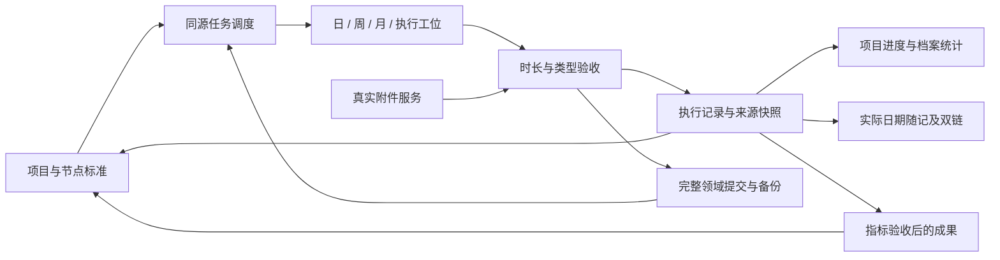

# 1.1.0 页面来源与功能通路

本表是当前实现说明。历史问题清单保留在`audit/PRD_DESIGN_PLUGIN_CLOSED_LOOP_AUDIT.md`，不能把那份旧审查当成本版实时状态。

## 来源关系

项目、记录与节点是事实；任务实例是可重建的派发结果；HTML、甘特格、周看板及月日历是展示。一次任务以`nodeId@计划日`定位，记录另存实际提交日。悬赏以自身ID及揭榜日定位，需家长核准才形成有效记录。

## 页面、按钮与返回落点

| 页面/功能 | 展示数据的具体来源 | 输入与前提 | 写入/下游 | 回查与返回 |
| --- | --- | --- | --- | --- |
| 全局档案HUD | 有效records、violationRecords、freezeRecords、domainTodayTasks | 无直接改数按钮；保护需客观原因与亲子批准 | 统计聚合；保护保存日期、理由与时间 | 公约裁决台/保护记录 |
| 学期项目条 | projects + projectProgress(nodes,records) | 已有项目 | 无额外事实副本 | 原projectId脑图 |
| 今日任务轮播 | 今日ready/completed及活跃悬赏实例 | 未到期/前置阻塞不能提交 | 进入同一taskInstanceId工位 | 关闭回待办，保留独立草稿 |
| 周看板/任务详情 | 按选定周自然日读取同源实例与recordId | 筛选只改显示范围 | 打开准确实例；显示规划标准与实际交付日 | 执行/原件/源节点 |
| 月日历/日期详情 | 计划日实例 + 实际date记录 + 当日违约 | 日期按钮 | 准确任务入口；日期实际附件相册 | 只读原件，不伪造补卡 |
| 执行工位 | 当前实例、源node.cardPayload、drafts[id]、通过记录 | 计时、清单、指标、自定义实际值及规定原件 | 验收 → records → 源节点引用 → 进度/HUD/随记 | 源节点、项目关联节点、附件 |
| 规划沙盘/自定义场馆 | PAVILION_META及真实项目计数 | 场馆名称/图标/位置 | 元数据、筛选项、项目分类选择器 | 对应场馆甘特 |
| 二级甘特 | projects及有效records；轴按项目范围生成 | 新建/编辑合法标题与日期；归档须全部验收 | 项目/起始节点 → 调度器；日期格只读 | 原projectId脑图/实际日期记录 |
| 三级脑图 | nodesByProject + 项目边 | 标准编辑、列表、同项目前置、位置/成组操作 | 结构化节点/依赖/边 → 任务重建 | 项目内撤销/重做，执行记录不随之丢失 |
| 目标成果归档 | goal节点 + 通过的指标验收记录 | 实测值、文字指标共同确认、规定交付 | achievement引用源项目/节点/记录 | 精确定位源节点或导出档案 |
| 复盘派生 | 已保存/规划的improvementList | 选中且尚无有效derivedNodeId | 成组实训节点、日期、派生边 → 调度 | 主节点管理整组；重复点击不新增 |
| 问道池 | 本人question + 本地经典语料结果 + linkedProjectId | 保存真实困惑后可转化 | 一个来源对应一个修身项目 | 关联项目及验收进度/解决状态 |
| 亲子公约 | family真实档案、clauses、signedAt、versions | 双方姓名、条款、共同确认 | 新版本、真实Markdown导出 | 公约全文；历史版本用于裁决引用 |
| 违约补救 | 已签署条款、共同确认事实 | clauseId、客观原因、共同核实 | violation → 七日修身项目 → 七个日实例 → 履约 | familyVersion及remedyProjectId |
| 家长悬赏 | bounties[id]、当前activeId、证据及核准记录 | 发布 → 揭榜 → 原件 → 寄语/家长核准 | 独立有效record、achievement、事件 | 历史契约选择、原件与荣誉档案 |
| 藏金屋 | ledger及真实收支汇总 | 正金额到分，支出不透支 | UUID交易、余额、来源事件 | 真实明细筛选/每日随记 |
| 每日随记 | dateKey、当前文本、事件、mood/energy、实际附件 | 编辑自动草稿；封存30～500字 | 当日/历史版本、Markdown、附件链接 | 日期历史、原件及来源ID |
| 成就馆 | 实测成果、核准悬赏、本人高光 | 高光需有效日期、标题/说明及照片原件 | 成果记录与动态场馆分组 | 源项目/节点、实测值、原件、导出 |
| 设置 | USER_PROFILE_STATE.settings及插件设置 | 昵称/化身/壁纸/粒子/沉浸；启动开关 | 领域stores/插件设置，重载恢复 | 设置不增加坚持或生成成果 |
| Canvas | 首次导出的原生文件、显式导入 | 真实项目；同ID有效坐标 | 只回流布局与文本便签 | 标准仍在规划器维护 |

## 保存与恢复

`domain_state.json`原子提交nodesByProject、records、bounties、family、events、drafts、edgesByProject及其他模块stores。会话缓存与查询导出可重建。项目索引/节点导出带storageRevision，空索引另有`projects.revision.json`；同版本正常外部编辑允许导入，旧导出不能覆盖新提交。

主档案损坏时阻止自动写入；缓存损坏且有有效主档案时保留损坏缓存并恢复。真实附件以path关联二进制原件，不以文件名或成功提示充当原件。独立HTML使用独立IndexedDB，恢复完成后开放交互。
